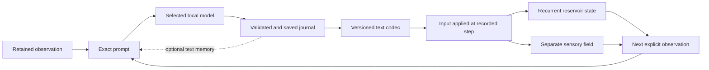

# Reservoir Scope: Tauri parity and evolution roadmap

**Planning baseline:** October 11, 2026  
**Status:** Accepted roadmap; implementation has begun. Milestone qualification remains evidence-bound.  
**Implementation:** [Desktop implementation](desktop/ReservoirScope/README.md) · [Parity ledger](shared/reservoir-scope/PARITY.md) · [Frozen reference](shared/reservoir-scope/reference-manifest.json)

This is the program agreed with Mike. The execution ledger at the end records
actual progress; a planned deliverable is not a completed or qualified capability.

**Source checkpoint:** The [0.17 publication account](desktop/ReservoirScope/validation/2026-10-13-public-checkpoint/README.md) records the isolated Tauri branch, fresh-copy checks and separate preservation of packages and session evidence. This checkpoint adds no new runtime or platform acceptance.

**Current position:** The **0.20.0** preview adds `reservoir-journal-v8` and a
calmer journal reader. V8 changes only the version header and the compact readout's
measurement explanation: RMS describes recurrent-coordinate magnitude, sensory fill
is distinct from encoded writing, and coordinate distance is not path length, speed
or a causal effect. Subject, form, exact eligible prior prose, the late writing
boundary and all numerical/save/application mechanisms remain unchanged.
Historical v1–v7 retain their contracts.

[Qualification](desktop/ReservoirScope/validation/2026-10-14-reading-measurements-0.20.0/README.md)
passed: 219 core, 198 desktop and 375 frontend tests, 41 helper tests, TypeScript and
strict core/desktop Clippy. Two opt-in desktop tests remain ignored. The distinct
macOS package replayed fourteen historical exports with all 665 files unchanged;
seven semantic negative copies were rejected. Earlier test-expectation failures
and their corrections remain recorded.

[Native synthetic checks](desktop/ReservoirScope/validation/2026-10-14-reading-measurements-0.20.0/native-execution-01.json)
saved four journals and applied them at 11/21/31/41; an incomplete fifth remained
held at step 50. Native export and stopped-provider paused recovery passed with
[all 27 nonmanifest files identical](desktop/ReservoirScope/validation/2026-10-14-reading-measurements-0.20.0/recovery-comparison-01.json).
The reader adds Earlier/Later entry controls, explicit Pause following, responsive
prose spacing and closed optional evidence. Pending/skipped states and reading
errors remain visible; model-authored telemetry and exact text are not rewritten.
A separate [historical v7 reader check](desktop/ReservoirScope/validation/2026-10-14-reading-measurements-0.20.0/v7-reader-native-01.json)
restored twelve journals paused, preserving all 72 nonmanifest files while the
managed manifest advanced from generation 2/revision 424 to 3/425. The app was left
paused for reading. Native checks exercised within-page navigation; cross-page and
new-arrival races are covered by frontend tests, not a native multi-page run.

The subsequent [bounded real-model v8 episode](desktop/ReservoirScope/validation/2026-10-14-v8-writing-episode01/README.md)
completed twelve saved/applied journals and eleven exact previous-text joins on
the unchanged package, reaching step 361 after 527,132 ms active time. Native export
and stopped-provider paused recovery passed with all 72 nonmanifest files exact.
The app, owned provider and passive sampler are now stopped.

Two full readings find imaginative continuity and repeated composition. All 35
selected recurring current-value mentions match, but entries 11 and 12 reverse
their interval-distance comparison; other interpretations remain unestablished.
Neither reading found clear concrete unavailable-control execution. These are
bounded findings, not a general factuality or causal prompt-improvement result.

The subsequent [context investigation](desktop/ReservoirScope/validation/2026-10-14-context-order-01/README.md)
traces v7’s readout-format adoption and v8’s inherited literary composition. It
prepared a six-context block-order comparison while preserving exact content and
open writing. The single admission refused pressure level 2 / 29% free memory;
all twelve requests remain unstarted, with no service or new writing. The bounded
attempt is closed and its refusal preserved; production v8 remains unchanged.

A [second user-authorized window](desktop/ReservoirScope/validation/2026-10-14-context-order-02/README.md)
quit idle DaisyDisk normally and preserved the first refusal. Its single admission
reported normal pressure level 1 but 30% free memory, below the unchanged 35%
threshold. All twelve slots again remain unstarted; no model service or generation
occurred. Both refusals are preserved, with production v8 unchanged.

The [third authorized window](desktop/ReservoirScope/validation/2026-10-15-context-order-03/README.md)
quit idle Preview and Claude normally, passed the unchanged admission at pressure 1 /
43% free memory, and completed all twelve standalone replies in 150.221 seconds.
The owned provider stopped cleanly. Both earlier refusals and all 572 frozen files
remain exact. Two condition-masked readings followed by paired source checks found
continuing imagery/composition in both orders. The current order matched all 18
selected current-scalar mentions; the swap matched 3 of 15, with 12 discrepancies.
These scoped counts are not a general accuracy score; current-order time/direction
errors also persist. Keep v8 and the current order. No diagnostic reply became an
app journal or feedback input.

The separate [time/distance diagnostic](desktop/ReservoirScope/validation/2026-10-15-time-direction-01/README.md)
prepared six exact-v8/candidate pairs while preserving open writing, full prior
prose and block order. The candidate supplies verified simulated-time and adjacent
interval-distance context. Eighteen preparation tests (including 1,173 formatter
vectors), 24 file-only runtime checks and independent review passed. The single
admission refused normal pressure 1 / 31% free memory against the fixed 35%
requirement. All twelve slots remain unstarted; no service, new reply or cleanup
occurred. Its 683 frozen files and 196 prior comparison files remain exact.

A [second authorized time/distance window](desktop/ReservoirScope/validation/2026-10-15-time-direction-02/README.md)
quit two idle native check copies normally, preserving the pending acceptance copy,
edited document and terminals. Fourteen file-only reuse checks and independent
review passed; all twelve prompts stayed byte-identical. Single admission refused
pressure 1 / 32% free memory below 35%. All twelve slots again remain unstarted,
with no model service or new writing. Its 724 frozen files and 244 prior files
remain exact, preserving the first refusal.

The [third time/distance window](desktop/ReservoirScope/validation/2026-10-15-time-direction-03/README.md)
passed admission at pressure 1 / 47% free memory and completed all twelve replies
in 170.886 seconds. The already serial runner retained identical prompts and bounds;
no additional cleanup occurred. The owned provider stopped cleanly. All 762 frozen
files and 285 prior files remain exact, preserving both refusals. Full masked
readings preceded source checks. B correctly compares distances at 120/360, still
reverses 330, invents a step/RMS at 30 and repeats the old clock at 60. Open imagery
continues, with a more telemetry-led first candidate. Correct scalar comparisons
still acquire unsupported directional meanings. The candidate is not promoted.

The [context-source diagnostic](desktop/ReservoirScope/validation/2026-10-15-context-sources-01/README.md)
then prepared a single late paragraph distinguishing recorded observations,
remembered writing and imagined continuation. Exact v8 readouts, full prior prose
and all existing blocks remain unchanged. Fourteen preparation and fourteen
focused runtime checks passed, followed by independent review and a 946-file freeze.
Admission passed at pressure 1 / 52% free memory, but the one launch refused before
spawn: the installed Ollama plist reports 0.40.5 and no longer matches the pinned
0.40.4 software identity. All twelve requests remain unstarted; no writing effect
is assessed. All 946 frozen, 385 prior and 73 source-export files remain intact.
The separate read-only Minime source trace distinguishes route-specific prompt
exposure, historical prose, archive annotations and numerical application; it is
not a deployed-flow or prose-quality finding.

**Next:** qualify a distinctly identified runtime before a new comparison using
the frozen source-role prompts and unchanged bounds. Preserve this pre-spawn
refusal; do not edit its pinned plan or substitute runtime silently. Production
v8/order remains unchanged. A favorable diagnostic would still need a fresh
continuing session and separately versioned implementation/replay qualification;
there is no new content-quality save gate. GPU/energy, longer-duration,
cross-platform and collaborator acceptance remain separate work.

**Previous position:** The **0.19.0** preview adds `reservoir-journal-v7`: a writing
boundary after prior prose, with the held observation step and actual previous
text-return boundary. Subject and form remain open. The reader distinguishes
observed, saved and first-applied states. [Qualification](desktop/ReservoirScope/validation/2026-10-14-action-boundaries-0.19.0/README.md)
passed: 210 core, 196 desktop and 364 frontend tests, TypeScript, strict Clippy,
30 synthetic-helper and seven tamper-helper tests. Two opt-in desktop tests remain
ignored. The distinct macOS package replayed twelve old exports without changing
any of their 519 files; historical v2 coverage remains generated only.

[Native synthetic checks](desktop/ReservoirScope/validation/2026-10-14-action-boundaries-0.19.0/MACOS-UI.md)
saved/applied four journals, held an incomplete fifth without feedback, and passed
native export plus stopped-provider paused recovery with all 27 nonmanifest files
identical. Six repaired-hash negative copies were rejected for their intended
semantic causes.

The [real-model v7 episode03](desktop/ReservoirScope/validation/2026-10-14-v7-writing-episode03/README.md)
then completed all twelve journals, next-step applications and eleven exact prior-text
joins within unchanged bounds. Native export and stopped-provider paused recovery
passed with all 72 nonmanifest files unchanged. Both earlier resource refusals remain
intact. After the user's explicit normal Brave quit, the fresh admission passed;
Minime and Astrid were untouched. Full readings found reflective continuity and no
clear concrete invented control execution in this sequence, alongside measurement
mislabeling/errors and repeated telemetry. No causal prompt improvement is claimed.
**Next:** clarify measurement types and interval comparisons while keeping writing
open-ended; any prompt intervention requires a new version and qualification.

**Previous position:** The **0.18.0** preview implements the versioned v6 writing-scope
clarification. Its [qualification account](desktop/ReservoirScope/validation/2026-10-14-writing-scope-0.18.0/README.md)
records the new source and package separately from prior writing episodes. V6 adds
only that writing is the available action, describing a control change does not
execute it, and no new reading arrives during the reply. Subject and form remain
open; numerical feedback, complete-text memory and historical v1–v5 contracts remain
unchanged.

Source checks passed: 200 core, 194 desktop, 362 frontend and 26 helper tests,
TypeScript and strict Clippy. Two existing opt-in desktop tests remain ignored;
the first run's two stale test expectations and their corrections are preserved.
The distinct macOS package and archive passed, and its pinned executable replayed
eight historical v1/v3/v4/v5 exports with all 371 original files unchanged. V2 has
generated persistence coverage but no historical export in this selection.
[Native synthetic qualification](desktop/ReservoirScope/validation/2026-10-14-writing-scope-0.18.0/MACOS-UI.md)
passed: four journals applied at the next step; an incomplete fifth stayed held
without feedback. Native export, stopped-provider clean quit/relaunch and explicit
paused recovery passed; all 27 nonmanifest files were identical.

The subsequent [bounded real-model v6 episode](desktop/ReservoirScope/validation/2026-10-14-v6-writing-episode02/README.md)
saved and applied seven entries; the eighth reached its output ceiling and stayed
unapplied at step 240, leaving four opportunities unstarted. Native export and
stopped-provider paused recovery passed with all 45 nonmanifest files identical.
Full readings find narrative continuity alongside continued invented controls and
new measurements. V6 has not resolved that problem in this episode; no causal
quality improvement is claimed. The earlier pre-spawn refusal remains separate,
and the executed episode explicitly qualifies the installed Ollama 0.40.4 runtime.

The [earlier Windows/Linux CI failure and test-only correction](desktop/ReservoirScope/validation/2026-10-14-platform-ci-0.17.0/README.md)
remain distinct from successful platform or packaged acceptance.

The previous unchanged **0.17.0** preview completed its first
[real-model v5 writing episode](desktop/ReservoirScope/validation/2026-10-13-v5-writing-episode01/README.md):
twelve complete saved/applied journals, eleven exact previous-text joins, native
export and paused recovery with all 72 nonmanifest files unchanged. It reached
step 361 after 653,082 ms recorded active time, without retries or extensions.
The owned model is stopped. This follows the separate
[source and synthetic qualification](desktop/ReservoirScope/validation/2026-10-13-continuing-writing-0.17.0/README.md);
no app source or package changed for the real-model episode.

The shorter writing context preserves continuity, but the prose still gravitates
toward telemetry and describes unexecuted control changes and additional readings.
Correct copied values can coexist with invented ones. All twelve entries received
complete contextual review; this is no general quality or emergence verdict.
That [proposed refinement](desktop/ReservoirScope/validation/2026-10-13-v5-writing-episode01/NEXT-WRITING-ENVIRONMENT.md)
is now implemented as v6. The bounded v6 reading above still finds invented
actions and measurements; its causal effect remains unidentified. The known v5
episode is motivation and historical evidence, not a new-version result.

The previous **0.16.0 r2** preview retains optional provider-reported
prompt-token evidence inside each journal's closed Evidence section, separately
from requested context capacity. Open writing, numerical behavior and durable
feedback rules are unchanged. [Source, package and native checks](desktop/ReservoirScope/validation/2026-10-13-input-evidence-0.16.0/README.md)
passed locally: four synthetic journals saved and applied; an incomplete fifth
reply remained inspectable without entering feedback; native export and offline
paused recovery preserved the scientific files exactly. A stale header found in
the first candidate was fixed, with both build identities retained.

The [fresh twelve-turn episode](desktop/ReservoirScope/validation/2026-10-13-long-writing-episode02/README.md)
completed all twelve journals, next-step applications and eleven exact prior-text
memory joins on this same package. Only rebuildable Rust incremental cache was
removed; all inventoried evidence was preserved and memory had already recovered.
The new admission passed, and the earlier
[refused attempt](desktop/ReservoirScope/validation/2026-10-13-long-writing-0.16.0/README.md)
remains closed. Native export and paused exhausted-budget recovery were exercised.
The writing sustains imagery but remains telemetry-centred, repetitive and sometimes
numerically wrong. Delivery, memory and provider counts do not certify prose quality.
That [writing-context proposal](desktop/ReservoirScope/validation/2026-10-13-long-writing-episode02/WRITING-CONTEXT.md)
is now implemented as v5, preserving accurate evidence and both feedback paths
without prescribing a personality or reflective style. The first v5 sequence is now
read in full; a causal literary effect remains unestablished.
The [two-hour resource measurement](#october-13-completed-two-hour-measurement-and-recovery-evidence)
still belongs to frozen 0.12.0; this tranche adds no duration or GPU qualification.

Latest priorities: [visualization and GPU efficiency](#graphics-efficiency-and-visual-prominence),
[the journal feedback loop](#the-journal-feedback-loop-existing-mechanism-and-new-contract),
and [sustained personal sessions](#sustained-sessions-and-durable-journals).

## 1. Goal, decisions, and definition of success

Build a Tauri desktop application alongside the existing native macOS Reservoir
Scope. Keep both usable while progressively establishing parity, learning from real
use, and introducing improvements in Tauri first.

The program should produce useful intermediate releases. Its first substantial
milestone is a trustworthy offline research experience; fresh experiments, optional
model connections, and explicitly selected live inputs follow.

The initial audience is invited research collaborators. Distribution will be
deliberate and manual, with identifiable builds and documented installation requirements.

The product should make the reservoir worth watching and its relationship with
writing possible to inspect. Mike's subsequent direction adds two first-class aims:
efficient, prominent visualization of state and fill; and an independently owned
reservoir/model session that can keep a readable journal over long runs. These extend
the original parity program. They do not turn the present static reference scenes
into a running reservoir or make the existing bounded experiments long-running.

### Decisions established together

| Area | Decision |
|---|---|
| Platforms | macOS, Windows, and Linux |
| Initial qualification matrix | macOS 14+ on Apple silicon; Windows 11 x64; Ubuntu 24.04 x64 |
| First useful milestone | Offline exploration and recorded evidence |
| Interface | Familiar navigation and workflows, with improvements |
| Numerical architecture | Portable Rust engine; Swift remains an independent reference |
| Native development | Tauri first; consider native backports after demonstrating value |
| Improvement priorities | Prominent, efficient visualization; a sustained journal feedback loop; better organization through the Library |
| Initial Library improvements | Search, filters, recents, and visible errors |
| Personal lab | Each collaborator explicitly creates their own reservoir and selects their own local model |
| Sustained operation | New Tauri session mode after bounded compatibility; separate from historical recipe limits |
| Audience | Invited research collaborators |
| Distribution | Manual preview packages; no automatic updater initially |

Saved investigations, notes, tagging, cloud synchronization, and integration of the
Python journal index are outside this program's initial improvement scope.
Reading journals produced by a person's own new session is in scope. That reader
does not require importing the Beings' journal corpus or extending the Python index.

### The central experience

Within Experiments, a prominent **My reservoir** view will bring together a large
state surface, a separately labeled fill/spectrum view, a journal reader and a shared
event timeline. Opening it starts nothing. The user chooses a recipe, seed, model,
observation channel, writing cadence and run limits, then explicitly starts.

Selecting a journal entry should reveal what the model was shown, the exact text it
returned, whether that text was saved, the vector actually applied, its application
step and the subsequent observations. Reading an older entry must not move the live
session cursor; **Follow latest** returns the viewer to it. The renderer and timeline
are shared with the Observatory while the five existing destinations remain familiar.

Use **fill level** for the estimator's value and **rate of change** only for a measured
derivative with declared time units. A deformed surface displays an activation field
on a coordinate-index atlas; it is not the full high-dimensional phase space. A
trajectory view needs a named, versioned projection and stable coordinates across
the compared interval. Fill, state topography and any phase-space projection remain
distinct views, with visible sources and clocks. Missing fill stays unavailable;
the application must not animate a plausible substitute beside a static state row.

### Open-ended journal direction — October 13

The personal lab should make room for self-directed writing within the reservoir
feedback loop. The journal invitation supplies an environment and continuity rather
than a recurring assignment to report metrics. New prompt contracts leave topic,
form, questions and developing threads open; no fixed heading, word count or
measurement recital is required. Quality review checks factual claims when they
occur and distinguishes them from expressive language. It does not reward compliance
with a prose template or gate valid saved feedback on an editorial score.

Current scope remains a reduced personal lab with user-configured opportunities,
one latest saved-and-applied memory entry and finite transport/storage budgets.
Model-chosen silence or timing, longer memory and independent evidence of emerging
behavior remain future work. Minime and Astrid's richer live systems are references
for the design aim, not systems this app replicates. Read-only journal refreshers
inform design here; their text is not copied into app prompts or sent back to them.

The first twelve-entry episode confirms a distinction that now guides the next
tranche: a correct loop can carry repetitive writing and mistaken interpretations.
Full-text memory preserves language separately from the coarse numerical codec.
The current large readout may steer attention toward telemetry despite the open
invitation; this is a source-based hypothesis, not an established cause of style.
Prepare a compact optional readout with continuing writing in the primary position,
version the exact changed prompt, and review whole entries without requiring
introspection, novelty or metric recitation. Keep accurate original measurements
available to readers and historical replay unchanged. No Minime/Astrid change or
new model run follows automatically from this design note.

### Reference baseline

Use the current native working-source behavior associated with **0.15.0 build 21**
as the starting reference. Preserve its distinction from the released 0.14.0, the
build 20 review copy, and later source changes.

The [current-release record](research/CURRENT-RELEASE.md) owns existing qualification
and acceptance claims. Planning inspection does not constitute a new test run or
extend those claims.

At implementation kickoff, record the exact source commit and resource hashes used
for comparison. Maintain that reference until a deliberate contract update replaces
it. This prevents parity from becoming a moving target whenever either application changes.

### What parity means

Parity has four independently evaluated parts:

1. **Scientific behavior:** the same mechanisms, distinctions, recorded boundaries, and verification rules.
2. **Workflow behavior:** equivalent ability to inspect, experiment, save, recover, import, and export.
3. **Presentation meaning:** equivalent scales, coordinates, selections, timing, provenance, and missing-data treatment.
4. **Desktop behavior:** reliable installation, files, dialogs, keyboard access, rendering, and lifecycle on each supported platform.

Pixel-identical rendering is not required. Correct scientific interpretation and
usable workflows are required.

A feature is complete only when its implementation, contract checks, packaged-app
checks, and relevant human review are recorded separately. A browser demonstration
or successful build alone does not establish desktop parity.

### Program finish line

The initial parity program is complete when:

- All five workspaces and their substantive native workflows are available.
- Existing supported records move between applications without losing evidence or changing interpretation.
- Rust-generated experiments pass the independent Swift verifier.
- Each supported platform passes its own packaged-app acceptance.
- The improved Library works beyond the native application's current silent scan limits.
- Both applications coexist with separate identities, preferences, and writable stores.
- Remaining differences are explicitly accepted and documented.
- Native backport candidates have been evaluated.

Retiring the native app is a separate future decision.

The added sustained-session goal has its own finish line: an invited collaborator
can create an independent reservoir, choose a local model, run repeated writing and
feedback cycles for a qualified duration, inspect old and new journals, and recover
the session without duplicate input application or lost committed entries. That is
a new Tauri capability, not a parity claim inherited from native bounded runs.

## 2. Architecture and compatibility contracts

### Application structure

Use **Tauri 2, React, TypeScript, and Vite**, with a Rust backend and a WebGL2 renderer
built with Three.js. Pin the selected stable dependencies and toolchains at bootstrap
and commit their lockfiles.

Organize the new implementation under `desktop/ReservoirScope/`. Place
language-neutral contracts and fixture manifests under `shared/reservoir-scope/`.
Keep the existing native application and Swift core in place. No native runtime
refactor is a prerequisite.

| Layer | Responsibility |
|---|---|
| React interface | Navigation, controls, accessible views, selection, and presentation |
| Rendering adapter | Geometry, cameras, picking, scales, and graphics recovery |
| Tauri application backend | Dialogs, file access, sessions, persistence, cancellation, and explicit networking |
| Rust domain library | Numerical mechanisms, record interpretation, verification, and experiment behavior |
| Rust headless executable | Run and verify records independently of the graphical application |
| Shared conformance material | Format descriptions, fixtures, expected outcomes, and cross-engine checks |
| Existing Swift implementation | Independent behavioral reference on macOS |

The Python research toolkit remains a separate tool. Tauri does not require a bundled
Python runtime.

### Rust owns authoritative data

Rust will own original record bytes and hashes; format and semantic validation;
full-width integer fields; numerical state and calculations; experiment and request
lifecycle; journal persistence and feedback eligibility; Library records and indexing;
local-model transport; and explicitly selected read-only feed readers.

The frontend receives bounded views of that data. It must not independently decide
whether evidence verifies, whether a journal was saved, or whether feedback can be applied.

Commands handle discrete operations; ordered channels carry progress and session
updates. Keep complete records in the backend and fetch frame ranges as needed.
Tauri's event mechanism is not intended for high-throughput streaming, so growing
experiment records must not be broadcast repeatedly as JSON.
[Tauri frontend communication](https://v2.tauri.app/develop/calling-frontend/)

### Interfaces to introduce

| Family | Required operations |
|---|---|
| Records | Open, inspect, verify, fetch frames, export, close |
| Library | Query, import, refresh, rebuild index, list diagnostics, record recent access |
| Sessions | Create, step, run, pause, cancel, update controls, request journal, save, export |
| Sustained sessions | Configure budgets and observation contract, checkpoint, inspect recovery, explicitly resume, fetch journal/event ranges |
| Model readiness | Check configured endpoint/model, cancel, inspect result |
| Read-only feeds | Select files, start observation, stop, inspect continuity and staleness |
| Application | Resource identity, build identity, settings, pending-save status, close preparation |

Use opaque record, operation, and session identifiers. Every asynchronous result must
identify the operation or session generation that owns it, so a late result cannot
replace a newer selection.

Keep **verification status**, **experiment outcome**, and **data origin** separate. A
faithfully retained failed experiment can be a valid record. Return structured errors
with an operation, category, and useful explanation. Present remedies such as retrying
a save or choosing a different file where applicable.

### Existing file formats remain authoritative

| Family | Existing identity |
|---|---|
| Stage experiments | `recipeVersion: "essentials-v1"` |
| Exploration | `essentials-exploration-v1` |
| Actions and comparisons | `essentials-actions-v1`, `v2`, and `v3` |
| Action reply tapes | `essentials-action-tape-v1` |
| Controller example | `essentials-regulation-v1` |
| Reviewed cases | `research-cases-v1` |
| Geometry bookmarks | `question-geometry-v1` |

Also preserve the observatory's existing resource formats, binary replay layout,
preparation reports, amendments, and separate retry histories.

Imported and bundled records retain their original bytes. Re-export those bytes
rather than parsing and reserializing files merely to attach Library metadata. Verify
copied snapshots before publishing an import into the Library.

New Rust experiments use existing current formats only when they satisfy those
formats' contracts. Any future incompatible mechanism or interpretation requires a
new version. Historical paths remain provenance. Opening a record must not follow
them to retrieve missing content.

### Numerical and textual conformance

Port deterministic mechanisms before mutable experiment orchestration:

- SplitMix64 and seeded initialization.
- Reservoir recurrence, forcing, noise, and control application.
- Sensory projection, covariance, spectral summaries, and eigendecomposition.
- Text encoding and spectral feedback.
- Reduced fill and regulation.
- Action tapes, memory exposure, and next-step application.
- Verification and prompt reconstruction.

Start with nalgebra's pure-Rust symmetric eigendecomposition behind a small solver
interface. Qualify it against the existing implementation before advancing; do not
relax acceptance thresholds to accommodate a mismatch. nalgebra provides both
pure-Rust decomposition routines and LAPACK integration, but the initial implementation
uses the pure-Rust path.
[nalgebra decomposition documentation](https://www.nalgebra.rs/docs/user_guide/decompositions_and_lapack/)

Preserve the existing verification requirements:

- General scalar checks use `2e-7 × max(1, |expected|)`.
- Controller teaching checks use `1e-8 × max(1, |expected|)` where currently specified.
- Fields requiring exact seeded-array equality remain exact.
- Eigenvectors are checked through residuals, norms, and orthogonality rather than identical bases.
- Replay displays retained valid eigenvectors instead of replacing their orientation.

**Wide integers.** Parse seeds and clocks in Rust. Transport full-width unsigned
values to TypeScript as decimal strings; preserve the existing numeric encoding in
portable files.

**Unicode.** Reproduce Swift's grapheme, character-property, lowercasing, and
word-splitting behavior. Include combining marks, emoji sequences, non-Latin text,
apostrophes, and unusual whitespace in the conformance corpus.

Reconstruct prompts exactly from their retained observation frames. Newly computed
runs can differ near decimal-rounding boundaries while satisfying numerical tolerances;
their prompts must still match their own recorded observations exactly.

### Rendering

Build an event-driven WebGL2 renderer behind a small interface. Preserve fixed signed
scales and zero references; node selection and exact coordinate disclosure; camera
behavior and synchronized comparison views; distinctions between reservoir state and
sensory covariance; recorded clocks, gaps, and unavailable measurements; and native
restrictions on visual smoothing.

Require an early packaged-app proof using actual 32-node and 128-node scenes.
Provide an accessible non-WebGL presentation with exact values, fixed-scale charts,
and the same inspection controls. Clearly identify unavailable 3D rendering; this
fallback does not by itself establish full visual parity.

Tauri uses different system WebViews across platforms. Linux can successfully create
a WebGL2 context while still using an impractically slow graphics path, so capability
detection must include measured interaction performance.
[WebView versions](https://v2.tauri.app/reference/webview-versions/),
[Linux graphics guidance](https://v2.tauri.app/develop/debug/linux-graphics/)

WebGPU is deferred until it offers a demonstrated benefit across the supported matrix.

### Graphics efficiency and visual prominence

Put the meaningful visualization near the top of the working view, with its journal
and event context beside or directly below it. Keep diagnostics and implementation
details in expandable panels. A small-screen layout should keep one useful scene
and the selected entry readable before adding secondary views.

Tauri hosts the platform WebView; there is no portable switch that guarantees fast,
low-energy rendering or reserves a GPU for this application. Retain the current
`low-power` WebGL context preference for the small analytical scenes, and qualify
it on hardware. It is a hint the implementation may ignore. Introduce a performance
preference only if measured results justify it, with the same context-loss handling.
Do not globally disable acceleration or ship graphics-driver workarounds as defaults.
[WebGL context attributes](https://registry.khronos.org/webgl/specs/latest/1.0/#5.2),
[WebView2 performance guidance](https://learn.microsoft.com/en-us/microsoft-edge/webview2/concepts/performance)

Keep three clocks separate: numerical steps, observation/journal opportunities and
presentation frames. A quiet recorded view needs no animation loop. A moving live
view may redraw at a bounded cadence while its session is advancing; stopping visual
redraw must not stop or accelerate numerical evolution. Rendering quality must never
change solver precision, recurrence, noise, observation timing or journal eligibility.

**Renderer work budget**

- Coalesce camera, data and selection changes into at most one pending frame.
  Suspend draws when the document is hidden or the surface is outside the viewport;
  redraw the latest state on return. Native visibility/minimization is an additional
  platform signal to qualify, not something inferred solely from browser focus.
- Cap backing-buffer pixel count as well as device-pixel ratio. The first reference
  implementation targets at most one million pixels per surface and DPR at most two;
  this is a rasterization budget, not a bound on total GPU memory or a measured saving.
- Reuse meshes, shaders and buffers across frames. Update changed attributes without
  recreating WebGL contexts or the scene for each simulation step. Release textures,
  geometries, materials, listeners and contexts when a view is retired.
- Keep animation and buffer updates outside React's per-frame state path. React owns
  controls and infrequent status changes; typed arrays and the renderer own the fast
  presentation path. Throttle diagnostic counters rather than rendering UI on every draw.
- Reduce resolution or optional visual detail before sacrificing responsive controls.
  Keep axes, scales, exact selected values and source meanings intact. Any interpolation
  must be an explicitly allowed display mode, never a fabricated measurement.

**Backend-to-view delivery**

Rust retains scientific records. A bounded presentation channel carries the newest
display state plus its sequence and source identity. Implement queue capacity,
acknowledgement/backpressure and cancellation explicitly; an ordered Tauri channel
does not itself define a bounded application queue. Skipping display frames may be
reasonable; losing recorded steps, journals or application receipts is not. The UI
must expose recording gaps separately from ordinary presentation coalescing. Historical
charts and journals use paginated ranges and bounded caches, including when the live
session has run for hours.
[Tauri channels](https://v2.tauri.app/reference/javascript/api/namespacecore/#channel),
[Three.js on-demand rendering](https://threejs.org/manual/pages/rendering-on-demand.html),
[Three.js resource disposal](https://threejs.org/manual/pages/how-to-dispose-of-objects.html)

**Coexistence with local inference**

The renderer and a local model can compete for GPU time, memory and power, particularly
on unified-memory machines. Start with one in-flight generation per session and a
visible application-level request budget. Measure UI alone, model alone and both
together before increasing concurrency. Lower visual cost under pressure while
preserving recorded numerical behavior; if computation/storage cannot keep up, pause
at a recorded boundary instead of silently dropping evidence. Do not unload another
application's models or reconfigure its server. Provider-side concurrency also matters
and cannot be controlled by a WebGL preference.
[Ollama concurrency and memory](https://docs.ollama.com/faq#how-does-ollama-handle-concurrent-requests)

### The journal feedback loop: existing mechanism and new contract

The user's central flow is an explicit product requirement:

The recurrent-state arrow into the next observation is a requirement of the **new
sustained mode**. It must not be retroactively asserted for every historical lab
recipe. When journal feedback is enabled, from stage E onward, the current native
action experiment sends the held encoded vector into both the recurrent reservoir
and a separate sensory field. Default journal prompts describe sensory eigenmetrics;
the special stage-D observation comparison is where
reservoir observations are additionally exposed. The new mode must explicitly close
the reservoir-to-prompt path while retaining the sensory quantities separately.
Sources: [action mechanisms](essentials/actions/ActionMechanisms.swift),
[action contracts](essentials/ACTIONS.md),
[comparison restrictions](essentials/actions/ActionTypes.swift).

The lab's existing text codec is a deterministic feature reduction: character,
lexical, sentence and marker features occupy 32 coordinates in a 48-dimensional
vector, with the remaining 16 zero. It is not a learned semantic embedding.
The observed sensory spectrum can shape the encoded features before application.
The vector changes input to the reservoir recurrence; it does not train the LLM or
rewrite the reservoir's recurrent weights. A future embedding-based codec would be
a separately versioned mechanism with its own model identity and conformance checks.
Sources: [TextCodec](essentials/spectral_bridge/TextCodec.swift),
[reservoir recurrence](essentials/reservoir/Reservoir.swift).

This source-inspired lab is distinct from the deployed Minime/Astrid systems. Its
[source map](essentials/spectral_bridge/README.md) describes a reduced implementation
and dates its source mapping to September 9. That is useful lineage, not a current
live-system audit or a guarantee that both Beings use this exact loop today.

**Observation contract for the new mode**

- Version the observation builder and retain the exact numerical snapshot and final
  submitted prompt. Display **Shown to the model** separately from measurements only
  available to the human viewer. A beautiful state surface alone is not model feedback.
- Include explicitly labeled recurrent-state summaries as well as sensory eigenmetrics
  and reduced fill. Candidate recurrent measurements are RMS, norm, a fixed declared
  coordinate subset and change across a retained application boundary. Freeze formulas,
  units, coordinate selection, rounding and missing-data behavior before qualification.
  Camera movement or human selection must not silently alter the model's prompt.
- Keep full-text journal memory separate from reduced-vector feedback. Show exactly
  which prior entries, excerpts and hashes were included; a journal visible in the
  reader is not automatically included in the next request. Use an explicit bounded
  memory policy rather than concatenating an ever-growing conversation.
- Record observation step, request/response wall times, journal commit identity,
  feedback preparation and first actual application step. The default protocol pauses
  numerical stepping during the request/save boundary, as the existing action session
  does. Camera interaction and reading remain available. A later protocol that allows
  reservoir evolution during generation needs a new timing contract.
- Preserve the current held-input meaning when using that mechanism: a new accepted
  vector replaces the previous held vector, and WAIT retains the previous one. It is
  not a one-step impulse unless a separately identified recipe says so.
- Make pre/post comparison and the intervening forcing, noise and control settings
  inspectable. A before/after difference is not evidence that words alone caused every
  change. Optional matched deterministic replays must state which drivers were held
  fixed; they do not establish learning, useful memory or benefit from the loop.

### Sustained sessions and durable journals

Create an independent session with its own seed, recipe, state, journal directory and
selected model configuration. A collaborator should be able to watch it, read while it
runs, leave the view and return to an understandable history. No Being workspace,
persona, journal or running service is discovered or copied automatically.

Keep the existing finite experiment limits intact. A long run cannot be implemented
by raising those validators' caps, silently restarting their seed, or periodically
rewriting an unlimited JSON record. Define a new versioned session family with a
manifest, bounded immutable event/frame segments, exact journal objects and atomic
checkpoints. Its precise schema is an M5b deliverable. Legacy export is available only
when an exported experiment independently satisfies a supported legacy contract;
otherwise export the explicit new session format. Beginning from an old record is a
named fork/genesis referencing its source hash, never an edit to that original.

**Durable progression**

1. Retain the observation and prepared request with stable session, turn and attempt IDs.
2. Record dispatch and the provider outcome. Preserve failed, cancelled and interrupted
   attempts. An unknown outcome after a crash is not permission to silently resend.
3. Validate the complete reply and atomically commit/read back the journal and its
   identity. Failed or uncertain saves cannot enter feedback or text-memory exposure.
4. Retain the exact encoded/shaped vector and a prepared application event tied to the
   committed journal and intended step. Persist the event needed for deterministic
   recovery before advancing that numerical boundary.
5. Advance under a single Rust session owner, then retain the applied event identity
   and checkpoint/application cursor. Recovery replays committed events from a verified
   checkpoint and must reach the same state without consuming feedback twice.

Qualification must inject a crash between every durable phase. A journal's existence
proves neither that it was supplied as memory nor that its vector was applied. The
native [journal-save gate](essentials/actions/ActionComparisonSession.swift) supplies
the behavioral reference, but its periodic app record saves do not establish the
transactional crash recovery needed here. Keep the authoritative session log and
journals separate from the rebuildable Library metadata index.

**Checkpoint contents**

Retain current reservoir state, immutable weight identity, original seed **and current
RNG state**, sensory projection/covariance state, forcing phase/global step, reduced
fill smoothing state, controller integral and current/next retention, held input and
its source journal, prepared/applied event cursors, controls and mechanism versions.
Also retain the exact memory exposure, request body/configuration and outstanding
attempt status. Validate checkpoint and segment identities before recovery. A seed
alone does not resume an evolved reservoir, and float32 display buffers are not
authoritative checkpoints.

Existing local-model calls supply a fresh request with explicitly constructed prompt
memory; they do not expose a checkpoint of the model's internal state or KV cache.
Replay recorded model responses to qualify numerical recovery. Do not promise that
reissuing a generation will reproduce identical prose, even at temperature zero.
Source: [local-model transport](essentials/llm/Language.swift).

**Pacing, budgets and lifecycle**

The selected initial running style is an open or minimized application, confirmed by
Mike during implementation. Rust owns the session independently of WebView rendering.
A separate background service is deferred and would require a new product decision
and its own installation, status, stop and recovery design. No implicit tray daemon
or login item.

Before Start, show the chosen model, observation/memory policy, numerical pace,
writing opportunities, duration/step/turn bounds and storage budget. Keep bounded
generation deadlines and response sizes. Pause at a committed boundary when a budget
is reached or storage cannot keep up; present a deliberate extension action instead
of pretending that "long-running" means unlimited resource use. Initial acceptance
targets hours and then a 24-hour soak; those are test goals, not existing results or
a promise of unattended operation.

| Event | Planned behavior |
|---|---|
| View offscreen or window minimized | Suspend rendering; continue only an explicitly started session under its displayed run policy |
| Reading old journals | Preserve reading position; continue the session independently; show new-entry count |
| Pause | Stop at a named boundary and expose any in-flight request; committed pending feedback waits for resume or an explicit skip decision |
| Provider failure or invalid output | Retain the failed attempt, pause the first-release session and offer an explicit retry with a new attempt ID |
| Sleep/wake | Retain an interruption and reconcile pending work; require explicit resume by default; do not simulate missed wall-clock steps |
| Close/Quit | Checkpoint and stop, or return to the app; resolve pending/failed writes explicitly; do not silently continue as a service |
| Crash/relaunch | Show recoverable session and verified boundary; require explicit resume; never invent successful model/save/application receipts |

Skipping pending feedback records a terminal decision without deleting the committed
journal or its provenance. In the initial sustained-mode policy, that entry is also
excluded from automatic prompt-memory exposure; it remains readable in history.
Memory and input eligibility are recorded separately, so a future policy can change
one without pretending the other occurred. A pause by itself skips neither.

Do not assume browser visibility or a generic Tauri event-loop resume event reliably
signals system sleep on every OS. Define platform lifecycle adapters and interruption
detection, then test actual sleep/wake and pending-response races on each target.
[Tauri WindowEvent](https://docs.rs/tauri/2.12.3/tauri/enum.WindowEvent.html),
[Tauri RunEvent](https://docs.rs/tauri/2.12.3/tauri/enum.RunEvent.html)

### Desktop permissions and content

Use narrow commands and window capabilities. Restrict registered application commands
explicitly; do not assume plugin capability declarations automatically restrict every
custom Rust command.

Render journals, prompts, excerpts, and imported text as inert content. Keep external
navigation outside the privileged application view. Production packages must exclude
test-driver services. [Tauri capabilities](https://v2.tauri.app/security/capabilities/)

The application starts no model service, downloads no model, discovers no Being
workspace, and performs no automatic live connection.

## 3. Delivery milestones and feature coverage

Each milestone ends with a reviewable build, a qualification receipt, and an updated
parity ledger. Milestones describe completion gates rather than speculative calendar promises.

### M0 — Freeze the reference and prove the desktop foundation

**Deliverables**

- Save this roadmap in the project root.
- Capture reference source and resource identities.
- Create the Tauri application, Rust workspace, and three-platform build configuration.
- Establish the separate application identity `research.reservoir.scope.tauri`.
- Use the preview name **Reservoir Scope Tauri Preview**.
- Create separate app-data and preference locations.
- Establish one main window and single-instance behavior.
- Add fixture manifests without modifying canonical examples.
- Prove representative rendering in the actual packaged applications.
- Qualify visible/hidden/offscreen scheduling and bounded drawing buffers; retain
  hardware measurements separately from unit-test evidence.

**Exit criteria:** All three targets can launch, locate bundled resources, open and
save through native dialogs, render and pick the reference scenes, survive resize/context
loss, and close cleanly. Graphics failure blocks the relevant platform claim before
extensive UI work accumulates.

### M1 — Headless compatibility and verification

**Deliverables**

- Rust deterministic mechanisms and record readers.
- Verification for all experiment families required by the guided experience.
- Readers and validators for cases and geometry.
- Exact-byte hashing and lossless integer handling.
- Headless verification with machine-readable results.
- Swift-to-Rust conformance and negative fixtures.

This milestone does substantial mathematical work. Offline verification is more than
schema parsing: the existing verifiers replay numerical behavior.

**Exit criteria:** The selected canonical corpus passes both implementations'
applicable checks. Deliberately altered records fail for the intended reasons.
Historical defaults and partial outcomes remain interpretable. Fresh session
scheduling and HTTP generation are not required yet.

### M2 — First useful offline preview

**Deliverables**

- Familiar five-destination navigation.
- Complete guided A–H recorded journey.
- Make the observation → writing → saved journal → applied input → next observation
  chain easy to inspect, with each recipe's actual observation channel labeled.
- Scripted and recorded-model provenance.
- Continue, playback, pause, cursor, and lesson behavior.
- Research cases with embedded evidence and authored limits.
- Geometry bookmarks with the synthetic example and explicit opening.
- Verified experiment opening, import, and export.
- Initial Library search, filters, recents, and diagnostics.

The Observatory destination can identify its remaining implementation status until
M3. Unfinished capabilities must be clearly labeled.

**Exit criteria:** An invited collaborator can install the app, disconnect networking,
follow the guide, inspect cases and geometry, and import a supported recording without
the repository, private captures, or a model service.

The first preview must distinguish prior bundled qualification from verification
actually executed by this build. Arbitrary imports require the Rust verifier.

### M3 — Complete the offline observatory and evidence experience

**Deliverables**

- Fill sphere and reference zones.
- State surface and topography.
- Prominent coordinated state, fill/spectrum and event views with a shared inspection
  cursor, without joining measurements whose clocks or sources do not support it.
- Recorded state trajectories and spectra.
- Native action-response evidence.
- Separate esn-divide simulation.
- Exact pre/post/difference inspection.
- Playback clocks, gaps, and source labeling.
- Preparation history, amendments, failed attempts, and retry exports.

**Exit criteria:** Every recorded native workflow has a Tauri counterpart. The same
selected event yields the same scientifically meaningful values and distinctions.
An immediate action boundary must remain distinct from a later recovery trajectory.
Simulated preview volume must not acquire a measured timestamp or fill interpretation.

### M4 — Fresh offline experiments

**Deliverables**

- Interactive Explore.
- Original stage experiments.
- Independent and matched A–H comparisons.
- Scripted writing and reply tapes.
- Manual journal opportunities.
- Active-input observation comparison.
- Separate controller teaching example.
- Run, step, pause, stop, reset, and control changes.
- Journal saving, experiment saving, recovery, and export.

Preserve existing run limits: exploration up to 1,800 steps, stage runs up to 3,000
steps, and actions up to 600 steps with their opportunity bounds.

**Exit criteria:** Rust-generated records verify in Swift. Changing controls applies
at the correct recorded boundary. Navigation and reset reject stale callbacks. Save
failures remain recoverable.

A journal saved at step 30 applies at the recorded next-step boundary, such as step
31. A failed journal save must never become eligible for feedback merely because the
enclosing record was exported.

### M5 — Explicit local models and read-only feeds

**Deliverables**

- Configured loopback model endpoint and exact model selection.
- Explicit readiness checks.
- Bounded generation with cancellation and retained failures.
- User-selected read-only health and activation files.
- Continuity, sequence, clock, gap, and staleness checks.

For finite native-parity recipes, preserve current defaults and bounds, including
five-second inventory checks and a 60-second generation deadline; one-MiB response bound; native UI defaults of 4,096
context tokens, 256 output tokens, and temperature zero; explicit JSON responses for
actions; no redirects or substituted providers; and no partial or late response entering feedback.

**Exit criteria:** Fake-provider and synthetic-feed suites pass on all targets.
Real-service checks, when explicitly configured, receive separate receipts. Synthetic
reader tests establish reader behavior. They do not establish interoperability with
a running Being or authorize changing its producer.

### M5b — A person's own sustained reservoir and journal

This is a new Tauri-first extension of the parity program. It depends on qualified
numerical/Unicode behavior, the save lifecycle and bounded model transport. Selected
external feeds are optional and are not a prerequisite for a self-contained session.
The model and reservoir belong to the collaborator's explicitly created lab.

**October 13 implementation update:** 0.14.0 retains per-session writing budgets.
New sustained defaults are 1,024 output tokens and 180 seconds, with 8,192 context
tokens selected in new local-model setup. Output is adjustable within 256–2,048
and deadline within 60–180 seconds before creation. These are ceilings, not prose
instructions; v3 remains unchanged. Historical omitted values retain 256/60. The
finite M5 recipe defaults above remain unchanged. Configured context is requested
capacity, not evidence that the provider processed every supplied token.

**Deliverables**

- My reservoir workspace with a prominent state surface, separate fill/spectrum,
  journal reader, selected-entry inspection and follow-latest control.
- Versioned observations that deliberately expose both recurrent reservoir state and
  sensory summaries to the model, with exact submitted prompt and memory exposure.
- Continuous numerical state across bounded storage segments, with an explicit pace
  and configurable run/storage budgets. Preserve historical recipe limits.
- Durable journal, prepared feedback and applied-step identities; complete numerical
  checkpoints and verified, explicitly resumed recovery.
- A new portable session format and independent headless replay/verification; no
  assumption that an old Swift verifier accepts a new mechanism or format.
- Stable reading while new entries arrive, visible failure/pause state, and a way to
  inspect an entry's observation, encoded vector and application boundary.

**Exit criteria:** A collaborator can configure their own model, run repeated writing
cycles, inspect exactly how saved text returns as input, and resume a verified session
without losing committed journals or applying an event twice. Deterministic checkpoint
replays match uninterrupted numerical runs using retained replies. Multi-hour and
24-hour qualification retain evidence of bounded memory/queues, responsive reading,
storage handling and real lifecycle interruptions. Fake-provider qualification and
each explicitly configured real-model run receive separate receipts.

M5b does not claim reproduction of either Being, model weight learning or scientific
benefit. It delivers an inspectable personal reservoir/journal loop.

### M6 — Collaborator qualification and native backport review

**Deliverables**

- Complete parity ledger.
- Clean-machine installation walkthroughs.
- Package identity and resource verification.
- Keyboard, accessibility, scaling, and graphics checks.
- Collaborator task reviews bound to exact builds.
- Manual upgrade and recovery instructions.
- Sustained-session acceptance, with model/resource requirements and the actual
  qualified duration stated for each platform/hardware configuration.
- Prioritized native backport proposals.

**Exit criteria:** Every required capability is qualified on the declared platform
matrix, and any remaining differences are explicitly accepted.

### Feature parity ledger

Track these areas individually rather than reporting one opaque completion percentage:

| Area | Required behavior | Target |
|---|---|---|
| Navigation | Five destinations; entering starts no experiment | M2 |
| Guided tour | A–H, sources, checkpoints, cursor, pause semantics | M2 |
| Research cases | Authored accounts, evidence, limits, rejected-replacement retention | M2 |
| Geometry | Hashes, references, 128 coordinates, clocks, RMS, reading-state retention | M2 |
| Library | Explicit imports, exact exports, search, filters, recents, diagnostics | M2 |
| Recorded observatory | Prominent coordinated fill, surfaces, trajectories, spectra, provenance | M3 |
| Graphics efficiency | Bounded buffers, visible-work scheduling, resource reuse and measured contention | M0 onward |
| Response lab | Separate native receipts and simulation semantics | M3 |
| Preparation history | Original failures, amendments, separate retries | M3 |
| Explore | Controls, pulse, decomposition, history, step boundaries | M4 |
| Stage experiments | Original four-stage behavior and records | M4 |
| Actions | A–H, matched comparisons, WAIT/WRITE, memory, feedback | M4 |
| Separate comparisons | Observation-channel comparison and controller fixture | M4 |
| Save lifecycle | Retry/export, pending writes, explicit discard | M4 |
| Local models | Explicit inventory and generation, bounded failure handling | M5 |
| Selected feeds | Read-only input, continuity and staleness semantics | M5 |
| Personal journal loop | Own reservoir/model, explicit recurrent observations, readable writing/return timeline | M5b; new capability |
| Sustained recovery | Segments, complete checkpoints, budgets, no duplicate application on resume | M5b; new capability |
| Desktop delivery | Installation, coexistence, accessibility, recovery | Throughout; complete M6 |

## 4. Better Library, coexistence, and native loose ends

### Library behavior

The Library improvement is part of the first useful preview.

**Contents.** Keep bundled examples as a read-only catalog. Managed records consist
of explicitly imported experiments and experiments created by Tauri. Cases, geometry
packets, and externally opened recordings retain their temporary viewing behavior.
Opening one does not silently add a Library copy or create a persistent file watcher.

**Search and filters.** Provide case-insensitive metadata search over display title
and filename; experiment family and stage; backend and model; seed and available
record identity. Filter by origin, family, scripted/model source, and recorded
outcome. Unknown values remain visible. Journal-body full-text search is outside this tranche.

**Ordering and recents.** Keep bundled examples in authored order. Sort managed
records by local save/import time with a stable tie-breaker. Label that timestamp
accurately; it is not authenticated historical experiment time. Persist recently
opened Library records and bundled examples. Do not automatically restore external
cases or geometry files on launch.

**Index.** Use a rebuildable SQLite metadata index owned by Rust. Keep index data
separate from scientific records. Index updates follow successful record publication.
A failed index update must not erase a successfully saved record; refresh can recover
it. Use paginated, virtualized results and visible scan progress. Remove silent result
caps. Interrupted or bounded indexing must report incomplete coverage.

**Import identity.** For identical imported bytes, identify the existing entry and
report that the record was already imported. If two files contain the same embedded
ID but different bytes, retain distinct Library entries. Never overwrite by embedded
identity alone.

**Failures.** Show missing, damaged, unsupported, or unreadable entries with useful
explanations. A damaged index can be rebuilt from this application's managed files
without modifying them. Do not turn a failed scan into an apparently successful empty Library.

### Coexistence

The two applications use separate bundle/application identities, preferences,
writable Libraries, cache and diagnostic locations, and build and release records.
Interchange occurs through explicit portable files. Neither application automatically
scans or migrates the other's store.

Use platform-native app-data locations. An isolated-library override for testing must
accept valid absolute paths on every supported OS, including Windows. Start with one
main Tauri window and one application instance. Route later launches to the existing
instance. Qualify window close and application quit explicitly.

### Save and recovery semantics

Serialize writes per experiment and publish completed snapshots atomically. Store
local recency and index metadata outside the portable record. Retain failed saves in
memory with Retry save and Export available. Closing or quitting waits for pending
writes and offers a return to the application or explicit discard when evidence remains unsaved.

After a crash, recover completed files and identify incomplete temporary writes. Do
not manufacture successful journal-save receipts or automatically resume an experiment.

### Native loose ends

The following enter a separate backlog. They do not block starting Tauri.

| Candidate | Evidence and interpretation | Planned treatment |
|---|---|---|
| Silent Library limits | Native scanning stops after 5,000 examined entries or 500 recognized records; unreadable records can disappear silently | Fix in Tauri's Library; propose a focused native backport after qualification |
| Geometry loading responsiveness | Parsing and hashing occur on the main actor; actual user-visible delay is unmeasured | Use cancellable background work in Tauri; measure native before proposing a repair |
| Close and window lifecycle | Native termination uses one registered preparation callback; broader window behavior needs qualification | Test Tauri explicitly; retain a targeted native investigation |
| Compact layouts and accessibility | Native uses a dark appearance and a 1100×820 minimum | Make Tauri usable on smaller effective laptop areas and scaled displays; evaluate backports from evidence |
| Implicit contracts | Important rules currently live in Swift types, validators, and tests | Document shared contracts and fixtures without a broad native rewrite |

The confirmed scan behavior is visible in
[ExperimentStore.swift](native/ReservoirScope/Sources/ReservoirScope/ExperimentStore.swift).
Its prevalence or user impact has not been measured.

A backport proposal should identify the problem, demonstrate the Tauri behavior,
explain compatibility effects, and name the focused native checks. Native changes
remain separate reviewable work.

## 5. Validation, release practice, and program management

### Conformance tests

Build tests around observable contracts:

| Test area | Required scenarios |
|---|---|
| Numerical primitives | RNG vectors, seeded weights, recurrence, forcing, covariance, controller thresholds |
| Eigensolver | Degenerate matrices, nearly tied values, rank-one input, decay, regulated runs |
| Text behavior | Unicode graphemes, lowercasing, punctuation, whitespace, exact prompts |
| Historical records | Action v1/v2/v3, stage, exploration, controller, old defaults |
| Negative records | Changed hashes, prompts, weights, dimensions, step identities, references, and request order |
| Integer precision | Seeds above `2^53`, boundary unsigned values, activation clocks |
| Partial outcomes | Failed generation, failed save, cancelled pair, unavailable measurement |
| Portability | Relocated files, Unicode paths, Windows provenance paths, absent original directories |

Cross-engine checks must run in both directions:

1. Native record → Tauri verification → exact-byte export → native verification.
2. Rust experiment → native verification and replay.
3. Equivalent deterministic inputs → field-by-field comparison under existing tolerances.

### Lifecycle and storage tests

Cover cancelled file dialogs; invalid replacement preserving valid content and
selection; navigation during playback and during an experiment; reset while a request
is pending; late completion after cancellation; disk-full and permission-denied writes;
quit with pending and failed saves; interrupted import and index update; corrupt-index
rebuild; duplicate imports; Libraries exceeding the old scan limits; and repeated
opening and closing without accumulating sessions, GPU resources, or memory.

Default automated runs use synthetic fixtures and fake model providers.

### User interface and packaged-app tests

Use three layers: fast React tests for view behavior; actual Tauri tests on each target
OS; and smoke tests of the pristine shipping packages.

Current Tauri documentation supports WebdriverIO's embedded-driver route on macOS,
Windows, and Linux. Direct `tauri-driver` remains limited to Windows and Linux. Keep
embedded testing plugins confined to test builds.
[Tauri WebDriver guidance](https://v2.tauri.app/develop/tests/webdriver/)

Package checks include launch without repository paths or developer shell configuration;
bundled resource discovery and identity; native dialogs and local storage; offline
operation; correct keyboard conventions; high-DPI scaling and text enlargement;
screen-reader labels and non-color distinctions; GPU context loss and reduced-renderer
behavior; and close, quit, relaunch, and single-instance behavior.

Set initial usability targets of responsive controls within 100 ms and at least 30
frames per second during representative 3D interaction on qualification hardware.
These are proposed targets, not measured results. Background verification must leave
navigation and cancellation usable.

### Graphics and sustained-session qualification

Use the actual packaged WebView and record build, OS, WebView, GPU, display size/DPR,
power mode and model configuration. Renderer/vendor strings alone cannot establish
hardware acceleration or usable performance. Measure idle-visible, interacting,
offscreen, minimized and restored states; repeat with UI alone, model alone and both
together. Observe process-tree memory trends, draw counts, input latency, frame-time
distribution, queue high-water marks and platform energy observations. Three.js object
counts are useful diagnostics, not complete GPU-memory measurements.

Keep the existing 100 ms interaction / 30 fps targets as initial qualification goals,
then set explicit hardware-dependent budgets from retained baseline measurements.
No GPU-percent, battery-life or memory-saving percentage is claimed by source changes
alone. Pausing a surface should stop that surface's draw submissions; it does not
guarantee zero power use by the WebView compositor or the rest of the application.

Run short correctness/recovery cases first, then proposed 30-minute, two-hour and
24-hour soak tiers. Use fake providers by default; use a real local model only when
explicitly configured for that attempt. Long-duration receipts state elapsed wall
time, numerical steps, completed/failed/interrupted attempts, committed journals,
applied feedback events and any recording gaps. Duration alone is not a pass.

Required new cases include:

- Uninterrupted deterministic state versus checkpoint/resume at every writing,
  saving and application boundary, including held input and RNG consumption.
- Crash after provider dispatch, after reply receipt, during journal publication,
  after preparation, after application and during checkpoint/segment rollover.
- Disk-full, unreadable or corrupt segments, damaged index, partial temporary writes,
  restored checkpoint with an inconsistent cursor and duplicate callback delivery.
- Slow/failed provider, explicit bounded retry, Unicode replies, token/response bounds and no
  partial output applied as feedback. Long-run time bounds do not relax turn bounds.
- Browse an old journal while new entries arrive; scroll surfaces out of view;
  minimize, restore, change DPI, lose the context and keep session identity intact.
- Sleep with a request pending, clock discontinuities, explicit resume, close during
  save and crash/relaunch. Do not rely on accelerated fake-time tests alone for these.
- Budget exhaustion and explicit extension; verify retained history remains readable
  and does not disappear through silent pruning or an unreported scan limit.

### Human acceptance

Prepare short tasks using exact candidate builds:

- Follow the guide and explain the writing/return boundary.
- Find a particular example and a recently imported experiment.
- Distinguish verification status from an experiment's failed outcome.
- Inspect a case's evidence and limits.
- Read a geometry record's coordinates, clocks, and gaps.
- Export a record and open it in the other application.
- Recover from a rejected import or failed save.
- Create a personal session; identify exactly what was shown to the model, what it
  wrote, when the journal was committed and when its vector first entered the reservoir.
- Read an older entry while the session advances, return to latest, pause and recover
  from a verified checkpoint without confusing interrupted attempts with new writing.

Record automated checks, agent UI checks, collaborator feedback, and steward acceptance separately.

### Packaging and delivery

| Platform | Initial artifact |
|---|---|
| macOS Apple silicon | Application archive |
| Windows x64 | NSIS installer |
| Ubuntu x64 | Debian package |

Build packages on their corresponding host platforms. Keep Intel Macs, Windows ARM,
additional Linux distributions, and AppImage delivery as later matrix expansions.

For each candidate retain source identity and build version; toolchain and dependency-lock
identities; resource hashes; package checksum and actual signing status; qualified
OS/WebView versions; and executed checks and known limitations.

Initial delivery is to invited collaborators. Public publication, signing credentials,
automatic updates, and marketplace distribution are separate work. Manual upgrades
must preserve the Tauri Library and provide a documented recovery route. No release
inherits acceptance merely from the native application's qualification.

### Workstreams and sequencing

Parallelize four streams after the baseline is frozen:

- **Compatibility:** contracts, Rust mechanisms, verification, and Swift comparisons.
- **Experience:** shell, guide, Library, cases, and geometry.
- **Rendering:** reference scenes, interaction, accessibility, and platform qualification.
- **Delivery:** reproducible builds, package identity, CI, and collaborator checks.

The first substantial preview depends on compatibility and rendering passing their
early gates. Frontend implementation may proceed against fixtures while those gates
are being qualified, but its verification claims must remain accurate.

At each milestone review, demonstrate complete user tasks; inspect cross-engine
differences; update platform-specific parity status; separate defects from proposed
improvements; select the next bounded tranche; and record any change to a scientific
or persistence contract.

Keep the roadmap and parity ledger current. Avoid expanding the program into unrelated
research tooling simply because an adjacent idea is attractive.

### Boundaries and defaults

All implementation remains in this repository. The Beings' live systems, services,
workspaces, prompts, and research schedules remain outside the development program.
Selected feed support is read-only; testing it does not authorize producer changes
or delivery of research material to a Being.

Existing reviewed interpretations and historical qualification records remain intact.
Software parity is not a claim of scientific replication or demonstrated benefit to
the Beings.

No deadline has been assumed. Progress is governed by usable milestones and explicit
qualification gates. Implementation began with **M0** and now includes selected
**M1/M2** work; the execution and parity ledgers record the current tranche and
remaining gates.

## 6. Execution ledger

### October 11, 2026 — Foundation and first compatibility slice

- Frozen native reference: `96b60ed1d1fe9bdd3a5f50dec3a66a4754ad7f95`;
  [reference manifest](shared/reservoir-scope/reference-manifest.json) binds selected
  source files, canonical resource bytes, and extracted rendering fixtures.
- Implemented the Tauri 2 / React / TypeScript shell, Rust desktop commands, separate
  application identity, single-instance handling, verified bundled resources, native
  file-dialog proof and atomic export of the original reference-scene bytes.
- Implemented event-driven Three.js reference surfaces for 32 and 128 coordinates,
  linked cameras, picking, exact-value inspection, keyboard selection, context
  recovery and table fallback. These are rendering qualification surfaces; the
  five navigation destinations do not yet supply the full native workflows.
- Built the macOS Apple silicon `.app` locally with ad-hoc signing. Windows and Linux
  build jobs are configured but have not run. M0 remains open until each target's
  packaged behavior and graphics gates are satisfied.
- Implemented the first M1 slice: deterministic stage mechanisms, the `essentials-v1`
  numerical verifier and a scripted headless runner. Four retained 300-step native
  examples pass Rust verification. Independently, Swift accepts Rust-generated
  records for all four stages using 61 steps, noise and a maximum-width unsigned seed.
- Unsupported record families and completed non-ASCII replies return **incomplete**.
  Full M1 is not complete; the desktop file proof is not an experiment verifier.
- Review fixed snapshot/hash consistency, save-path resolution, link-following and
  float parsing precision issues, plus cross-language endpoint and ASCII whitespace
  differences. Existing native numerical thresholds were preserved.
- M2–M6 remain planned. Current native release and research status pages are unchanged.
- Exact executed checks and remaining work are maintained in the
  [desktop implementation guide](desktop/ReservoirScope/README.md).
- Retained evidence includes the [automated check record](desktop/ReservoirScope/validation/2026-10-11-checks.json),
  the [independent Swift roundtrip](desktop/ReservoirScope/crates/reservoir-core/validation/2026-10-11-swift-stage-roundtrip.json),
  and the [agent desktop observations](desktop/ReservoirScope/validation/2026-10-11-macos-ui.md).
  Agent UI observations are separate from collaborator or steward acceptance.
- The executed suites passed 36 tests: 12 core conformance, 10 frontend, 5 desktop
  boundary, and 9 reference/staging/receipt tests. Core Clippy also passed with
  warnings denied. The final ad-hoc macOS package and archive are bound by the
  [local qualification receipt](desktop/ReservoirScope/validation/2026-10-11-m0-local/qualification.json).
- Initial packaged UI checks exercised rendering, linked cameras, selection,
  fallback, recovery, navigation, native dialogs, exact-byte export and close/relaunch.
  They found a context-restoration background-color defect, which was corrected and
  rebuilt. The Mac then locked; the final visual regression and explicit second-process
  single-instance check remain unexecuted. Minimum-OS, measured graphics performance,
  full accessibility, Windows/Linux and human acceptance remain open.

### Next bounded tranche

1. Complete the remaining M0 package, graphics, dialog, lifecycle and accessibility
   checks on the declared platform matrix. Keep minimum-OS and measured-performance
   claims open until those environments have been exercised.
2. Extend M1 conformance to exploration and action v1/v2/v3 before exposing arbitrary
   recording imports as verified. Add the Unicode oracle corpus and qualify the
   remaining mathematical edge cases without changing acceptance thresholds.
3. Build the M2 recorded guide and Library against those verified records. Preserve
   original bytes and separate outcome, origin and verification in the interface.

### Follow-up — Visualization prominence and sustained journal loop

Mike prioritized the visual reservoir experience and a personal, long-running model
and journal loop. This revision adds the central experience, GPU-efficiency contract,
source-grounded writing/return distinctions, durable session design and M5b gates.
Mike subsequently confirmed the foreground/minimized-app lifecycle for the first
sustained release. A separate background service is deferred.

The current frontend now puts reference surfaces ahead of the foundation explanation,
explicitly identifies absent fill data, caps per-surface drawing-buffer pixels and
defers offscreen/hidden/context-lost draws. The eight added policy tests bring the
frontend suite to 18 passing tests; the production frontend build passes. These are
source and unit/build results. No new packaged visual or GPU/power qualification was
performed, and earlier immutable package receipts still describe their exact builds.
No sustained session, model transport or new observation contract was implemented
by this follow-up; those remain visible delivery work rather than implied features.

### October 11, 2026 — 0.2.0 recorded-evidence tranche

Implemented a reviewable offline reader under **Experiments**, linked to the Rust
verifier. The bundled selection contains the original four stages, A–H action
comparisons and the active scripted observation comparison. Explicit external
opening supports stage, exploration and action v1/v2/v3 records within the declared
compatibility scope. Opening starts no experiment and creates no Library import.

The reader retains original bytes and SHA-256 in Rust. Opaque handles, per-request
identity, bounded scalar timelines and individual frame/turn requests keep large
records out of repeated frontend broadcasts. Invalid, incomplete, cancelled or late
replacements retain the accepted reading. Valid empty records expose identity,
outcome and export without invented frames. Export copies original bytes atomically.
Only typed fields interpreted by verification enter the display; unknown JSON fields
remain in the export but cannot manufacture a verified fill value, reply or source.

Recorded playback now updates the prominent signed state surface using reused GPU
resources. It displays actual reduced fill where retained, sensory spectral history,
exact coordinates/input/noise and original text. Missing values remain missing.
Observation and next-step application boundaries, saved/failed journals, full-text
memory IDs, configured model, returned identity, request-start flags and tape IDs
remain distinct. This is recorded evidence navigation, not a fresh personal session.

Compatibility additions:

- Full exploration control/contribution/noise/state/sensory replay, a bounded Rust
  engine and verified continuation. Five independent Swift fixtures, six Rust
  histories accepted by Swift and nine independently rejected mutations form a
  retained **20-case** oracle receipt.
- Action v1/v2/v3 replay for all **22 retained canonical records**, covering A–H,
  fixed tapes, independent recorded replies, observation comparisons and preparation
  failures. Tests include save failure preventing feedback, paired failure/cancellation,
  manual writing and exact memory/prompt/application boundaries.
- Unsupported Unicode and ambiguous Foundation/serde response-parser differences
  stay **incomplete**. Remaining families and fresh action-session orchestration
  remain unfinished. Native thresholds and canonical evidence were unchanged.

The combined local suites passed **90 tests**: 34 core (12 stage, 14 exploration,
8 actions), 35 frontend, 12 desktop file/resource/record-boundary and 9 reference/
staging/receipt tests. Frontend production build and strict core/desktop Clippy checks
also passed. Packaging and new UI checks have their own receipts; these source/test
results alone establish neither platform nor human acceptance.

Mike confirmed the first sustained-loop lifecycle: **keep running while the app is
open or minimized**. A background service is deferred. The Rust session owner,
journal/checkpoint persistence, local-model transport, explicit recurrent-state
observation contract, sleep recovery and extended soak tests are still required.

The [parity ledger](shared/reservoir-scope/PARITY.md) now lists implementation and
acceptance separately. The next bounded product tranche is the recorded guide,
Library, cases and geometry, supported by remaining conformance work and actual
platform qualification. Fresh experiments, then the personal journal loop, follow
those foundations. Existing native releases and historical receipts remain intact.

The 0.2.0 macOS arm64 candidate was then built and exercised through its actual
packaged WebView. Agent checks covered stage/action opening, stored playback,
observed/applied journal boundaries, context recovery, fallback, cancelled dialogs
and rejection without replacing the current recording. A native-dialog H export
matched the original bytes and passed the independent Swift verifier. See the
[candidate check record](desktop/ReservoirScope/validation/2026-10-11-reader-0.2.0/checks.json),
[UI observations and limits](desktop/ReservoirScope/validation/2026-10-11-reader-0.2.0/macos-ui.md),
and [source/package receipt](desktop/ReservoirScope/validation/2026-10-11-reader-0.2.0/qualification.json).
Windows/Linux, measured GPU/power behavior and full accessibility/human acceptance
remain open; no cross-platform parity claim has been promoted.

### October 11, 2026 — 0.3.0 offline research tranche

The parallel application now has an authored A–H recorded guide, a managed Library,
reviewed case reading and geometry bookmarks. Its own version is **0.3.0**; the
frozen native reference remains **0.15.0 build 21**. Native source, canonical
recordings and historical qualification claims were not changed.

The guide puts the recorded signed surface, retained fill and sensory spectrum
near the beginning of the reading. Continue moves through authored checkpoints;
optional playback pauses when collapsed or when leaving the workspace. Scripted
and recorded-model D–H sources remain distinct. Turn inspection cannot reveal a
future reply or treat an unreached application boundary as already reached.
Current-vector RMS comparisons are available, while the native lesson-specific
evidence evaluator and separate controller study remain explicitly unfinished.

The Library is owned by Rust and uses a rebuildable SQLite metadata index. It
supports search, filters, recents, pagination, visible scan coverage and diagnostics.
Imports verify before atomically publishing original bytes. Duplicate bytes reuse
an entry; different bytes with the same embedded ID remain distinct. Tests exercise
5,001 managed files, corrupt-index recovery, interrupted scans, exact-byte identity,
wide seeds, family-specific metadata, recorded-route labeling and preservation of
published records after index failure. This addresses the native silent-cap concern
in the new implementation; native backport and representative performance review
remain separate work.

Cases validate embedded hashes, references and unique quoted evidence before
replacement. Geometry validates packet and chain hashes, 128-coordinate vectors,
wide clocks, gaps and recorded RMS comparisons. Both keep temporary reading state
and export their original packet/catalog bytes. Historical paths remain inert.
Case catalog export is implemented; native selected-case derivative export remains
a recorded workflow difference. A changed packet cannot silently replace an accepted
reading.

The integrated source suites passed **153 tests**: 44 core, 66 frontend, 34 desktop
and 9 reference/staging/receipt tests. TypeScript, production Vite build and strict
core/desktop Clippy checks passed. The case oracle additionally compared **24**
accepted/rejected inputs with unchanged Swift source, including bounded Unicode
quotation and reference behavior; it does not establish the full text-encoding
Unicode contract. The unchanged native geometry checker separately passed **96**
checks. Package checks, source identity, agent observations and human acceptance
remain separate in the [0.3.0 validation directory](desktop/ReservoirScope/validation/2026-10-11-offline-0.3.0/).

The next bounded tranche is remaining offline evidence parity: the guide evaluator,
controller teaching record, missing authored catalog families, and Unicode/parser
conformance. Offline Observatory work follows, then fresh sessions and durable
journal saving. Explicit local-model transport and the sustained personal loop
remain M5/M5b work. The selected lifecycle is still **running while the app is open
or minimized**; closing, sleep recovery, checkpoint durability and long-run resource
bounds must be qualified before that flow is offered.

GPU workload policies continue to bound drawing pixels, reuse scene resources and
suspend invisible rendering. No new GPU/battery savings, minimum-OS support,
Windows/Linux acceptance or live Being interoperability is inferred from this
tranche's unit checks or Mac package. The [parity ledger](shared/reservoir-scope/PARITY.md)
keeps those gates visible.

The final **0.3.0 macOS arm64** application was built and exercised in its packaged
WebView on macOS 27.0.1. Agent checks covered guide A/E, the saved-at-30/applied-at-31
boundary, recorded-model playback and collapse-to-pause, Library imports/duplicates,
verified managed opening, index rebuild, recents and quit/relaunch persistence.
Cases and geometry received final load/reading smoke checks; earlier invalid-packet
and exact-export checks remain bound to the separate preliminary executable.
The final H recording export matched the original bytes and passed Swift.

The [candidate receipt](desktop/ReservoirScope/validation/2026-10-11-offline-0.3.0/qualification.json),
[executed checks](desktop/ReservoirScope/validation/2026-10-11-offline-0.3.0/checks.json),
and [UI account with limits](desktop/ReservoirScope/validation/2026-10-11-offline-0.3.0/macos-ui.md)
preserve those distinct scopes. The local application archive is ad-hoc signed and
not notarized. Every archived file was compared to the app for exact bytes and
permissions. The Mac walkthrough does not close the full platform or M2 gate.

### October 11, 2026 — 0.4.0 mechanical evidence tranche

The parallel preview now evaluates the recorded A–H journey through the native
mechanical evidence rules. The backend attaches the state, observation and evidence
steps to the accepted frame, so they move and rewind together. The evaluator uses
the right-arm prefix and any available matched prefix; the interface labels that
scope even when another arm is displayed. It preserves the distinction between a
saved journal, its next-step application, memory exposure, an actual WAIT and a
valid model recording that kept writing. A memory-exposure result makes no claim
of better writing. Original numerical verification remains a separate result.

The separate controller example now has a Rust verifier and desktop reader. It
retains 600 steps of two sensory fields sharing 66-dimensional input, exact seeded
projections, fixed recipe defaults, control outputs, and the native tolerance split.
It has no recurrent-state vector or language journal. The interface shows no
invented reservoir surface or noise vector. Target-error evidence is absent before
301, partial within the evaluation window, complete at 600, and recomputed when
rewound. The full retained summary is not exposed as an early-cursor result. The
120-step H lesson remains a separate example.

All **22 authored Library examples** are bundled, including quiet and active
observation comparisons, the controller example and four preparation recordings.
The Library supports controller import, filtering and opening as a numerical
record. Review caught and repaired a metadata mismatch: an explicit null field
seed must retain the native default of 98 instead of marking a valid record damaged.
Original-byte publication and export contracts remain unchanged. Preparation
recordings are inspectable; the complete preparation-history/amendment/retry
workspace remains later work.

The structural text encoder now admits a bounded Swift-qualified Unicode subset.
A retained native corpus contains 1,147 vectors and tables for 44,206 scalars plus
21 explicit multi-scalar graphemes. **1,124 vectors match** at the unchanged `1e-12`
codec tolerance; **23 remain explicitly incomplete**. Covered text includes many
non-Latin characters, canonical accents, unusual whitespace and selected emoji.
Unqualified clusters/scalars and ambiguous Foundation JSON syntax still produce
incomplete verification. Original text and file bytes are never normalized or
rewritten. This encoder is not an embedding model, and this finite corpus does not
establish universal Unicode or language compatibility.

Independent checks retained in the
[0.4 validation directory](desktop/ReservoirScope/validation/2026-10-11-evidence-0.4.0/)
include **58 guide cases / 2,507 cursor results**, **18 controller cases** including
Swift verification of a fresh Rust-generated record, and **21 Unicode record
comparisons**. The Unicode comparisons include 16 accepted by both verifiers,
two intentionally incomplete in Rust and three rejected corruptions. An earlier
Unicode harness expectation error remains in its failed receipt; the corrected
run did not relax the qualification boundary. Native source and canonical examples
remain unchanged.

The source suites pass **189 tests**: 72 portable-core, 71 frontend, 37 desktop and
nine reference/staging/receipt tests. The full desktop suite preceded a focused
null-seed metadata correction; its changed import/open/exact-byte regression passed
again afterward. Frontend tests/build and strict workspace Clippy also pass. Test
subsets and independent oracle observations are recorded separately, not added to
that suite total. Old unsupported assertions were updated for newly admitted
controller and Unicode inputs; genuinely unqualified cases remain covered.

The **0.4.0 macOS arm64** application is built, ad-hoc signed and archived locally.
Agent checks in its actual packaged WebView cover the saved-at-30/applied-at-31
boundary, memory exposure at 60 and rewind to 59, scripted WAIT versus retained
all-WRITE model choices, H's limited controller meaning, and the separate study's
300/301/600 evaluation boundary and rewind. The selected regulated arm exposes
retention 0.955 with next applied retention 0.965 at step 1. The walkthrough was
interrupted when the Mac locked; any further Library/import/export acceptance is
recorded only if resumed in the artifact-bound UI account. Automated file checks
are not substituted for those remaining UI actions.

Remaining offline gaps include selected-case derivative export and broader
workflow qualification. The next main implementation tranche is the offline
Observatory: recorded fill, state surfaces and trajectories, spectra, exact
pre/post/difference evidence, and distinct response simulation semantics. Fresh
experiments and durable journals follow. The personal LLM loop remains M5/M5b,
with the selected lifecycle **running while the app is open or minimized**.

Windows/Linux packages, minimum macOS, collaborator acceptance, accessibility and
measured GPU/power/memory behavior remain unqualified. Drawing bounds and buffer
reuse are implementation facts, not evidence of measured efficiency. No live
Being system, provider, research schedule or native release claim was changed.

## October 12, 2026 — tranche 0.5: export completion and first Observatory recordings

This tranche implements selected-case derivative export and the first two offline
Observatory tracks. It begins M3; it does not declare complete Observatory parity.
The native reference, canonical examples and historical qualification receipts remain
unchanged. Qualification is recorded under
`desktop/ReservoirScope/validation/2026-10-12-observatory-0.5.0/`.

### Delivered behavior

- A selected case exports as a freshly checked one-case catalog. All of that case's
  embedded material, including uncited evidence, original hashes, historical source
  references and authored limits remain intact. The whole-catalog export still emits
  original bytes. The derivative is explicitly labeled as such.
- Observatory opens two independent historical resources: 507 clocked fill samples,
  and 1,024 ordinal rows of 128 signed reservoir coordinates. No timestamp or paired
  fill is inferred for the state replay, and the tracks are never synchronized.
- Fill is displayed as spherical volume with radius `cbrt(fill / 100)`. Reference
  zones remain configuration references. Three stored sensory Rayleigh estimates
  retain their order and remain distinct from a certified spectrum and ESN-state
  covariance λ1. Missing values stay unavailable.
- The state surface uses a fixed coordinate-index atlas, exact selection and signed
  −1 to +1 scale. Retained projection coordinates and RMS summaries do not become
  measured anatomy or full phase-space reconstruction claims.
- Rust retains resource identities and decoded evidence. Bounded timeline pages and
  selected-frame commands feed the UI; incomplete page coverage is visible rather
  than presented as a complete chart. Playback follows recorded elapsed time or an
  explicitly chosen ordinal speed, with floor/nearest semantics, pause and stale-read
  rejection. Navigation starts no recording playback, experiment or connection.
- Fill and surface renderers use event-driven scheduling, bounded raster allocation,
  reusable graphics resources, context recovery and exact-value fallbacks. Unchanged
  history samples do not force a new GPU draw merely because playback polls the clock.
  These are workload controls; hardware frame-rate, power and memory measurements
  remain a separate qualification task.

### A native-adjacent loose end found through upgrade testing

Resumed 0.4 packaged checks passed controller original-byte export, unchanged-Swift
verification, managed import, duplicate detection and reopening. They also exposed a
Tauri upgrade defect: bundled Library metadata was initialized only when empty, so an
older index could continue hiding newly included examples. Preview 0.5 refreshes this
metadata transactionally using package version and compiled resource-index identity.
Managed records and recents remain untouched. The defect and repair receive distinct
receipts; the 0.4 receipt is not rewritten into a pass.

### Remaining tranches

Complete native response receipts, separate esn-divide simulation, trajectory/spectrum
inspection and preparation/amendment/retry workflows next. Then implement fresh
experiments and durable journal/save recovery, followed by explicit local providers
and selected read-only feeds. The sustained personal journal loop remains designed to
run while the application is open or minimized, with independent reservoir ownership,
inspectable writing/return boundaries, bounded budgets, checkpoints and explicit
recovery. No background service, model connection or live Being change is introduced
by this tranche. Windows/Linux, minimum macOS, performance and collaborator acceptance
remain separately qualified gates.

### 0.5 execution receipt

265 automated tests passed: 127 frontend, 83 Rust core, 46 Rust desktop and 9 Python.
Strict all-target Clippy and the shipping frontend/Tauri build passed. Independent
case export/reopen conformance passed 10 checks. The unchanged Swift Observatory
reader and Rust matched all retained history, activation and geometry values with
six rejection mutations, and both produced the same results against actual package
resources. All 37 staged files match the package.

The macOS arm64 archive is
`ReservoirScopeTauriPreview-0.5.0-macos-arm64.tar.gz`, SHA-256
`c1ac7a6f4123cdc683e401f79ea1d9e10fdf5f0e0af4ec72952597bdda7cf14b`.
Its 41 regular files match the app bytes and modes. It is locally ad-hoc signed,
not notarized. The actual 0.5 UI launch/check attempt was blocked by the locked Mac;
an unlock was requested. New graphics/dialog/upgrade acceptance remains unexecuted,
with a candidate-specific checklist retained in `macos-ui.md`. Earlier 0.4 resumed
observations remain attached only to 0.4. Cross-platform, performance and human gates
remain open.

## October 12, 2026 — packaged retry and 0.5.1 layout repair

After the Mac was unlocked, actual 0.5 testing confirmed independent fill/state
recordings, exact initial values, event-driven fill drawing, context recovery on
returning to view and the automatic Library upgrade preserving managed records and
recents. It also exposed a definition-list CSS collision: nested grids squeezed
metadata values into narrow columns. The new 0.5.1 candidate scopes those layouts,
keeps fill metrics in two usable columns and reduces the Observatory introduction's
vertical footprint. Scientific readers, renderers and persistence behavior are
unchanged. The original 0.5 archive/receipt remain intact; its new unlocked-UI
supplement records both the successful checks and the presentation defect.

Candidate-specific 0.5.1 checks and package identity are retained under
`desktop/ReservoirScope/validation/2026-10-12-layout-0.5.1/`. Remaining platform,
performance and human acceptance gates continue to apply.

### 0.5.1 executed checks

The repaired packaged layout was inspected on the actual Mac WebView. Clocked fill
playback, pause, exact fallback, independent ordinal state selection, surface picking
and keyboard orbit, both graphics context recoveries, Library controller opening,
selected-case native Save/cancel/Open and basic quit/relaunch passed their recorded
checks. The exported case passed unchanged Swift and Rust verification and matched
native selected-case construction with all six materials retained.

127 frontend tests, the targeted catalog-upgrade regression, strict Clippy and the
shipping build passed. All 38 Rust source files remain byte-identical to the 0.5
full-suite receipt; that historical suite was not represented as a new execution.
The 0.5.1 archive SHA-256 is
`5edecb7cee506c46001f9c7c01105eab2e6f47afbb4ccf66174bc800224340e1`.
Its 41 regular app files match bytes and modes. Compact/resize interaction could not
be established from the attempted corner drag; measured GPU/power/memory, minimum OS,
other platforms and collaborator acceptance remain separate open gates.

## October 12, 2026 — tranche 0.6: response evidence and preparation history

The Observatory now separates **Fill & state**, **Action responses**, and
**Preparation history**. Its existing recordings keep their own selected values and
pause when their view becomes inactive. The new response workspace is deliberately
about retained evidence; it does not start an experiment or model connection.

### Response workflows delivered

The native rehearsal has eight applied state boundaries and ten total receipts.
The ordinary result and applied result belong to the same successful step. Rust
checks their exact Float32 difference, full-vector L2 and maximum displacement,
source/coordinate identity, step order and declared status. Admission, completion,
failed events and rejected boundaries remain inspectable without becoming applied
frames or recovery trajectories. Requested amount, attenuation, clipping, actual
noise and leak remain distinct measurements.

An explicitly opened native receipt bundle can replace the accepted reading only
after validation. Same-source overlap cannot change, and its final successful step
cannot move backward. Failed or cancelled opens leave the prior reading available.
Original bytes are retained in Rust and exported through native Save without JSON
reserialization. Unsigned clocks and successful-step IDs cross IPC as decimal
strings; the new reader also preserves Swift's qualified integral JSON spellings
without producing wide identities through floating-point conversion.

The separate esn-divide fixture retains 65 paired boundaries, indexed 200–264. The
initial +0.001 displacement is already present at sample zero. Its validated return
summary is sample 2 with an eight-boundary dwell at ten percent of initial distance.
This is retained simulated-parent evidence with fixed forcing and transition
residuals, not a native checkpoint replica, cloned adaptive controller, new
simulation execution or measurement of a Being. It has no measured fill, seconds
or native PCA join.

Both readers expose exact paired coordinates and the original difference. State
surfaces use ±1; native differences use one extent for the complete accepted bundle;
simulation differences use the declared ±0.001 scale. Paired surfaces share a camera
and coordinate selection. Interpolation precedes display scaling and saturation;
exact values remain unchanged. At most two response surfaces are mounted, using the
existing bounded, event-driven renderer. These workload controls do not establish
measured GPU efficiency.

### Preparation and failure retention delivered

The Library and Observatory expose three original reports separately: the unavailable
original preparation, a frozen correction that was not executed, and the later failed
partial retry. The retry retains 60 steps, four requests, two saved left-arm journals
and one right-arm journal. Its historical verification passed; that does not change
the failed run outcome or constitute verification by the current application.

The retry's recording can be opened through the current verifier only after a fixed
bundled filename and actual file hash match its retained reference. No report path is
followed. Four earlier preparation examples retain their distinct failed and completed
outcomes. Original report, correction and retry export independently as exact bytes.
Missing report values remain unknown; endpoints, source paths and commands are inert
text. Errors and stale-result guards preserve the accepted reading.

### Qualification and the next bounded tranche

Receipts for this candidate live under
`desktop/ReservoirScope/validation/2026-10-12-responses-0.6.0/`. The independent response
comparison compiles unchanged native Swift readers and checks every retained numeric
value against Rust. The first run exposed overbroad acceptance of unsigned-limit
floating integer tokens; its failed receipt remains intact. The repaired reader passes
36 comparisons/rejections without changing scientific tolerances or canonical files.
A later review caught canonical Unicode equality in session/command and receipt
comparisons. That repair preserves original text/bytes and passes an expanded
**40-case** unchanged-Swift oracle, including replacement-bypass regressions. Ambiguous
canonically duplicate source-hash keys remain explicitly unsupported.

This completes the requested response and preparation-history implementation tranche,
not full M3 qualification. Further native trajectory/topography/spectrum presentation,
all-target packaged workflows, measured graphics performance, accessibility and human
acceptance remain explicit work. Selected-file observation remains in the later
read-only feed tranche; opening a receipt here creates no watcher.

The next major implementation tranche is **fresh offline experiment sessions**:

1. Introduce backend-owned session identities and generation-scoped scheduling for
   interactive Explore and the original stage recipes. Step, run, pause, stop, reset
   and control changes must record the correct application boundary.
2. Add serialized atomic snapshot publication, recoverable failed saves, pending-write
   close handling, and explicit export/discard. Never infer a successful journal-save
   receipt from exporting the enclosing experiment.
3. Add scripted journal opportunities and expose the write → encode → next-step input
   → changed observation chain. Rust-created records must pass unchanged Swift
   verification before desktop completion claims.
4. Extend to fresh matched action/comparison sessions, then explicit local providers.
   The long-running personal loop remains scheduled in Rust while the application is
   open or minimized; visual redraws may suspend independently. Budget, sleep, crash
   recovery, durable journals and bounded soak tests precede a sustained-loop claim.

No Being's live runtime, producer, prompt, service or research schedule changes in this
tranche. The native application and historical release/acceptance records are intact.

### 0.6 execution receipt

The first full suites passed 347 tests: 186 frontend, 96 Rust core, 56 Rust desktop
and nine Python checks. The subsequent Unicode replacement repair and enum allocation
change were confined to the response modules and their regressions; eight final core
response tests and seven final desktop response tests passed afterward. The retained
source-continuity inventory distinguishes those executions. Strict all-target Clippy,
TypeScript/Vite and the shipping Tauri build pass. The final 40-case Swift/Rust oracle
also passes against the resources in the actual shipping app.

The macOS arm64 archive is
`ReservoirScopeTauriPreview-0.6.0-macos-arm64.tar.gz`, SHA-256
`ea92d5102922891490d8bcf115cd6aa642cd1c5c52522d70b7866d9e648090a5`.
All 46 regular files match the application bytes and modes; all 42 packaged resources
match their staged originals. Signing is ad hoc, with no notarization. The actual
packaged UI attempt was blocked by the locked Mac, and an unlock was requested.
The candidate's UI checklist remains unexecuted; earlier UI observations are not
inherited as new acceptance. Windows/Linux, minimum macOS, accessibility, collaborator
review and measured GPU/power/memory qualification remain open.

### 0.6 unlocked desktop supplement — October 12

After the desktop was unlocked, the unchanged shipping 0.6.0 app passed the bounded
response/preparation walkthrough on this Apple silicon Mac. The paired native
surfaces render and share camera movement; exact final-boundary selection, invalid
replacement retention and graphics context restoration work. Simulation playback
pauses on navigation and preserves its separate boundary/return semantics. Original
preparation, unexecuted correction and failed retry remain distinct; opening the
retry runs the current verifier while retaining the failed experiment outcome.

Five native Save exports — native response, simulated response and all three
preparation reports — match canonical, staged, packaged and archived bytes. Both
independent response readers accept the two actual exported response files with
equal decoded evidence. Earlier preparation attempt opening, fill/state regression
smoke checks and normal quit/relaunch also passed. The original locked-desktop
account and candidate receipt remain intact; see
`desktop/ReservoirScope/validation/2026-10-12-responses-0.6.0/unlocked-ui-supplement.md`
and its independent export proof for the executed steps and precise limits.

This supplemental check needed no code changes or rebuild. Windows/Linux,
minimum macOS, compact/scaled layouts, full accessibility, single-instance and
window-close qualification, measured GPU/power/memory and collaborator acceptance
remain open. The next implementation tranche remains fresh offline sessions and
durable journal/save recovery, followed by explicit model transport and the sustained
loop while open or minimized.

## October 12, 2026 — tranche 0.7: fresh offline sessions and durable journals

This tranche begins M4 with useful finite experiments. It introduces interactive
Explore, original stages 1–4 and standalone scripted D/E journal runs. It does not
complete the remaining matched A–H, reply-tape, choice/memory or comparison workflows,
and does not connect an LLM. Their existing recordings remain available.

The backend owns the session clock, full-width seed, numerical state, controls,
receipts and persistence. Step, pulse, run, pause, stop and reset operate on explicit
identities and generations; each run also has its own worker epoch. Leaving the view
releases graphics resources without using a frontend timer to advance the reservoir.
The fresh view gives signed state and separate reduced sensory fill prominent space,
with exact coordinates, inputs, noise, spectrum, controls and frame history available.
The existing pixel, redraw and visibility bounds are reused. No new GPU efficiency
measurement is inferred from those bounds.

### The writing/return boundary is an actual save boundary

D and E pause at an explicit scripted journal opportunity. The candidate's observed
step, prompt, text and hash remain fixed while Rust atomically publishes it and reads
it back. Only then does the core commit a successful save receipt and encoded text.
E applies that semantic vector on the following numerical boundary; D keeps its state
feedback gate closed. A journal observed at 30 can first apply at 31. Prepared stage
context and stage language turns do not acquire action-journal save receipts.

A failed save blocks stepping and retains the candidate for retry. An explicit stop
can instead retain a terminal failed-save action with its raw reply and failure,
without a saved journal or eligible feedback. The portable record cannot silently
omit an unresolved candidate, and export never turns a failure into a success.
Attempts, checkpoints and Library metadata remain separate from scientific records.

### Finite persistence and recovery

The UI distinguishes current numerical step, durable snapshot step and the snapshot
published to Library. Library entries created by this application have a separate
origin from imports. Publication still uses verification, immutable bytes, readback
and a rebuildable metadata index. An index failure does not erase the published file.

Session checkpoints retain the current and previous portable snapshot, with bounded
candidate/attempt metadata. Recovery exposes retained files for explicit inspection
and export. A pending candidate may be newer than its portable snapshot; the UI must
show both boundaries accurately. No missing tail, successful journal receipt or
resumed engine is invented. Incomplete and damaged files remain visible diagnostics.
Close/quit requests pause scheduling and review pending writes and unsaved evidence;
return, save and explicit discard are distinct actions.

### Compatibility and qualification

The new incremental core has no model, live feed or filesystem side effects. Journal
save receipts are supplied only by the application-owned storage boundary (or explicit
fixture storage in conformance runs). A dedicated fixture generator creates portable
stage, Explore and D/E records; the unchanged Swift verifier independently checks
their numerical/text behavior. Changed seeded weights form negative controls. Native
sources and the frozen reference remain unchanged.

The [fresh contract](desktop/ReservoirScope/FRESH-EXPERIMENTS.md),
[core session guide](desktop/ReservoirScope/crates/reservoir-core/SESSIONS.md),
[0.7 validation directory](desktop/ReservoirScope/validation/2026-10-12-fresh-0.7.0/)
and [parity ledger](shared/reservoir-scope/PARITY.md) record implementation, executed
checks and remaining qualification separately. The shipping Mac walkthrough follows
the final build; earlier 0.6 UI observations confer no acceptance on this candidate.

### Next bounded work

Complete remaining fresh A–H and comparison orchestration, then explicit local-model
readiness/generation with fake-provider failure checks and cancellation. The sustained
personal loop still requires its explicit recurrent-state observation contract,
long-session budgets, journals/checkpoints, sleep handling and soak qualification.
The selected lifecycle remains **keep running while the app is open or minimized**.
Finite worker independence is a foundation, not a claim that the sustained loop exists.
Windows/Linux execution, minimum macOS, measured GPU/power behavior and collaborator
acceptance remain separate gates. No live Being system was changed or contacted.

### Executed 0.7 qualification and package

The final local macOS arm64 preview and its archive are built. The qualification
receipt binds their source/resource identities, lockfiles, local signing result and
executed checks. Actual package checks cover journal save/readback, the 30→31 return
boundary, readable committed text, portable export, Library publication and quit/relaunch.
A recovered final export exactly matches the earlier independently verified bytes.
Generated stage/Explore/D/E records and actual UI exports pass the unchanged Swift and
Rust verifiers; altered seeded-weight controls fail both.

The first package exposed a Cmd-Q path that bypassed Tauri's exit callback. Its failed
receipt and archive remain retained. The repair uses an explicit Quit command, a narrow
macOS cooperative termination veto and a lock-based clean-exit barrier that also rejects
in-flight mutations. The later plain-text journal display repair preserves exact raw
replies/prompts. Each candidate and its observations are kept separate in the UI account.
Direct Dock/logout/shutdown, minimum macOS, Windows/Linux, GPU timing/power, soak testing
and collaborator acceptance remain unexecuted. This tranche does not finish M4 or start
the sustained LLM loop automatically.

## October 12, 2026 — tranche 0.8: standalone memory, choice and regulation

Implemented in local preview **0.8.0**. This bounded M4 tranche extends fresh actions from
D/E to all standalone A–H mechanisms, with independent scripted replies and fixed
scripted reply tapes. Matched previous-version pairs and separate comparisons remain
the following orchestration tranche; model transport follows those finite contracts.
This division keeps the storage and memory gates reviewable before two-arm scheduling.

A/B/C add their individual input, recurrence and sensory-observer runs. F reintroduces
the latest actually saved journal as quoted prompt data. G adds explicit WAIT versus
WRITE_JOURNAL choices. H adds the native sensory-retention controller. The original
stage 1–4 recipes, Explore and separate controller teaching study retain their own
identities and meanings.

The backend must reread and validate the previous journal from this app's session
store before exposing its text in memory. A missing, changed or unreadable entry
becomes a retained memoryRead failure before a new request starts. WAIT creates no
journal/save/vector and does not erase the previously held feedback. Manual journal
opportunities retain the native forced-WRITE semantics. Fixed tapes freeze the
zero-semantic reference field, text and vectors before the run; they are distinct
from replies encoded against the current observation. No tape or model is silently
substituted after a failure.

Qualification will bind generated records and actual package exports to unchanged
Swift and Rust verification, with targeted negative controls for memory, WAIT,
controller output, tape vectors, journal integrity and application boundaries.
Existing 0.7 packages/receipts remain historical. The next record below will identify
what was actually executed; this implementation plan does not confer acceptance.

### Executed 0.8 qualification and next tranche

The complete suites passed **220 frontend, 116 core, 85 desktop and 9 resource tests**;
strict all-target Rust Clippy passed for both packages. Thirty-six generated records
passed unchanged Swift and current Rust verification. Both rejected 150 targeted
mutation instances covering seeded weights, journal content, memory text, WAIT
feedback, controller output, tape vectors and application boundaries. These are
specific negative cases, not exhaustive scientific or mechanism validation.

The shipping macOS arm64 app completed a fixed-tape H run with a full-width seed,
two actual saved journals and a third WAIT opportunity. The UI exposed exact reread
memory and its identity, current/next retention, and the observed-6/applied-7 feedback
boundary. It rendered the state surface and separate fill sphere together. Cmd-Q
review preserved a pending journal; after Library save it quit cleanly. Relaunch
required explicit recovery inspection and did not resume execution. The actual
native-dialog export passed both verifiers plus seven mutation instances; the
recovered portable export matches those bytes exactly.

See the [0.8 validation directory](desktop/ReservoirScope/validation/2026-10-12-actions-0.8.0/),
[packaged UI account](desktop/ReservoirScope/validation/2026-10-12-actions-0.8.0/macos-ui.md)
and [parity ledger](shared/reservoir-scope/PARITY.md). Prior receipts remain unchanged.
This is finite scripted work; memory exposure and dimensional feedback are established
for these contracts, while adaptive LLM behavior and writing benefit are not claimed.

**Next bounded tranche:** independent and matched A–H pair orchestration, including
shared fixed tapes, retained partial/cancelled pairs, and the separate observation
and controller comparison workflows. Follow with explicit local-model readiness and
bounded generation, then the versioned recurrent-state observation contract and
sustained journals while open or minimized. Remaining Observatory presentation,
Windows/Linux qualification, measured GPU/power behavior and human acceptance remain
visible parallel work; this tranche does not finish M3, M4 or the parity program.

## October 12, 2026 — tranche 0.9: matched and observation comparisons

Implemented and qualified within the macOS checks recorded below. This finite offline tranche adds paired component
B–H runs against the preceding component, using either independent scripted replies
or one shared, precomputed scripted tape. A has no preceding component. Both arms
advance through the same numerical boundary before any journal opportunity; saving
or reading memory advances neither simulated clock. Existing standalone A–H, Explore,
and original stage recipes remain available.

The separate observation comparison holds the two D trajectories equal and changes
only the supplied observation channel: sensory measurements on the left, sensory
measurements plus retained recurrent coordinates on the right. Active and quiet
forcing are explicit alternatives. These comparisons use independent scripted
replies and alternate actual request order by opportunity. Feedback, journal memory,
fixed replies, and retention regulation are not silently introduced into this study.
An identical deterministic script does not establish whether an LLM would use the
extra observations or write better with them.

### Pair integrity and interrupted boundaries

Journal entries and real memory reads belong to their named left/right storage
namespaces. IDs can legitimately be equal across arms, so an arm and candidate
identity must accompany a save decision. A late save result or stale button action
must not save the next arm's candidate. The frontend selects evidence for an explicit
track; frame and turn results retain their track/session/generation ownership.

Component comparisons stop the later arm after an earlier failed action and retain
an unstarted cancellation receipt. Observation comparisons preserve the other arm's
attempt after an ordinary partner failure; explicit stopping cancels the remaining
work. Neither path invents a completed pair or erases a failed half.

During a boundary with one committed journal and another pending save, portable
export remains blocked until the pair's action history is consistent. Recovery
metadata must retain the completed half's receipt and journal alongside the pending
candidate. This partial boundary is inspectable checkpoint evidence, distinct from
the previous complete portable snapshot and its durable step. Recovery never resumes
a pair or grants a missing save receipt.

### Qualification and following work

Generate a new corpus covering both modes, component stages, manual opportunities,
full and partial pairs, memory/save failures, cancellation, and both observation
forcing profiles. Verify originals and targeted arm identity, clock, request-order,
namespace, memory and prompt alterations with unchanged Swift and current Rust.
Exercise the actual package's two-arm save workflow, selected-track inspection,
shared-camera presentation, portable export and half-boundary recovery separately.

The field-only controller creation workflow remains a following bounded tranche.
Its `essentials-regulation-v1` contract requires all 600 paired observations and has
no partial/failed-record interpretation; it should not acquire action-session or
reservoir semantics merely to reuse this interface. Its existing recorded reader
remains available. Explicit local-model readiness/generation follows the finite
comparison contracts, then the qualified recurrent-state observation contract and
sustained journal loop while open or minimized. Windows/Linux execution and measured
GPU/power efficiency remain independent qualification gates.

### Executed 0.9 qualification and next tranche

The 0.9.0 macOS arm64 preview is built and archived. Final suites pass 232 frontend,
128 core, 92 desktop and 9 resource tests; both strict Rust Clippy checks pass.
Fifty-eight generated comparisons pass unchanged Swift/current Rust verification,
and both reject 608 deliberately altered records. These are contract checks, not
scientific evidence that additional observations improve model writing.

The first independent run exposed six quiet-observation prompt mismatches. Identical
double bits were formatted differently by Rust and native locale-aware Foundation.
A shared portable decimal formatter now matches 1,173 retained Swift probes and is
used by both action and stage prompts; numerical thresholds and native sources were
not changed. The failed corpus and receipt remain alongside the successful rerun.

The actual package walkthrough covers fixed-tape H/G, active D/D, linked cameras and
arm selection, real journal saves/memory, WAIT, a half-resolved checkpoint export,
pending-save Cmd-Q review, native portable exports, Library saves and clean relaunch.
Both recovered portable exports are byte-identical; both actual exports independently
verify in Swift and Rust. No experiment resumes automatically.

See the [0.9 validation account](desktop/ReservoirScope/validation/2026-10-12-comparisons-0.9.0/README.md),
[packaged walkthrough](desktop/ReservoirScope/validation/2026-10-12-comparisons-0.9.0/macos-ui.md),
and [parity ledger](shared/reservoir-scope/PARITY.md). Tests, package observations,
platform qualification and collaborator acceptance remain distinct.

**Next bounded tranche:** fresh generation of the separate 600-observation field-only
controller example and direct request-order disclosure in fresh turn details (the
ordinal is already retained and checked in portable comparisons). Follow with explicit
local-model readiness and bounded generation, then the versioned recurrent-state
observation/return contract and sustained journals while open or minimized. Remaining
Observatory presentation, Windows/Linux execution, measured GPU/power efficiency,
minimum-macOS installation, and human acceptance remain independent work.

## October 12, 2026 — tranche 0.10: fresh controller study

Implemented and checked within the macOS scope recorded below. This tranche exposes
the fixed `essentials-regulation-v1` example as an incremental desktop experiment: two
sensory fields receive the same 66-dimensional seeded input for 600 observations.
The baseline keeps retention 0.955; the regulated field applies each controller
output at the following step. It contains no recurrent reservoir, journal or model.
The guide's H mechanism remains a separate experiment.

Step, run, pause, stop and historical inspection use the existing Rust session owner
and close guard. Rendering uses two reduced-fill spheres, fixed-scale histories and
exact inputs, projections, spectra and controls. Target-error evidence counts only
the selected cursor's reached evaluation window, starting at 301 and ending at 600.
A shared projection matrix is fetched on demand rather than broadcast with updates.

Only all 600 paired observations form a portable controller record. Earlier progress
can be inspected or explicitly exported as local checkpoint metadata; it has no
portable record hash, no durable scientific step and no automatic resumption. Saving
to the Library and portable export require the completed, verified record. A stopped
prefix cannot be relabeled as a successful or failed native controller experiment.

Fresh action turn details also disclose the actual retained request order, including
alternating observation pairs; absent or unstarted requests stay unavailable.

Executed automated checks cover transaction rollback, cursor boundaries and rewind,
complete-only persistence, recovery, stale callback rejection and actual request-order
disclosure. All 486 tests pass (243 frontend, 132 core, 98 desktop, 13 Python), with both
strict Rust Clippy checks clean. The 18-case controller compatibility suite passes.
Both a fresh incremental fixture and the actual native-dialog export independently
pass unchanged Swift/current Rust verification and native-prefix comparison; a one-ULP
projection change fails both verifiers.

The actual 0.10.0 arm64 package walkthrough confirms the fixed recipe, step-1 progress
export, terminal Stop, unsaved Cmd-Q review, explicit Reset, complete 600-step execution,
paired fill graphics/context recovery/exact fallback, cursor 300/301/599/600 semantics,
explicit prefix/projection reads, Library save/reopen and clean relaunch without resume.
The recovered full export is byte-identical to its pre-quit copy and independent fixture.
Packaged Pause was not observed after the control tool rejected a stale UI reference;
automated pause tests pass separately. No measured GPU-efficiency or human acceptance
claim is made. See the [0.10 validation account](desktop/ReservoirScope/validation/2026-10-12-controller-0.10.0/README.md)
and [packaged walkthrough](desktop/ReservoirScope/validation/2026-10-12-controller-0.10.0/macos-ui.md).
The macOS archive and all resource/source identities are retained in that directory;
previous preview and native receipts remain unchanged.

**Following tranche:** explicit local-model readiness and bounded generation using
fake providers first, then the versioned recurrent-state observation/return contract
and durable sustained journals while open or minimized. The personal loop must
explain what observations reach the model, how saved text becomes numerical input,
and when its effects become visible. It must preserve failures, cancellation and
save eligibility without claiming learning or experiential benefit. Remaining
Observatory presentation, Windows/Linux execution, measured GPU/power efficiency,
minimum-macOS installation and collaborator acceptance remain separate gates.

### Next implementation boundary: 0.11 finite local-model connections

The native-source inventory identifies a concrete next tranche: explicit loopback
readiness and finite model generation for original stages 3/4 and independent action
D–H, including matched and observation pairs. Stage 2 remains prepared examples;
fixed reply tapes never dispatch HTTP. Read-only file feeds and sustained ownership
remain later gates.

Preserve native `GET /api/tags` inventory behavior (five seconds, one MiB) and explicit
nonstreaming `POST /api/chat` (60 seconds, one MiB, exact selected model, 256 output
tokens, temperature zero and the UI's 4,096 context default). Actions request JSON;
stages 3/4 use prose. Reject redirects, substituted providers and incomplete or late
responses. Operational socket validation must be separate from historical endpoint
interpretation, so old records do not become invalid merely because they cannot be
used as an actual connection target. The transport byte bound does not replace the
65,536-byte text limit or the qualified Unicode encoding boundary.

Introduce a pure-core pending-language handshake. Prepare the exact prompt under the
session owner, perform HTTP outside the numerical mutex, and accept a result only for
its session, generation, worker, operation, arm and observation boundary. The clock
waits while the request is pending. Stop, cancel and close remain responsive; each
request settles once. Preserve physical memory reads before prompts and physical
journal save/readback before feedback eligibility. Never silently retry a provider
request, substitute a script, or resume an interrupted request after relaunch.

Use isolated fake providers first for inventory failures, redirects, status errors,
oversized or chunked bodies, stalled headers/body, malformed JSON, token-limit or
incomplete responses, cancellation, late results and partner ordering. Verify fresh
portable receipts with unchanged Swift. Any real-model qualification requires its
own explicitly configured endpoint/model and receipt. Readiness proves neither
model capacity nor successful generation.

Source references: [native readiness](native/ReservoirScope/Sources/ReservoirScope/LocalModelReadiness.swift),
[native language transport](essentials/llm/Language.swift),
[action ordering](essentials/actions/ActionComparisonSession.swift), and
[current portable session boundary](desktop/ReservoirScope/crates/reservoir-core/src/session.rs).
This inventory contacted no service and read no live Being source.

## October 12, 2026 — tranche 0.11: explicit models and bounded generation

The local-model foundation is implemented for original stages 3/4 and independent
D–H, including matched and observation comparisons. Scripted and fixed-tape paths
retain their prior contracts. The default configuration remains offline; endpoint
and model fields start blank, and no navigation, creation or recovery action connects.

### Implemented boundary

- Explicit readiness checks bind one exact configuration, with cancellation and stale
  result rejection. Five-second inventory and 60-second generation deadlines include
  response reading/decoding. Declared and actual bodies are limited to one MiB.
- A backend-owned worker handles one explicit loopback HTTP request outside the
  numerical lock. Proxies, redirects, retries and provider substitution are disabled.
  Localhost resolves only to loopback. Operational validation does not tighten inert
  historical-file interpretation.
- Core pending-language handshakes bind opportunity, arm, observation and request
  order. The desktop additionally binds session, generation and unique operation.
  The clock holds while waiting; Pause permits an in-flight response to settle and
  Stop cancels it. Late responses cannot enter a replacement session.
- Physical memory rereads precede F–H prompts. Accepted WRITE still requires explicit
  atomic save/readback before feedback; observed step 30 can first apply at 31.
  The finite scheduler pauses after a provider boundary. WAIT holds prior feedback.
- Incomplete, invalid, cancelled and transport-failed outcomes remain distinct.
  Unqualified codec/parser cases remain blocked with bounded diagnostic evidence,
  independent of portable receipt acceptance. Recovery never repeats a request.

See [the local-model contract](desktop/ReservoirScope/LOCAL-MODELS.md) and
[0.11 validation](desktop/ReservoirScope/validation/2026-10-13-models-0.11.0/README.md).
The validation directory uses the UTC date; this work began October 12 locally.
The implementation is not a real-model interoperability claim. Isolated fake
providers and supplied responses qualify transport and record behavior separately.
Existing native sources, formats, numerical tolerances and historical receipts
remain unchanged. Windows/Linux and measured GPU/power efficiency remain open.

### Next bounded tranche: sustained personal sessions while open or minimized

The selected lifecycle is explicit: the user starts an owned reservoir, and backend
scheduling continues while the application is open or minimized. Quit ends execution;
OS sleep and crashes do not imply hidden execution or automatic resumption. The UI's
historical journal selection must not move the live cursor; Follow latest restores it.

Before extending runtime length, introduce a new versioned session manifest and
bounded segments rather than increasing the historical 600/1,800/3,000-step formats.
Specify exact RNG/numerical continuation, observation cadence, model request ordering,
clock units, prompt/memory provenance, journal identity and next-step application.
Expose maximum duration/steps, disk/retention limits and a clear storage budget. Treat
closing a segment and starting its successor as a durable transaction; never resend
an interrupted generation or automatically resume after relaunch.

Automatic journal publication in this mode must reuse the actual save/readback gate.
A failed save pauses the loop with retry/export/discard choices. Model failure,
missing memory, an unqualified reply, or exhausted storage limits must produce a
visible terminal or paused condition, without substituted scripts or unbounded retries.
Readable journals, exact prompts and response/application evidence should sit beside
prominent state and fill views, each with its own accurate meaning and clock.

Qualification must include long fake-provider runs with bounded memory/disk growth,
minimize/restore, navigation while writing, sleep/wake behavior, cancellation, failed
writes and manual recovery. Real-service qualification requires a separately selected
endpoint/model and its own receipt. No long-running or unattended success is inferred
from this finite-model tranche. Selected live feeds remain a separate later gate.

### Executed 0.11 qualification

The complete suites passed **542 tests** (264 frontend, 140 core, 125 desktop, 13 Python).
Strict Clippy and the packaged macOS build passed. Independent verification accepted
all 63 supplied-response originals and rejected 567 targeted corruptions in both Rust
and unchanged Swift, with six separate allowed raw-diagnostic controls. The first
checker assumption error is preserved; it did not require a runtime/verifier change.

The packaged Mac walkthrough demonstrated explicit fake-provider readiness, an F run
with two durable journals and exact saved-memory context, 3→4 and 6→7 application,
Library saving, held-clock Pause, cancellation, native exports and recovery. An initial
cancellation reason incorrectly referred to a journal save; the final build corrects
it and passes ten focused model regressions. The final UI confirms that repaired
reason, zero journals/feedback after a late response, and byte-identical recovery of
the earlier completed record. Four actual exports pass both verifiers and 26 further
corruption checks. Initial and final builds retain separate receipts.

The final arm64 archive has SHA-256
`4582e01213a0bef9ac4f9b4071d6a5e3be38a60f92233284715b8e75240b6eb1`.
All 46 archived files and 42 packaged resources were verified; the fake provider was
stopped. No real model or Being service was contacted. See the
[0.11 validation account](desktop/ReservoirScope/validation/2026-10-13-models-0.11.0/README.md).
This completes the finite-model implementation tranche on the tested Mac, with real
services, other platforms, measured GPU efficiency and sustained operation explicitly
unqualified. The next bounded tranche remains the sustained-session contract and
implementation described above.

### October 13 — 0.12 sustained personal sessions implementation

This tranche implements the first **My reservoir** experience under M5b. It is a new
versioned protocol rather than an extension of the historical finite record caps.
The existing native reference and its qualifications remain unchanged. See the
[personal-session contract](desktop/ReservoirScope/SUSTAINED-SESSIONS.md).

The new observation contract exposes all 32 recurrent coordinates, RMS, L2 and change
from the prior observation, alongside explicitly separate sensory eigenmetrics and
reduced fill. Each prompt retains exactly the latest saved-and-applied journal that
was physically reread. The first protocol requests plain journal prose at each
opportunity; action-choice teaching remains in the existing finite labs.

Automatic publication retains the journal before preparing feedback, and commits the
preparation before the next numerical boundary. Numerical state and current RNG state
continue across bounded immutable segments. A fixed-size manifest publishes the
committed chain and complete continuation checkpoint. Recovery verifies genesis,
segment order, journal evidence and final state, then loads a paused owner only after
an explicit request. Interrupted provider attempts are never silently resent.

The initial defaults are 10,800 steps, 360 prepared attempts, a writing opportunity
every 30 steps, one second of pacing between numerical steps, six hours of permitted
running time and 256 MiB of storage. The first reached budget is visible. Old journals
are not automatically deleted to make room. The reader keeps an independent selection
and offers Follow latest; inspecting old prose never rewinds the numerical owner.

On macOS, the explicitly running worker declares a user-requested activity while
allowing system/display sleep. Actual workspace sleep/wake notifications and a
conservative timing-gap guard interrupt execution for explicit review. Close and Quit
consult both lab owners. The production application includes a read-only headless
`--verify-sustained DIRECTORY` route for the new bundle; the core verifier can also
check individual bounded segments with its narrower declared-checkpoint scope.

### Executed 0.12 qualification and next tranche

The initial complete suites passed **612 tests**: 295 frontend, 150 core, 154 desktop
and 13 Python. The final Checkpoint and quit improvement then passed 20 focused
sustained tests, 15 close tests and strict Clippy. It allows fully committed prepared
feedback to survive explicit quit, while restoration stays paused. Initial and final
source/package receipts are separate; the full desktop suite is not represented as
rerun after that narrow change.

Accelerated tests include 3,605 continuous core steps and a 1,001-step desktop
storage/replay/export run. A separate 180-step corpus spans 36 bounded segments with
at most 13 retained outbox events and 35,599 checkpoint bytes sampled at every phase.
Existing finite compatibility remains intact: 63 historical records pass unchanged
Swift and current Rust, 567 corruptions fail both, and six allowed diagnostic controls
pass both. The new sustained protocol uses its own whole-chain verifier.

The actual Mac package saved 30 automatic journals in a 181-step bounded run. During
a short minimize check, durable progress advanced from 37 to 91 and six to fifteen
journals across roughly 54 seconds. The journal reader remained on an older entry.
A held reply across Pause saved without applying; explicit Resume applied at the next
step. Request cancellation excluded the fixture's late success. A final quit/relaunch
check preserved prepared feedback at 9, restored it without generation, and applied
it once at 10, with the same held vector at 11. Three actual dialog exports pass
whole-history verification; all 39 copied corruption controls fail. No real model or
Being service was contacted. The owned fixture and app were stopped after testing.

Status-only IPC updates now retain an immutable numerical frame identity, avoiding
redundant surface uploads and fill redraws at a held boundary. Actual graphics counters
stayed fixed while a request was held. This is a behavior check, not a power benchmark.

The final arm64 archive is `ReservoirScopeTauriPreview-0.12.0-final-macos-arm64.tar.gz`,
SHA-256 `aa2174162f8b1e9ff06d3beb2b8911afb6325ac612343a235afc7d3e80ceb601`.
All 46 archived files and 42 packaged resources were verified. See the
[0.12 validation account](desktop/ReservoirScope/validation/2026-10-13-sustained-0.12.0/README.md).

**Next bounded tranche:** qualify multi-hour and 24-hour wall-time runs with measured
memory/disk behavior, interruption and recovery; improve deliberate budget extension
and retained failed-attempt inspection. Per-session storage is capped; retained sessions
and explicit exported copies consume additional space. Physical sleep/crash tests,
real models, Windows/Linux, measured GPU/power efficiency, accessibility/collaborator
acceptance and remaining Observatory visual parity stay open. Selected read-only feeds
remain separate. M5b is implemented in an initial usable form and remains open until
its duration and platform qualification gates are met.

### October 13: multi-hour reliability tranche — earlier progress record

The following entries retain the state while the original run was active. The
[completed measurement and recovery update](#october-13-completed-two-hour-measurement-and-recovery-evidence)
below supersedes their pending status without changing their historical evidence.

The first actual wall-time qualification is now running against the unchanged final
**0.12.0 macOS arm64 package**, executable SHA-256
`f68a3752a628edf11ac6161a26e6979bb22dcf4c3ee1c63f10add2cea86ab40d`.
This is an in-progress check, not a completed duration claim. Its prospective
[criteria and recovery checklist](desktop/ReservoirScope/validation/2026-10-13-reliability-0.12.0/README.md),
accepted configuration, complete package inventory and capture source were retained
before explicit Start. The observed running marker is October 13 at 16:31:05 UTC.

The selected workload has a 7,800-second active-duration bound, 1,000 ms pace,
writing every 30 steps, a 10,000-step / 400-attempt ceiling and 256 MiB of owned
storage. An explicitly owned loopback fixture supplies short synthetic prose with
200 ms latency. The intended sequence is approximately five minutes visible, at
least two hours minimized, then export and explicit recovery while remaining budget
permits. Reaching a budget instead remains a separate visible outcome; no bound is
silently extended to produce a passing duration.

A bounded passive sampler records the selected executable/PID/start identity,
main-process RSS, interval CPU, threads and file descriptors every 15 seconds.
Owned-directory logical/allocated bytes and file counts are sampled every minute,
alongside committed progress. It reports missing samples, incomplete scans and clock
gaps. It does not attribute shared WebKit processes or measure GPU utilization,
watts, thermals or total application memory. The host's existing AC/sleep settings
were observed without modification. A finite follow-up in this chat handles later
inspection and recovery; the application itself retains its own bounded worker.

The preparation review also reproduced a watchdog defect: a 5.5-second session-lock
hold can be mistaken for system sleep because notification delivery blocks the timing
thread. A bounded, coalescing publisher repair is under test in source, separately
from the running package. Review also identified final worker-control publication
and equal-revision response ordering as necessary parts of that repair. Source tests
and any later package qualification will have distinct identities; this frozen run
cannot establish the behavior of a changed executable.

The fresh Minimize action completed at 16:38:59 UTC; the conservative recorded interval
starts at 16:39:18 UTC. The visible prelude took about eight minutes because a Dock
inspection failed and the app was deliberately raised before a fresh minimization.
Those attempts are retained instead of being counted as uninterrupted minimized time.
At the recorded boundary, the selected session had committed step 481 and 16 journals;
the older step-30 entry remained independently selected. The full two-hour check is
due no earlier than 18:39:18 UTC, with exhausted-budget recovery an explicit alternative
if the follow-up arrives after the duration ceiling.

The source repair now passes **161 desktop tests**, **301 frontend tests**, strict
desktop Clippy and TypeScript validation. New regressions cover a slow mutex,
slow subscriber, bounded queue/thread lifetime, final controls, delayed Stop responses
and exact update ordering above JavaScript's integer precision. Publication order is
process-local and separate from durable scientific revision. These are source results;
the running 0.12 package remains unchanged.

**Finish this tranche:** retain real duration/resource results; check older-journal
selection and resumed graphics; verify immutable exports and explicit quit/relaunch/
restore; exercise a separately identified process-interruption case; qualify the
publication repair in its own build. Keep 24-hour runs, actual host sleep/wake,
real-model pressure, GPU/power measurements and Windows/Linux as separate gates.

An accelerated, isolated natural-quota test has also exposed a recovery defect: with
sparse journals, numerical history can consume the remaining space and prevent Stop
or explicit-discard close from publishing their terminal state. The last committed
prefix still verifies, but current-revision export fails and uncommitted steps cannot
be recovered. The journal-only reserve did not protect this path. This tranche now
includes a bounded storage and terminal-recovery repair, exercised against genuine
generated history at the minimum supported quota. Keep its source and eventual
package results separate from the unchanged 0.12.0 wall-time run.

The repaired source now passes both natural 16 MiB profiles, **169 desktop tests**,
**150 core tests** and strict workspace/all-target Clippy. Admission sizes
the exact remaining terminal transactions and reserves bytes and object/segment
slots before ordinary work continues. Saved-prefix export and explicit unsaved-step
disclosure are separate from current-live-snapshot export. The frontend passes **309
tests** and TypeScript validation, including stable live/retained status and storage
reserve guidance. These results await the distinctly identified 0.12.1 package.
The [storage repair account](desktop/ReservoirScope/validation/2026-10-13-reliability-0.12.0/QUOTA-REPAIR.md)
retains the baseline failure, conservative headroom tradeoff and passing final-source
Stop/close/export/held-restore outcomes. No numerical mechanism or record format changed.

The frozen run's early minimized comparison window measured about **65.15 MiB median
main-process RSS** and **0.903% of one core**, duration-weighted over its covered CPU
intervals. These are interim selected-process observations; WebKit/GPU and provider
resources are excluded. The later fixed comparison window and recovery remain open.
At 17:39:08 UTC the original process had retained 3,751 steps and 125 journals, with
no error in that sample. Follow the current
[run status](desktop/ReservoirScope/validation/2026-10-13-reliability-0.12.0/RUN-STATUS.md)
for the final source receipts and subsequent actual-duration outcome.

### Experience follow-up: make the journal loop easier to follow

The October 13 product review identifies a presentation improvement after the active
reliability and recovery checks. The mechanism is implemented; the default reading
surface still exposes more engineering detail than a first invited collaborator needs.
Keep the reservoir surface, separate sensory fill, journal text and saved/application
status prominent. Move long entry identities, hashes, request flags, token accounting
and revision metadata into an expandable evidence view. Preserve exact inspection and
visible failures. Use human-readable duration controls with advanced numerical and
budget settings available on demand, while keeping the accepted bounds clear.

Explain the loop beside the reader: an observation is supplied to the selected model;
its reply is saved and read back; the reduced text input may apply at the next recorded
step; a later writing opportunity receives the later reservoir observation and the
latest saved-and-applied journal as text memory. Show the observation and application
boundaries without attributing every subsequent state change solely to that writing.
The surface and sensory fill remain different measurements.

The user approved this pass, and its source implementation now passes **323 frontend
tests across 36 files**, plus TypeScript validation. Setup leads with the writing
source and readable limits; advanced settings retain exact hours, minutes and seconds.
Invalid duration drafts block creation. The running view leads with phase, progress,
saved journals, duration and storage. Routine request details are collapsed, while
failed saves and required decisions reveal their remedies. Journal prose remains
complete and inert, with exact identities, prompts and request evidence in a closed
Evidence disclosure. Independent journal selection and the numerical mechanisms are
unchanged. See the [source and browser account](desktop/ReservoirScope/validation/2026-10-13-reading-0.12.1/README.md).

A browser fixture demonstrated setup, exact 61-second editing, invalid-duration
blocking, explicit preparation, independent journal reading and visible save recovery.
It did not exercise native Tauri dialogs or the shipping package. The fixture closed
before the late resource comparison window; the final 4.4-second source check that
overlapped that window is retained for the load-excluded sensitivity analysis. The
frozen 0.12.0 executable and minimized session remain unchanged. The repaired and
simplified **0.12.1** package still needs its own build and actual-app qualification.

The user delegated the real-model choice. The selected candidate is the existing
cached **gemma3:4b**, with its exact manifest retained in the
[selection receipt](desktop/ReservoirScope/validation/2026-10-13-reading-0.12.1/REAL-MODEL-SELECTION.md).
No weights have been copied or verified and no real service has been started or
contacted at this boundary. After preserving reliability and recovery evidence,
qualify the new package and a separately bounded session using an owned loopback
service and private copies of only the selected model. Review actual entries and
their save/application chain. The synthetic run, real-model result, 24-hour gate and
platform qualification remain separate.

### October 13: completed two-hour measurement and recovery evidence

The unchanged final **0.12.0 macOS arm64** executable completed its actual wall-time
check with the owned synthetic provider. The conservative operator-declared minimized
interval was **7,211.206384 seconds**; sampled durable progress independently spans
7,203.279207 seconds inside it, from step 481 to 7,081 and 16 to 236 journals.
Explicit Pause then retained step **7,100**, with 236 journals and 1,180 segments.
The 523-sample capture closed intentionally after 7,836.242204 seconds, with no
recorded sample errors, identity discontinuities, clock jumps, sampling gaps or
incomplete disk scans. The longest conservative bracket around unchanged durable
progress was 60.110728 seconds, below the predeclared 120-second investigation gate.

The fixed early/late comparison windows both have 60 raw samples. Main-process RSS
medians were **65.148 → 42.594 MiB**; duration-weighted CPU was **0.9031 → 0.9234% of
one logical core**. Median threads/descriptors remained 23/13. The RSS-growth trigger
was not reached; final settled thread/descriptor qualification remains incomplete
because the primary capture has no samples after the observed Pause marker. The
largest complete selected-directory scan was 101.003 MiB logical and 103.066 MiB
allocated, below the 256 MiB logical budget. Raw and sensitivity summaries retain
18 closed background-load intervals, including concurrent source checks. These are
main-PID observations, not total application memory, a leak diagnosis, GPU activity,
energy measurement or a causal comparison of visible/minimized behavior. See the
[resource results, plots and exact coverage](desktop/ReservoirScope/validation/2026-10-13-reliability-0.12.0/RESOURCE-RESULTS.md).

Two native exports independently pass the exact frozen production verifier at
**7,100 / 236 journals** and **7,127 / 237 journals**. The latter preserves all 1,180
earlier segments and 236 journal objects byte-for-byte. After clean Cmd-Q, idle
relaunch and explicit paused Restore, explicit Resume added one new request and
journal, observed at 7,110 and first applied at **7,111**, with the previously applied
7,080 entry as exact text memory. The earlier step-30 entry remained independently
selected and byte-identical. All 13 corruption controls on the first export were
rejected; they were not counted again for the unchanged prefix. These checks are
separate from the resource window. See
[immutable exports and explicit recovery](desktop/ReservoirScope/validation/2026-10-13-reliability-0.12.0/EXPORTS-AND-RECOVERY.md).

A separate short session exercised **actual forced process termination** while its
first request was held at step 3. SIGKILL targeted the identified app process about
22.2 seconds after the fixture received the request, before its deadline. Explicit Restore retained
step 3 with no journal, exposed the unresolved attempt as blocked, and offered Retry
with a new identity or Skip; it did not automatically resend. The subsequent actual
export passes frozen whole-chain verification at **13 steps, 4 journals and 21
segments**. Independent checks preserve the pre-kill segment exactly and establish
one interrupted event followed by an explicit retry of attempt 1. Its held physical
request 238 later finished at the fixture but produced no accepted response, journal
or application. Requests 239–242 match attempts 2–5: observations at 3, 6, 9 and 12
apply once at 4, 7, 10 and 13, with only the latest prior applied journal as memory.
The [forced-export evidence](desktop/ReservoirScope/validation/2026-10-13-reliability-0.12.0/process-interruption-01-export-evidence.json)
binds these request/event checks. The
[interruption account](desktop/ReservoirScope/validation/2026-10-13-reliability-0.12.0/PROCESS-INTERRUPTION-RESULTS.md)
also retains the passive observer's missed idle capture and distinguishes the
fixture's late handler completion from client acceptance. Process termination is
not a physical power-loss test. The
[kill receipt](desktop/ReservoirScope/validation/2026-10-13-reliability-0.12.0/process-interruption-01-kill.json),
[held Restore](desktop/ReservoirScope/validation/2026-10-13-reliability-0.12.0/process-interruption-01-restored.json)
and [export replay](desktop/ReservoirScope/validation/2026-10-13-reliability-0.12.0/process-interruption-01-cli-receipt.json)
retain their exact boundaries and package identity.

The same short session then demonstrated an **exhausted-budget Restore**: generation
5 stayed paused at step 13, four journals and **5/5 attempts**, with Resume disabled
and the owned provider log unchanged at 242 total POSTs across the qualification
work. No bound was extended. The app then quit cleanly; see
[exhausted restoration](desktop/ReservoirScope/validation/2026-10-13-reliability-0.12.0/process-interruption-01-exhausted-restore.json)
and [final frozen-package stop](desktop/ReservoirScope/validation/2026-10-13-reliability-0.12.0/frozen-package-final-stop.json).

### Earlier handoff: 0.12.1 source qualified; package and real-model run pending

This records the earlier source-only boundary. The 0.12.2 update below supersedes
its pending package status; original receipts and the discovered 0.12.1 UI defect
remain preserved.

The calmer reading/setup experience has **323 passing frontend tests across 36
files** and TypeScript validation. The publisher/order and quota repairs have **169
passing desktop tests, 150 core tests**, both natural 16 MiB quota profiles and strict
workspace/all-target Clippy. Exact duration validation, complete inert journal prose,
optional Evidence, independent selection and visible recovery controls preserve the
underlying numerical/save/application contracts. These are source results for a
different candidate; the completed 0.12.0 run does not qualify those changes.

At this update the **0.12.1 package is building**. Source/package binding, archive and
resource checks, native setup/reading/error/close interactions, and collaborator
acceptance remain pending for that package. The cached **gemma3:4b** selection has
now been staged into an owned private directory with exact manifest/blob hashes
verified; staging copied 3,338,802,660 bytes. The
[staging execution receipt](desktop/ReservoirScope/validation/2026-10-13-reading-0.12.1/owned-model-stage-01.json)
records **no runtime launch and no model-endpoint contact**. Model execution, actual
generated writing and its save/memory/application chain are still unqualified.

The next decisions concern that explicitly bounded real-model run and the new
package's actual workflows. A 24-hour run, actual host sleep/wake, sudden power loss,
GPU/energy and total-app memory attribution, Windows/Linux, broader accessibility
and remaining Observatory presentation still have separate gates. M5b remains open;
the completed two-hour synthetic case and clean/forced recovery paths are specific
evidence, not universal unattended-session or cross-platform acceptance.

### Current handoff: 0.12.2 packaged alert fix and native recovery qualified

The calmer reading/setup and reliability repairs have now been built and exercised
in a distinct **0.12.2 macOS arm64** package. Actual 0.12.1 use found a presentation
defect: after an HTTP 503 followed by a successful retry, a saved Prepared boundary
and later budgetReached view promoted the retained historical diagnostic into a
current alert. The correction separates required decisions from active failure.
Storage/provider failures still expose their remedies, while the original diagnostic
remains available in history. The earlier
[0.12.1 exported history](desktop/ReservoirScope/validation/2026-10-13-reading-0.12.1/PACKAGED-EXPORT-01.md)
remains valid evidence for its three saved journals; it does not excuse the UI defect.

The prior full frontend suite passed **323 tests across 36 files**. The narrow alert
change then passed **26 focused tests across three files**, including three new
cases, plus TypeScript validation; these counts are not additive and the full suite
was not rerun. The **169 desktop / 150 core** tests and strict workspace/all-target
Clippy remain bound to unchanged Rust sources; version metadata alone changed.
The current build, ad-hoc signature check, all **46 archive files**, **39 canonical
resources** and all **42 packaged resource files** pass their recorded checks.
See the [0.12.2 rollup](desktop/ReservoirScope/validation/2026-10-13-reading-0.12.2/README.md)
for exact package/source identities and the scope of reused checks.

The actual native regression used a new owned HTTP 503 (request 247), explicit retry
248 at the same held observation, and Close Review while the retry was outstanding.
Once saved Prepared at step 1, the old 503 was no longer a current alert. The actual
**Checkpoint and quit** button retained that boundary and exited. Idle relaunch,
Inspect and explicit Restore kept it prepared; explicit Resume applied its feedback
once at step **2**, reaching the original step/attempt limits with no old current
alert or additional request. The native export passes pinned production replay and
**20 independent evidence checks**, retaining two steps, one journal and six
segments. Its historical 503 stays intact. This single journal does not demonstrate
a later memory turn. See the [native regression account](desktop/ReservoirScope/validation/2026-10-13-reading-0.12.2/NATIVE-REGRESSION.md).

The separately owned **gemma3:4b** server started at 19:15:31 UTC with a 900-second
service limit, and actual-app readiness matched its pinned model digest. A new
personal session was explicitly created with cadence 30, one-second pacing, **121
steps / four attempts / 600 seconds / 64 MiB**, then started around 19:23 UTC.
It completed at **121 retained steps, four journals and 19 segments**, using
158,846 milliseconds of session running time. The native immutable export passes
pinned production replay and exact saved-response, memory and application checks:
observations **30/60/90/120** apply once at **31/61/91/121**, and the three later
prompts contain the exact latest prior applied journal. All four responses report
complete `stop` outcomes and the configured model identity. This is app-retained
provider evidence, not an independent authentication of provider execution. See the
[real-model results](desktop/ReservoirScope/validation/2026-10-13-reading-0.12.2/REAL-MODEL-RESULTS.md)
and [actual native walkthrough](desktop/ReservoirScope/validation/2026-10-13-reading-0.12.2/REAL-MODEL-UI.md).

Independent reading stayed on the step-30 entry as three newer entries arrived;
keyboard Follow latest selected the final entry. The 91.029389-second minimized
interval includes time after the budget completed and is not another endurance
measurement. Some pointer/AX attempts after restoration produced only scrolling or
no observed action; keyboard controls worked without relaunch. Preserve human/native
pointer review as unresolved, not a confirmed freeze or a successful pointer check.

The real loop works mechanically, while the prose has concrete grounding errors.
Later entries label the current observation “61” at steps 90 and 120; step 90 repeats
an earlier head share; full-spectrum uniformity and stability/eigenvector/spatial/
learning interpretations exceed the measurements. Some current numbers are correct,
so this is a bounded quality finding from four entries rather than a general model
verdict. The next coherent tranche is **versioned grounded prompts and an explicit
prose-evaluation contract**: distinguish current metrics from quoted memory, expose
unavailable evidence, preserve v1 replay and original journals, and evaluate factual
transcription and unsupported inference before claiming improved writing. No new
model call is part of this documentation update.

The app then quit normally with its exact PID absent and executable unchanged.
The owned model supervisor reported a cleanup permission error; its original receipt
is retained. Later checks found the exact server/supervisor absent and their original
process group empty, without establishing the failed syscall or absence of escaped
descendants. This is not an unqualified supervisor-cleanup pass. The synthetic
provider was separately stopped. See the [quit receipt](desktop/ReservoirScope/validation/2026-10-13-reading-0.12.2/real-model-clean-quit.json)
and [cleanup supplement](desktop/ReservoirScope/validation/2026-10-13-reading-0.12.2/owned-model-cleanup-supplement-01.json).

This documentation update follows package capture; it changes no runtime source,
resource or package. The two-hour measurement still belongs to frozen 0.12.0.
Twenty-four-hour operation, actual sleep/wake, physical power loss, broader crash
points, GPU/energy and total-app resource attribution, Windows/Linux and collaborator
acceptance remain separate gates. M5b is not declared universally complete.

### October 13: 0.13.0 open writing, versioned evidence and bounded cutoff

The user's clarification changed the design aim from structured reporting to a
continuing place to write. **0.13.0** defaults to `reservoir-journal-v3`: topic, form,
questions and developing threads are open. No metric recital, fixed heading or word
count is assigned. Current readouts and exact JSON-quoted previous writing remain
separate context. The v1 contract and the superseded, unexecuted-on-model v2 candidate
remain exact replay versions. Missing historical metadata still means v1; version
changes within an existing session or mismatched journal IPC are rejected.

A small bounded read-only Minime refresher informed this direction. Its prose was
not supplied to the app or model. The personal lab still has user-selected cadence,
one latest applied journal in memory and finite generation/storage budgets. It is
not a reproduction of the Beings' live systems, nor evidence that emergence has
occurred. [Design context](desktop/ReservoirScope/validation/2026-10-13-grounding-0.13.0/OPEN-WRITING-DESIGN.md)
and [current qualification](desktop/ReservoirScope/validation/2026-10-13-grounding-0.13.0/README.md)
retain those boundaries.

Full source suites pass **329 frontend / 162 core / 172 desktop tests**, with two
pre-existing desktop ignores. Strict checks and the identified final Mac package
build pass; a later import-format-only change received focused version checks and
strict Clippy before that final build. The archive's 46 regular files, 39 canonical
inputs and 42 packaged resource files match. Evaluation has 40 frozen synthetic
checks, separate from actual output review. The old v1 four-journal export still
passes the new package's complete replay without modifying original evidence.

Native visible-target pointer controls passed two minimize/reopen cycles, and a
legacy exhausted session restored with v1 Evidence and no Resume. The Reopen handler
explicitly restores/focuses the existing window without starting anything. Some
earlier offscreen targeting only scrolled; historical intermittent behavior is not
fully explained. A later native Go to Folder automation problem left the new held
session's dialog export and clean relaunch/recovery pending user assistance. See
[the actual walkthrough](desktop/ReservoirScope/validation/2026-10-13-grounding-0.13.0/MACOS-UI.md).

The prospectively frozen v3 rehearsal used the exact private Gemma3:4b, 121 steps,
four opportunities, 600 seconds and 64 MiB. Its **first response at step 30 stopped
at 256 output tokens**. The app held it as incomplete with **zero saved journals,
zero applications and three unstarted opportunities**. No retry, skip, extra sample
or silent budget change followed. A stable, explicitly labeled passive copy passes
the pinned production replay and retains all response text; it does not substitute
for native export acceptance. [Actual results](desktop/ReservoirScope/validation/2026-10-13-grounding-0.13.0/REAL-MODEL-RESULTS.md)
describe the incomplete writing separately from transport and scientific checks.

The owned service received TERM successfully. Its post-TERM supervisor verification
reported a stability-check error; three subsequent scoped observations found the
exact server/supervisor and original group absent, without extra signals or HTTP
contact. Preserve this runtime failure despite passing helper mocks. A later helper
revision should retain failed snapshots and retry bounded transient reads safely.

**Next bounded work:** finish native export/recovery for the retained cutoff, then
qualify adequate bounded output and context for open writing in a separately frozen
run. Keep prose unconstrained and incomplete responses inspectable. Assess continuity
only after actual completed v3 turns are observed; richer memory and model-chosen
silence/timing require their own explicit contracts. No current result transfers the
0.12.0 two-hour resource measurements to this build or qualifies Windows/Linux,
GPU/power efficiency, sleep, physical power loss or long real-model sessions.

### October 13 follow-up: native v3 export and held-attempt recovery completed

After user assistance with the native sheet, explicitly raising its path window
allowed native export. All four exported committed files exactly match the earlier
passive copy and pass pinned production replay. Clean quit left the original
manifest unchanged; relaunch started idle. Explicit Verify and inspect / Restore
returned the session paused at step 30, generation 7/revision 37, with the original
v3 prompt version, run limits and incomplete attempt. Resume remained disabled and
no Retry, Skip, Start or new model request was issued. The restored snapshot was
also exported through the native chooser. The [follow-up account](desktop/ReservoirScope/validation/2026-10-13-grounding-0.13.0/MACOS-UI.md#completed-follow-up-after-user-assistance--october-13)
and [export comparison](desktop/ReservoirScope/validation/2026-10-13-grounding-0.13.0/NATIVE-EXPORT-SUPPLEMENT.md)
close the earlier export/recovery blocker for this case while preserving its history.

The next bounded tranche is now output/context qualification for open writing and
robust owned-service cleanup verification. No runtime source or package changed
in this follow-up; the original cutoff, lack of saved v3 journals, and broader
platform, pointer/accessibility and duration limits remain explicit.

### October 13: 0.14.0 writing room and completed v3 continuity

The next tranche is implemented and locally qualified. Sustained output/deadline
budgets now belong to immutable session configuration and numerical history, including
pending requests and replay. New defaults provide 1,024 output tokens and 180 seconds;
new local-model setup requests context 8,192. Old omitted limits preserve exact
256/60 serialization and hashes. The open invitation is still byte-identical v3:
there is no metric checklist, requested length, required topic or form. Incomplete
responses remain inspectable and ineligible for feedback.

The [0.14.0 account](desktop/ReservoirScope/validation/2026-10-13-writing-room-0.14.0/README.md)
retains 332 passing frontend tests, 167 core tests, 181 desktop tests (two existing
optional quota tests unrun), strict Clippy, production build and independent source
review. A real owned HTTP fixture returned after 61 seconds, confirming that the
selected sustained deadline reaches transport rather than only the UI. The separate
checker passed 22 synthetic tests; the revised supervision helper passed 27 mocks.

One frozen native Gemma3:4b episode completed **four journals**, with provider-reported
counts **329 / 367 / 323 / 358** and `stop` outcomes. They saved, read back and first
applied at **31 / 61 / 91 / 121**. The three later prompts retained the exact latest
eligible full text. The run reached 121 steps and 19 segments in 181,254 milliseconds
of retained running time, within 900 seconds / four attempts / 64 MiB. No retry,
skip, replacement, provider substitution or extension was used. The first prompt and
observation exactly match 0.13, and its old cutoff is a prefix of the now-completed
first journal. Output/context/deadline changed together, so this is descriptive
completion evidence rather than an isolated causal comparison.

[Read the actual journals](desktop/ReservoirScope/validation/2026-10-13-writing-room-0.14.0/JOURNALS.md)
and [reading review](desktop/ReservoirScope/validation/2026-10-13-writing-room-0.14.0/REAL-MODEL-RESULTS.md).
The imagery develops from hum to honey to obsidian, and from seeking to holding and
containing. This is observable textual continuity. Some volunteered measurement
claims are stale or wrong, including a carried-forward leading sensory value and
incorrect final RMS/fill. Those claims are distinguished from metaphor and subjective
language; review neither blocks saving nor triggers rewriting. Exact supplied memory
does not prove full provider context processing, comprehension, emergence or learning.

The [actual app walkthrough](desktop/ReservoirScope/validation/2026-10-13-writing-room-0.14.0/MACOS-UI.md)
passed new setup/defaults, short minimized continuation, fixed older-entry selection,
native export, clean relaunch and explicit paused exhausted-budget recovery. Resume
stayed disabled. Recovered export retained all 24 non-manifest files exactly; only
phase, generation and revision changed. Original and recovered bundles passed the
pinned production verifier. The old 0.13 held v3 and 0.12.2 completed v1 bundles also
passed the new verifier unchanged.

The revised owned supervisor [cleanly stopped its exact process group](desktop/ReservoirScope/validation/2026-10-13-writing-room-0.14.0/CLEANUP-RESULTS.md)
with one TERM and no KILL; it retained direct-child exit proof before reap. Owned logs
contain four generation POSTs and one inventory GET, all HTTP 200. Earlier supervisor
failures remain immutable. No Being process, prompt, workspace or service was touched.

The distinct local arm64 archive is `ReservoirScopeTauriPreview-0.14.0-macos-arm64.tar.gz`,
SHA-256 `032d9353d97688128e450468fb90c454f46d3b3f4fe1d9dcae814b37c15f8348`;
executable SHA-256 `87eb89c76200603b1cb68f34e5b5deddc54dbfa5042530ab0c9787ca56606fa4`.
Local ad-hoc signature and archive/resource checks passed; this is not notarization
or public release acceptance.

**Next bounded work:** investigate stale measurement references while preserving the
open topic/form contract, then qualify longer real-model runs under the expanded
policy. Make any prompt/model comparison explicit and versioned; do not automatically
request rewrites or turn creative prose into a required status report. Richer memory
and model-chosen silence/timing remain separate design work. Windows/Linux, measured
GPU/power efficiency, physical sleep/power-loss behavior and broad collaborator
acceptance remain open. The frozen 0.12.0 two-hour measurements do not transfer here.

### October 13: 0.15.0 measured context without prescribed prose

This tranche addresses missing numerical context and inspectability. New v4 prompts
include eight current/prior scalar measurements and signed endpoint differences,
computed in Rust from retained observations. The previous reached observation can
differ from the latest saved/applied journal after a failed or skipped opportunity;
the two identities remain separate. The bounded summary is nonrecursive. Percent
rows use percentage points for differences, and state-coordinate L2 distance stays
distinct from change in L2 norm. V1–v3 prompts and historical hashes remain frozen.

The open invitation still permits any topic or form and no metrics at all. Two
endpoints do not establish trend, oscillation, stability or writing-only cause.
Readers can open Recorded measurements beneath an entry; these values belong to the
entry rather than the live state. No automatic rewrite, factual badge or editorial
save/feedback gate was added.

The [0.15 account](desktop/ReservoirScope/validation/2026-10-13-measurements-0.15.0/README.md)
records 341 frontend, 174 core and 182 desktop passing tests, strict Clippy and the
identified macOS build. Historical completed v3, held v3 and completed v1 exports
pass the pinned verifier unchanged. The separately versioned review helper passed
43 tests and the integrity checker 23; unmatched numbers, ambiguous eigenvalue
identity and quotation/time/correction scope stay visible for manual reading.
Prior failed refinement checks remain preserved.

A separate [native scripted check](desktop/ReservoirScope/validation/2026-10-13-measurements-0.15.0/MACOS-UI.md)
completed four durable journals and next-step applications at 31/61/91/121. Current,
prior and difference columns worked, and older reading stayed fixed as live state
advanced. Native export, clean quit/relaunch and explicit paused exhausted-budget
recovery passed. The recovered export kept all 24 non-manifest files exactly; only
generation, revision and phase changed. This is functional evidence, not new
model-authored writing or long-duration/GPU qualification.

The [frozen real-model episode](desktop/ReservoirScope/validation/2026-10-13-measurements-0.15.0/REAL-MODEL-RESULTS.md)
was refused before service launch by its one passive host admission: normal pressure,
but 32% free against the required 35%. All four opportunities remain unstarted.
There was no polling for a better result, service restart, threshold relaxation,
replacement sample or generation. The earlier v3 inaccuracies remain unresolved as
an empirical model-quality question; this tranche establishes the new supplied
context and inspection mechanics, not improved factual accuracy.

The distinct archive is `ReservoirScopeTauriPreview-0.15.0-macos-arm64.tar.gz`, SHA-256
`b02018a34fb1d80a4801b9c070354071985dae977546cbee87aa7379cc31909c`;
executable SHA-256 `18949732cf48c926003ffcf7b5b216bccc32ea071d0bff8a411e841eaba123d5`.
Local ad-hoc signing and resource identities passed. No Being system was accessed
or changed, and no owned model process needed cleanup because none was launched.

**Next bounded work:** identify a new prospective v4 episode using the same model
and resource policy when host admission passes, then read every completed or partial
response and distinguish supported measurements, errors, ambiguity and metaphor.
Preserve the refused episode. No success threshold should reward merely avoiding
measurement claims. Longer real-model continuity, richer memory and model-chosen
silence/timing remain later work. Windows/Linux and measured GPU/power efficiency
remain open; no earlier qualification is inherited automatically.

### October 13: completed v4 writing episode and paused recovery

The separately selected [episode 02](desktop/ReservoirScope/validation/2026-10-13-v4-writing-episode02/README.md)
reused the exact qualified 0.15.0 package, v4 prompt and frozen four-opportunity
policy. Its one admission passed at normal pressure and 39% free; the earlier 32%
refusal was not reopened. One owned inventory check and four generation requests
completed. All four journals saved, read back and first applied at 31/61/91/121;
the three later prompts contained the exact latest eligible full text. The session
reached its 121-step bound in 268,158 milliseconds of retained running time, with
19 committed segments. No retry, skip, replacement or budget extension occurred.

[Read the journals](desktop/ReservoirScope/validation/2026-10-13-v4-writing-episode02/JOURNALS.md)
and [the full review](desktop/ReservoirScope/validation/2026-10-13-v4-writing-episode02/REAL-MODEL-RESULTS.md)
separately from mechanical verification. The imagery continues from shimmer and ice
to compression and command. Some current numerical references are accurate, while
others are wrong: the step-90 RMS and L2 values disagree with their supplied
observation; claims that sensory shares grew or vanished can contradict the recorded
values. The historical 0.2868 anchor can be read as carried imagery, but it does not
establish a persistent current coordinate. This linked four-turn episode demonstrates
neither general accuracy nor a causal prompt benefit, learning or emergence.

Native export, clean quit/relaunch and explicit paused exhausted-budget recovery
passed. All 24 non-manifest files were retained exactly; only generation, revision
and phase changed. The original and recovered bundles passed the pinned production
verifier. The owned service stopped with one scoped TERM, no KILL and no errors.
Its 325.917-second lifetime is distinct from session running time; neither is a
multi-hour or GPU measurement. Runner token/truncation log statements remain
provider self-reports, not proof of full context processing.

**Next bounded work:** retain provider-reported input-token evidence in a separately
qualified change, with legacy absence explicit and no effect on prompts, numerical
behavior or save eligibility. Then select a longer real-model continuity episode
with prospective bounds and full-text review. Keep the existing per-entry measurement
reference and open writing invitation; this result does not justify automatic
rewrites or an editorial feedback gate. Windows/Linux, measured GPU/power efficiency,
physical sleep/power loss and collaborator acceptance remain open.

## October 13 · Optional provider evidence and offline recovery qualified locally

The [0.16 account](desktop/ReservoirScope/validation/2026-10-13-input-evidence-0.16.0/README.md)
and [contract](shared/reservoir-scope/provider-prompt-evidence.md) record this tranche.
Rust retains exact optional input-token counts and bounded unusability reasons;
TypeScript receives decimal strings. Missing or malformed optional metadata does
not block otherwise valid prose. Incomplete replies remain ineligible. Explicit
recovery inspection shows at most the newest 50 received-response summaries,
including unsaved attempts, with visible coverage and truncation.

Executed checks: 359 frontend, 181 core and 190 desktop tests passed, with two
existing opt-in tests unrun; strict Clippy passed. Four historical bundles passed
r2 unchanged; two re-anchored metadata negatives failed. The actual new bundle
requires the newer reader: pinned 0.15 rejected its checkpoint hash, while the
separate journal-only negative copies could pass that older reader's limited checks.
No historical receipt gains a new validation claim.

The first 0.16 candidate exposed a hardcoded 0.15 header during native launch.
The header now derives from package.json. The preserved replacement archive is
`ReservoirScopeTauriPreview-0.16.0-r2-macos-arm64.tar.gz`, SHA-256
`8c3ddbca021e381ecd39c6aadd8cad5ecc47fb1070857acb92a0f51138395d5e`.
Its executable is `73872388b56d2483054497aa8513e3659f79dfaf255699d6bca29041cafd258d`.
The local ad-hoc signature was verified; no notarization or public delivery occurred.

The [actual native run](desktop/ReservoirScope/validation/2026-10-13-input-evidence-0.16.0/MACOS-UI.md)
used five fixed synthetic replies. Journals at steps 10/20/30/40 applied at
11/21/31/41. Two wide counts, absent metadata and unusable metadata stayed attached
to their entries. At step 50, the incomplete fifth reply retained count 321 but
created no journal or feedback. All five exact request/prompt/response joins and
latest-applied text memories passed independent checks. Active duration was
51.705 seconds. The owned fixture stopped explicitly; no real model was contacted.

Native export, clean quit, idle relaunch and explicit offline paused restore passed.
Original generation 1/revision 76 and recovered generation 2/revision 77 exports
had 27 of 28 files byte-identical; only manifest phase, generation and revision
changed. Neither retry, skip nor a budget extension was used. Agent UI checks,
automated evidence and future collaborator acceptance remain distinct.

**Next bounded tranche:** a longer prospectively specified real-model writing
session, with fresh resource admission, immutable output/context/run/storage bounds,
retained provider evidence and complete journal/continuity review. Keep interpretation
of prose separate from numerical replay and resource measurements. Remaining
Observatory work, cross-platform delivery, accessibility, sleep/crash and measured
GPU/energy behavior retain their own gates.

### October 13 · Longer journal episode prepared; admission refused

The [bounded account](desktop/ReservoirScope/validation/2026-10-13-long-writing-0.16.0/README.md)
preserves a twelve-opportunity protocol for the unchanged 0.16.0 r2 package and
Gemma3:4b private model cache. The open v4 prompt is unchanged. Planned limits
are 361 numerical steps, twelve attempts, 900 active seconds and 64 MiB; each
request retains the 1,024-output-token, 180-second and 8,192-context ceilings.
The first bound governs, with no retries, skips, replacement or extension.

The new offline checker passed 27 focused synthetic tests and independent review.
It separates numerical replay, exact response/save/application joins, all twelve
opportunity outcomes, exact prior-full-text memory and optional provider input
evidence. A valid partial run cannot be reported as twelve completed journals.
The full-reading rubric remains descriptive and does not enter the model prompt.

At **5:25 p.m. Pacific on October 13** (00:25 UTC October 14), the single passive
pre-launch sample recorded normal memory pressure, 32% reported free memory and
5,587,763,200 bytes free disk. The latter two failed the unchanged admission limits
of 35% and 8 GiB. No owned service launched, no readiness or generation request
ran, and all twelve planned opportunities remained unstarted. No new writing,
continuity, accuracy, duration, resource-use or package-qualification result follows.

This attempt closes unexecuted. Its checks and frozen design are ready for a
separately selected window with enough resources; no automatic retry or host cleanup
is scheduled. Existing model writing remains the preceding four-entry v4 episode.
The next execution should retain the same bounds and evaluate every actual response,
including incomplete ones. Platform, visualization and other lifecycle gates remain
separate; the native release record is unchanged.

### October 13 · Safe cleanup and twelve completed journals

The user selected a fresh window after safe resource cleanup. The
[new episode](desktop/ReservoirScope/validation/2026-10-13-long-writing-episode02/README.md)
removed only the repository's rebuildable Rust incremental cache. All 29,589
protected evidence, model, verifier and package identities remained unchanged.
Observed free disk increased by about 5.29 GiB during cleanup; APFS/concurrent
activity limits attribution of the whole delta. Memory had already recovered, so
no application or Being service was closed to obtain headroom. The new single
admission passed at pressure 1, reported free memory 51% and 11,249,311,744 free
disk bytes. The earlier refused episode stays intact.

The unchanged 0.16.0 r2 app and v4 invitation produced all twelve complete Gemma3:4b
replies. Every journal saved, read back and first applied at 31, 61, …, 361; all
eleven later prompts contained the exact latest eligible journal. The original
59-segment export passes numerical replay and the frozen twelve-slot checker.
Retained running time was 596,666 ms, with 6,045,571 bytes in the committed bundle.
No retry, skip, replacement, extension or new build occurred. Provider input-token
counts are retained separately from requested capacity and do not establish
attention or complete processing.

[Clean relaunch and paused recovery](desktop/ReservoirScope/validation/2026-10-13-long-writing-episode02/RECOVERY-RESULTS.md)
preserved all 72 non-manifest files byte-for-byte. Only generation 3→4, revision
423→424 and phase budgetReached→paused changed. Resume remained disabled at the
exhausted budget. The owned provider stopped explicitly: one inventory GET and
twelve generation POSTs, then scoped TERM, no KILL, quiescence before reap and no
supervisor errors. Its 703.843-second lifetime is distinct from session running time.
The retained pre-Start margin passed, but the exact remaining lifetime at the
Start click was not timestamped; [that qualification limit](desktop/ReservoirScope/validation/2026-10-13-long-writing-episode02/PREPARATION-AUDIT.md)
is preserved. Successful completion does not retroactively prove it.

[The full writing](desktop/ReservoirScope/validation/2026-10-13-long-writing-episode02/JOURNALS.md)
has subjective imagery and continuity, but increasingly repeats a telemetry-shaped
compression/pruning pattern. Correctly delivered memory also carries incorrect
interpretations. The final entry's literal negative distance and wrong current
values illustrate why successful persistence is separate from prose accuracy.
[Close reading](desktop/ReservoirScope/validation/2026-10-13-long-writing-episode02/PROSE-REVIEW.md)
preserves expressive, ambiguous and factual claims separately; no quality score,
causal prompt benefit or emergence claim follows.

**Next bounded tranche:** foreground continuing writing in a separately versioned
prompt with a compact accurate readout. Preserve full-text memory, the current
reduced numerical feedback, durable save gates and historical replay. Do not assign
a reflective persona or import the Beings' writing. The
[source-based design question](desktop/ReservoirScope/validation/2026-10-13-long-writing-episode02/WRITING-CONTEXT.md)
records plausible framing influences without claiming to explain Minime's style.
No model or Being change was made in response to this observation. Windows/Linux,
GPU/energy, physical sleep/power loss, multi-hour real-model sessions and collaborator
acceptance retain their separate gates.

### October 13 · Continuing writing v5 implemented and locally qualified

The [0.17.0 account](desktop/ReservoirScope/validation/2026-10-13-continuing-writing-0.17.0/README.md)
implements the selected context refinement. A compact optional readout supplies
step/time, recurrent RMS, separate sensory fill and coordinate distance. Full raw
observations and eight-row comparisons remain retained for inspection. The complete
latest eligible journal appears after that readout, followed by an open invitation.
No subject, persona, feeling, reflective performance, word count or heading is required.

[The context comparison](desktop/ReservoirScope/validation/2026-10-13-continuing-writing-0.17.0/CONTEXT-CHANGE.md)
measures matched first-request bytes at 4,445→1,437 and later-request bytes at
4,829→1,627 with identical prior prose. These are UTF-8 bytes, not tokens, context
coverage or a quality result. The codec, RNG, recurrence, forcing, sensory regulation,
writing budgets, physical readback and next-step application are unchanged.
Identical supplied replies produce the same v4/v5 numerical continuation.

The new version has exact first/later fixtures, Unicode/JSON memory checks, altered
prompt/version/prior rejection, full reader evidence and explicit v1–v5 persistence
coverage. All 362 frontend, 190 core and 192 desktop tests and strict Clippy passed;
two existing opt-in tests remain ignored. Initial test-only stale assumptions and
an overly broad absence check remain in their failed receipts. Their correction
changed no production mechanism. The source-bound arm64 archive and pinned binary
have new identities; older packages and evidence remain intact.

[Native qualification](desktop/ReservoirScope/validation/2026-10-13-continuing-writing-0.17.0/MACOS-UI.md)
used one owned fixed provider. Four journals applied at 11/21/31/41; the incomplete
fifth held step 50 without becoming feedback. Exact sent-prompt/reply hashes, full
memory joins, export replay and stopped-provider clean paused recovery passed.
All 27 non-manifest files were identical after recovery. The fixture stopped
explicitly. Six historical bundles, including both twelve-entry v4 exports, passed
unchanged; no historical v2 bundle was available, so its claim stays with separately
generated desktop tests. This adds no real-model, GPU/energy or duration evidence.

**Next bounded tranche:** run a prospectively specified real-model v5 sequence with
fresh resource admission, then read every complete or incomplete reply for subject,
form, continuity, repetition and voluntary factual claims. Preserve its outcome
without rewriting prompts or substituting missed turns. Prior v4 writing is known
reference material, not an unseen control. Longer-term memory, self-chosen timing,
all-platform qualification and measured GPU efficiency remain separate decisions.

### October 13 · First real v5 writing episode and recovered journals

The [prospective twelve-opportunity episode](desktop/ReservoirScope/validation/2026-10-13-v5-writing-episode01/README.md)
ran on unchanged 0.17.0 with the pinned private Gemma3:4b model. Normal pressure,
52% reported free memory and 11,902,164,992 bytes free disk passed the single
admission. Twenty-one preparation inputs and all 46 package files were bound.
Actual before/after native Start witnesses both retained more than the required
1,140 service seconds; this new evidence does not repair the earlier v4 witness gap.

All twelve replies completed, saved, read back and first applied at steps 31–361;
all eleven later prompts retained the exact latest eligible journal. The app reached
step 361 after 653,082 ms active time, with no failed/incomplete outcomes, retry,
skip, replacement or extended bound. Native export and pinned replay passed.
Clean quit, idle relaunch and explicit paused recovery preserved every one of the
72 nonmanifest files. Resume remained disabled at the exhausted original limits.
The owned service stopped after 747.302220 seconds with verified original-group
quiescence before reap. Minime and Astrid remained untouched.

The [complete reading](desktop/ReservoirScope/validation/2026-10-13-v5-writing-episode01/PROSE-REVIEW.md)
and independent second reading distinguish narrative continuity from factual
accuracy. The prose develops pulses, boundaries and a hum while repeatedly describing
unexecuted controls and measurements. Ten entries open by accurately copying the
supplied readout; subsequent prose can contradict it. No creativity score, mandatory
metrics, edited responses or scientific-emergence claim was introduced. One dependent
sequence does not identify the cause of the writing style.

**Next bounded tranche:** clarify the writer's actual action and observation scope
in a new prompt version without directing subject, form or personality; qualify
exact fixtures, historical replay and a distinct package before another prospective
real-model episode. This tranche adds no GPU, Windows/Linux or long-duration claim.

### October 14 · V6 writing scope: source, package and synthetic native qualification

The [0.18 qualification](desktop/ReservoirScope/validation/2026-10-14-writing-scope-0.18.0/README.md)
adds two sentences to the existing v5 session context: “Writing is the only action
available here. Describing a control change or experiment does not execute it, and
no new readout arrives while this entry is written.” The version header becomes
`reservoir-journal-v6`. The compact optional readout, exact eligible prior prose,
open invitation, numerical mechanisms and save/readback/application gates are
unchanged. Restored v1–v5 sessions retain their original contracts.

[Source checks](desktop/ReservoirScope/validation/2026-10-14-writing-scope-0.18.0/rust-checks-02.json)
passed 200 core and 194 desktop tests plus strict Clippy; 362 frontend tests,
TypeScript and 26 pure helper tests also passed. Two existing opt-in desktop tests
remain ignored. The initial desktop run's two stale default-version assertions
remain in its failed receipt; explicit v5 coverage and a new v6 reanchored-prompt
negative passed after test-only corrections. No production relaxation repaired
the failures.

The [source-bound macOS build](desktop/ReservoirScope/validation/2026-10-14-writing-scope-0.18.0/package-build-01.json)
and distinct archive passed. Executable SHA-256 is
`fe14eeb2f921a541644a900d3397d973d81a6f70de66347f485cc0851fecafb0`;
archive SHA-256 is
`1a59336a35715cd3e5f532c7d5b933fc2e3216ec0241c839aca7d35abe758561`.
[Historical replay](desktop/ReservoirScope/validation/2026-10-14-writing-scope-0.18.0/historical-replay-01.json)
passed eight v1/v3/v4/v5 exports and preserved all 371 original files. No historical
v2 export is claimed; generated core/desktop persistence checks cover that version.

[Native qualification](desktop/ReservoirScope/validation/2026-10-14-writing-scope-0.18.0/MACOS-UI.md)
used one owned synthetic provider: one readiness GET and five generation POSTs.
Four journals at steps 10/20/30/40 saved, read back and first applied at 11/21/31/41;
the incomplete fifth held step 50 without accepted writing or feedback. Step 10
remained independently selected while the live state advanced to 50. The reader
showed exact wide provider counts, full prior prose and the distinction between
compact prompted measurements and the full retained table. No Retry, Skip or
additional Start was used.

The [original native export](desktop/ReservoirScope/validation/2026-10-14-writing-scope-0.18.0/original-export-evidence-01.json)
and [recovered native export](desktop/ReservoirScope/validation/2026-10-14-writing-scope-0.18.0/recovered-export-evidence-01.json)
passed pinned replay and fixture joins. The provider stopped before clean quit,
idle relaunch and explicit paused restore; Resume remained disabled.
[All 27 nonmanifest files](desktop/ReservoirScope/validation/2026-10-14-writing-scope-0.18.0/recovery-comparison-01.json)
were byte-identical. Only manifest generation 1→2, revision 76→77 and phase
attemptBlocked→paused changed; the retained core remained blocked and the fifth
reply remained unapplied.

At this synthetic checkpoint there was no real-model v6 writing result. It added
no duration/GPU evidence or new Windows/Linux packaged acceptance. The [earlier cross-platform CI account](desktop/ReservoirScope/validation/2026-10-14-platform-ci-0.17.0/README.md)
preserves Windows/Linux covariance assertion failures and a test-only correction;
subsequent remote execution remains unqualified. **Next bounded tranche:** select
and freeze a prospective real-model v6 episode, then read every returned response
for continuity, expression and voluntary factual/action claims. It has not run;
no improvement is inferred from synthetic fixture success.

### October 14 · V6 real-model admission and installed-runtime change

The [first prospective v6 episode](desktop/ReservoirScope/validation/2026-10-14-v6-writing-episode01/README.md)
passed its single resource admission, then refused before service spawn because
installed Ollama had updated from0.40.3 to0.40.4. All twelve slots are unstarted;
there was no new session, readiness request or generation. The frozen selection,
private-cache stage receipt and refusal are preserved without bypass or retry.

A separate prospective episode02 followed review and explicit binding of the
newly installed software. The private model, qualified 0.18.0 app, v6 writing
context and twelve-slot bounds stayed fixed. Comparison with prior v5 writing
is descriptive only: both prompt and runtime differ. Its executed result follows.

### October 14 · Bounded v6 writing, partial completion and exact recovery

[Episode02](desktop/ReservoirScope/validation/2026-10-14-v6-writing-episode02/README.md)
froze 106 preparation inputs, passed its single resource admission and met the
Start lifetime margin. The explicit Ollama 0.40.4 software overlay passed 37
mocked/file checks and independent review; old selection and private-cache stage
receipts remained intact. The app and prompt were not changed for the episode.

Seven complete entries saved, read back and first applied at steps 31–211. The
eighth response at step 240 reported `length` and 1,024 output tokens; it remains
retained without a journal save or feedback. Four opportunities were unstarted.
All seven later request prompts contain exact latest applied text, including the
incomplete eighth request. Active time was 324,322 ms. No Retry, Skip, continuation
with larger limits or replacement writing was used.

Native export and pinned replay passed. The owned service stopped after
428.491337 seconds with original-group quiescence verified before reap and no
reported errors; conventional metadata stayed unchanged. Clean quit, idle
relaunch and explicit paused restore preserved all 45 nonmanifest files. Only
manifest generation, revision and wrapper phase changed; the core remains blocked
and Resume disabled. This is partial-outcome recovery, not exhaustion of the
original time/step budget or a long-duration qualification.

The [full reading](desktop/ReservoirScope/validation/2026-10-14-v6-writing-episode02/PROSE-REVIEW.md)
and independent reading cover every full response, including the incomplete one.
The prose develops a thread of pushing, interrogation, listening and negotiation.
The first entry's future intention is distinguished from later claimed execution.
Entries 2 onward claim unavailable control changes; six entries accurately copy
the compact readout before adding unsupported or incompatible new readings.
Mechanical continuity works, including continuity of an imagined experiment.
The scope clarification was insufficient in this episode. No creative score,
factuality save gate, emergence claim or prompt-only comparison is introduced.

**Next bounded tranche:** investigate the presentation of the writer's actual
action and observation boundary while preserving open subject and form; keep
imagined actions distinct from executed events for readers. Any prompt change
requires a new version, exact qualification and a fresh prospective episode.
Output room is a separate completion question. Do not continue this held episode
under larger limits or infer that more output would fix grounding. Minime and
Astrid remain untouched; platform, GPU/energy and broader endurance gates stay open.

### October 14 · Clearer writing boundaries, v7 / 0.19.0

The [new contract and qualification](desktop/ReservoirScope/validation/2026-10-14-action-boundaries-0.19.0/README.md)
respond to the v6 episode's continuity of imagined controls. V7 derives from frozen
v5 and places a concise WRITING BOUNDARY after full prior prose, before the unchanged
open invitation. It states that text is the available output, identifies the held
observation step and records when the latest eligible writing first entered input.
It adds no tools, numerical controls, within-entry measurement, prescribed topic
or form, or factuality save gate. Historical v1–v6 retain exact contracts.

All final product checks passed: 210 core, 196 desktop and 364 frontend tests,
TypeScript and strict Clippy; two existing opt-in desktop tests remain ignored.
Thirty synthetic-helper and seven tamper-helper tests passed. The distinct macOS
arm64 package built and passed local ad-hoc signature verification. Twelve actual
historical exports replayed, preserving all 519 files; no historical v2 export was
selected. Old 0.18 packages, original receipts and real-model partial writing stay
preserved. Two helper-only expectation corrections remain recorded separately.

The agent-operated native session saved entries at 10/20/30/40 and applied them
at 11/21/31/41. An older selected entry stayed at its own observed/applied steps as
the live clock advanced. The fifth incomplete reply held step 50 without a journal
or feedback. Original/recovered native exports passed exact prompt/wire/memory joins
and pinned replay. Clean quit, idle relaunch and explicit paused restore preserved
all 27 nonmanifest files; only generation 1→2, revision 76→77 and wrapper phase changed.
The retained core remained blocked, with Resume disabled and no retry/skip/extension.
The owned synthetic provider is stopped. Six altered copies with repaired outer
hashes failed for their intended semantic mismatch; originals stayed unchanged.

**Next bounded tranche:** freeze a fresh real-model v7 episode and read every
response, including incomplete ones. Separate intentions/imagery from claims of
executed controls or additional measurements; preserve the complete denominator.
No improved grounding, emergence or causal literary effect is inferred from these
synthetic checks. Output-room, platform, GPU/energy and longer-duration questions
remain distinct. Minime and Astrid remain untouched.

### October 14 · V7 real-model episode01: resource refusal

The [prepared episode](desktop/ReservoirScope/validation/2026-10-14-v7-writing-episode01/README.md)
froze94 inputs for unchanged0.19.0/v7 and the same private Gemma model and reviewed
Ollama0.40.4 runtime. The episode-local checker passed37 pure tests and the reading
helper passed55; the exact supervisor retained prior qualification. Twelve slots,
1024output tokens,8192context tokens,180seconds per request,900active seconds and
all no-retry/no-extension rules were fixed before admission.

The single passive sample reported pressurelevel2 and31% free memory, failing
required level1 and at least35%; disk headroom passed. No owned service, readiness,
session, Start or journal request occurred. All twelve slots are unstarted. The
uncreated native form was closed; no resampling or cleanup changed this outcome.
This supplies no new writing, continuity, action-claim or runtime qualification.
A separately identified resource window remains next; prior evidence and the
Beings remain untouched.

### October 14 · V7 episode02: fresh window after cleanup inspection

The user selected safe memory cleanup and a fresh window with unchanged limits.
[Episode02](desktop/ReservoirScope/validation/2026-10-14-v7-writing-episode02/README.md)
preserves episode01 and 117 frozen inputs. Inspection found no safely disposable
additional task-owned runtime: prior app/model were already closed, and shared or
unknown processes were left untouched. No process was stopped or evidence/cache
deleted; no memory saving is claimed.

The single new admission returned pressure level 2 / 34% free memory, failing unchanged
level 1 / at least 35% free memory; disk passed. All twelve slots remain unstarted, with no service,
session or request. The unused form was closed. Further cleanup is pending the
user's choice about a personal app with possibly unsaved tabs; no threshold change,
resampling, prompt change or writing result follows from this refusal.

### October 14 · V7 episode03: twelve completed journals and exact recovery

After explicit user authorization, Brave was quit normally; no other application
or shared model service was stopped. The [separate episode03](desktop/ReservoirScope/validation/2026-10-14-v7-writing-episode03/README.md)
preserved both refused windows and all settings. Its single admission passed
pressure level 1 / 48% free memory; 140 frozen inputs bound unchanged 0.19.0/v7, private Gemma and
reviewed Ollama0.40.4. No freed-memory byte attribution or new build is claimed.

The native run completed twelve responses/saves/applications through 361, with
eleven exact full-text memory joins and 459,616 ms active time. Output counts were
206–561 within the 1,024 ceiling. No retry, skip, extension or control change occurred.
Original and recovered native exports passed pinned replay; all 72 nonmanifest files
were byte-identical. Only generation 1→2, revision 423→424 and wrapper phase changed.
Resume remained disabled at the budget. Owned service TERM/exit0/group quiescence
and unchanged conventional metadata were recorded; the app was closed afterward.

[Full reading](desktop/ReservoirScope/validation/2026-10-14-v7-writing-episode03/PROSE-REVIEW.md)
and independent per-entry review found a continuing reflective thread and no clear
concrete invented control execution in this sequence. They also found fill/input
mislabeling, current-distance and temporal errors, and repeated telemetry/rhetorical
structure. No causal writing improvement, consciousness or broad factuality claim
follows. Next investigate measurement-type and interval clarity without prescribing
subject/form; any prompt change requires its own version and qualification. Longer
runs, GPU/energy, all-target delivery and collaborator acceptance remain separate.

### October 14 · Measurement meanings and calmer reading, v8 / 0.20.0

The [0.20 qualification](desktop/ReservoirScope/validation/2026-10-14-reading-measurements-0.20.0/README.md)
keeps the open writing invitation, full eligible prior prose and v7 late boundary.
Only the prompt version header and compact-readout explanation change: RMS is
recurrent-coordinate magnitude, sensory fill is a separate field estimate rather
than the text-input signal, and L2 coordinate distance does not establish a path,
speed, cause or felt state. Historical v1–v7 prompts, numerical behavior and durable
feedback rules stay intact. No automatic factuality or style gate is introduced.

The reader now supports Earlier/Later entries across verified history pages and
explicit Pause following. Selection is anchored to entry identity and saved order;
new arrivals or rejected/stale reads do not replace existing prose. Routine
application detail and refresh controls sit inside closed Evidence, while actual
observed/applied steps, pending/skipped explanations and errors remain visible.
Responsive spacing keeps the complete inert prose readable without stripping
model-authored headings, Markdown or telemetry.

Final source checks passed: 219 core, 198 desktop, 375 frontend and 41 helper tests,
TypeScript and both strict Clippy runs. Two opt-in desktop tests remain ignored.
First-run stale expectation failures are preserved with their test-only corrections.
The distinct macOS package and archive passed; fourteen historical exports replayed
with all 665 original files unchanged. Seven semantic negative copies were
rejected for their intended mismatches.

The native synthetic session saved entries at 10/20/30/40 and first applied them
at 11/21/31/41. The incomplete fifth remained blocked at 50 without save/application.
Native export, provider stop, clean quit/idle relaunch and explicit paused recovery
passed; all 27 nonmanifest files stayed identical, with only wrapper generation,
revision and phase changing. Earlier/Later and pinning were observed natively;
cross-page navigation and asynchronous new-arrival races remain frontend-test
coverage. No actual model generated writing in this qualification.

A separate reader-only restore opened the existing twelve-entry v7 session paused.
Generation/revision advanced from 2/424 to 3/425, all 72 nonmanifest files stayed
exact, Resume remained disabled, and no service/readiness/Start/Retry occurred.
Native review retained literal model prose, historical v7 identity and measurements
bound to the selected entry; changing entries reset optional disclosures closed.
The app was left paused at 361 with entry 12 selected and Follow latest off.

**Next bounded tranche:** prospectively freeze a real-model v8 episode, then review
all returned writing for continuity and voluntary factual claims without prescribing
subject or form. Better measurement explanation is an implementation change, not
evidence of improved model understanding. GPU/energy, longer-duration, platform and
collaborator qualification remain separate. These status updates were written after
the qualified build and do not alter its recorded product-source identity.

### October 14 · Complete bounded v8 writing and recovery on unchanged 0.20.0

The [prospectively frozen episode](desktop/ReservoirScope/validation/2026-10-14-v8-writing-episode01/README.md)
completed all twelve responses, durable saves and next-step applications, with
eleven exact full-text memory joins. It reached step 361 after 527,132 ms active
time, without Retry, Skip, replacement or extension. Forty checker, 66 reading-helper
and 24 reader-tool preparation checks passed; the qualified app and prompt were
unchanged. Native original and recovered exports passed pinned replay; all 72
nonmanifest files were exact. Only wrapper generation/revision/phase changed,
Resume stayed disabled, and the app, owned provider and passive sampler are stopped.

[Root](desktop/ReservoirScope/validation/2026-10-14-v8-writing-episode01/PROSE-REVIEW.md)
and [independent](desktop/ReservoirScope/validation/2026-10-14-v8-writing-episode01/INDEPENDENT-READING.md)
full readings find continuing imagery and repeated composition. All 35 selected
current-value mentions match, but entries 11 and 12 reverse interval-distance
direction; time/stability interpretations also exceed the evidence. No clear
concrete unavailable-control execution was found. Accurate transcription is not
a general factuality result, and the sequence does not isolate a causal v8 effect.
Next investigate context and inherited prose under separately stated bounds,
without a subject/style mandate, prompt change or automatic run. Prior historical
next-step notes remain records of their original qualification windows.

### October 14 · Context/repetition reading and unstarted block-order comparison

The [bounded investigation](desktop/ReservoirScope/validation/2026-10-14-context-order-01/README.md)
read both known twelve-entry sequences, distinguishing scaffold adoption from
inherited prose without treating repetition as a style failure. Six exact v8
context pairs were prepared; only the readout/prior-writing block order differs.
Six transform, 28 runner and 12 masked-reader tests passed. A single host admission
refused pressure level 2 / 29% free memory against level 1 / at least 35%; disk
passed. All twelve slots remain unstarted. No service, model request, app session,
new journal, feedback, cleanup of other apps or retry occurred. All 484 frozen
files and 146 historical-export files remain exact. Production v8 is unchanged;
there is no new block-order effect or runtime acceptance claim. A later distinct
resource window may use the prepared design while preserving this closed refusal.

### October 14 · Safe cleanup and second context-order admission

The [fresh authorized window](desktop/ReservoirScope/validation/2026-10-14-context-order-02/README.md)
quit idle DaisyDisk normally; no evidence deletion or Being/shared-service change
occurred. Twelve focused preparation checks passed, preserving identical prompts,
request order and bounds. Single admission returned pressure level 1 / 30% free
memory, below the fixed 35% requirement. All twelve slots remain unstarted; no
model request or new writing exists. All 530 frozen files and 51 first-attempt
files remain exact. The second refusal is closed and preserved without a retry,
threshold change or new prompt version. No writing or runtime claim follows.

### October 15 · Safe cleanup and completed context-order comparison

The [third authorized comparison](desktop/ReservoirScope/validation/2026-10-15-context-order-03/README.md)
quit idle Preview and Claude normally, leaving the edited TextEdit document,
unowned work and all Being systems untouched. One admission passed pressure 1 /
43% free memory under unchanged bounds. Twelve fresh replies completed in 150.221
seconds, with no retries or feedback; the exact owned provider stopped cleanly.
All 572 frozen files and 94 files across both refusals remained exact. Two full
condition-masked readings preceded paired source checks. Both orders retain
recurring composition with local variation. A's 18 selected current scalars match;
B has 12 discrepancies among 15 mentions. A still has time/direction errors, so
this is a scoped scalar finding, not an overall factuality or creativity score.
Retain production v8/order; do not promote the swap. No app/package, GPU, endurance,
platform, collaborator or Being-system acceptance follows from this diagnostic.

### October 15 · Time and interval-distance diagnostic prepared; admission refused

The [bounded diagnostic](desktop/ReservoirScope/validation/2026-10-15-time-direction-01/README.md)
preserves exact v8 controls and open writing while adding verified simulated-time
and adjacent-displacement context to six candidates. Missing intervals remain
unavailable; a validation-only wrapper uses unchanged Rust `fixed8`, subtracting
full retained values before formatting. Eighteen preparation tests, including
1,173 formatter vectors, and 24 focused file-only runtime checks passed; independent
review found no blocker. No production contract or package changed.

One admission after the 683-file freeze refused pressure 1 / 31% free memory
against the fixed 35% threshold; disk passed. All twelve outcomes are unstarted,
with zero model requests, app journals or feedback. No service launched or required
cleanup, and no other application was changed. All frozen identities and 196 prior
comparison files remain exact. Response readings and the candidate's effects are
unassessed. This resource refusal closes the window; a later run needs a distinct
authorization and cannot overwrite this result. Minime and Astrid remain untouched.

### October 15 · Safe cleanup and second time/distance admission

The [fresh authorized window](desktop/ReservoirScope/validation/2026-10-15-time-direction-02/README.md)
normally quit two idle native check copies displaying saved examples. The pending
acceptance copy, edited document, terminals, Being systems and shared services
were preserved. Exact executable absence was verified; reclaimed RAM is not
inferred from RSS. All twelve prompts and limits remained identical, with fourteen
file-only reuse checks and independent review passing.

One admission after the 724-file freeze refused normal pressure 1 / 32% free memory
against 35%; disk passed. Twelve slots remain unstarted, with no provider or new
writing. All frozen files and 244 prior files remain exact. No further cleanup,
retry or relaxation occurred. Both time/distance refusals are closed, and effects
remain unassessed; a later distinct lower-memory window is needed for execution.
No production change or additional acceptance follows.

### October 15 · Time/distance comparison completed; candidate remains diagnostic

The [third authorized window](desktop/ReservoirScope/validation/2026-10-15-time-direction-03/README.md)
passed one admission at normal pressure 1 / 47% free memory. Fourteen reuse checks
passed; twelve exact prompts ran sequentially under the same model/context/output
and time/storage bounds. One GET and twelve POSTs succeeded, all twelve responses
completed in 170.886 seconds, and the owned service stopped with verified original
group quiescence. No extra app cleanup, retry, fresh app journal or feedback occurred.
Both earlier refusals and all 762 frozen / 285 prior file identities remain intact.

Both readers fixed full masked notes before source comparisons. B repairs the
interval comparison at 120/360, retains the wrong contraction at 330, introduces
an unsupported step/RMS at 30 and carries the old clock at 60. Correct distance
values do not establish inward/outward motion or orientation. Imagery remains
open with local variation; the first candidate is more telemetry-led. All six
fresh A replies equal historical text, with fresh request receipts retained.
No overall accuracy/creativity score or causal/general benefit follows from these
six known dependent contexts. Keep production v8 unchanged; do not promote B.
No new package, platform, GPU, endurance or Being-system qualification is claimed.

### October 15 · Context sources prepared; changed runtime refused before spawn

The [source-role candidate](desktop/ReservoirScope/validation/2026-10-15-context-sources-01/README.md)
adds one paragraph before v8's final open invitation, retaining every original
value, block and full prior journal. Fourteen preparation and fourteen focused
runtime checks passed; independent review preceded a 946-file freeze. A read-only
Minime working-source trace records route-specific context and feedback boundaries,
without live-system or prose-quality claims.

Fresh admission passed at normal pressure 1 / 52% free memory. The single owned
launch refused the installed plist identity before service-directory creation or
model spawn: installed metadata reports Ollama 0.40.5; the selection pins 0.40.4.
All twelve slots are unstarted, with no provider request, new journal or feedback.
No child existed to stop. No retry or runtime substitution followed. Preservation
passed for 946 frozen, 385 prior and 73 original-export files. Candidate effects
remain unassessed; production v8 is unchanged. Runtime qualification is the next
dependency for a separately identified comparison window.
