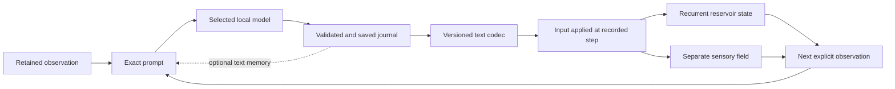

# Reservoir Scope: Tauri parity and evolution roadmap

**Accepted planning baseline:** October 11, 2026. **Current pointer reviewed:** October 22, 2026.

[Current status and next tranches](desktop/ReservoirScope/STATUS.md) ·
[Desktop app](desktop/ReservoirScope/README.md) ·
[Capability and platform parity](shared/reservoir-scope/PARITY.md) ·
[Frozen reference](shared/reservoir-scope/reference-manifest.json)

This document retains the accepted long-term program, scientific and persistence
contracts, milestones and qualification gates. Milestone descriptions are targets,
not claims that every listed workflow is implemented or qualified. Current progress
and the active backlog are consolidated in **STATUS.md**.

**October 22, 2026:** the research line of the program (0.28.0 through 0.39.0, the
sustained-session apparatus of S-010 and S-011) is frozen at 0.39.0 as an instrument
([synthesis](analyses/2026-10-22-s011-apparatus-synthesis.md); [CURRENT-RELEASE](research/CURRENT-RELEASE.md)).
The milestones after M5b (M6 collaborator qualification and the native backport review, the
parity ledger, the Library work) are parked, not deleted: nothing below is withdrawn, and none
of it is scheduled. The sharing candidate remains 0.27.0 candidate 04.

The current candidate is **0.27.0 candidate 04**, ready for a first invited tester
on its scoped Apple Silicon macOS path; actual uncoached human acceptance remains
pending. The [release account](desktop/ReservoirScope/RELEASE-0.27.0.md) owns its
exact package identity and qualification scope, including standalone preparation,
portable historical writing and the named compact activation screens. The separately
versioned [activation experiment](shared/reservoir-scope/activation-experiment.md)
remains an isolated research apparatus. Its incomplete condition comparison is
separate from preview readiness; action selection and continuous wall-clock ticking
remain later tranches.

A [bounded ordinary Ollama check on candidate 04](desktop/ReservoirScope/validation/2026-10-16-journal-flow-0.27.0/README.md)
now records four complete v8 journals, saved/applied at 30→31 through 120→121.
Native pinning survives a new arrival; Later and Follow latest work, with current
fill distinct from selected-entry measurements. The session reaches its bound and
quits normally; same-package offline replay preserves all 25 files. This adds scoped
local-model reading evidence, not human acceptance, endurance or activation-study
results. Known prose grounding limits remain; production is unchanged.

[0.27.1 completion polish](desktop/ReservoirScope/RELEASE-0.27.1.md) now distinguishes
a settled limit from unresolved work. Scoped source checks, a standard macOS package,
native scripted completion and unchanged-record replay pass. The private handoff
remains candidate 04; the new source save point adds no platform or human acceptance.

The published **0.25.0 source checkpoint** retains production v8 and numerical/save
contracts. [Journal-first reading](desktop/ReservoirScope/validation/2026-10-15-journal-first-0.25.0/README.md)
puts complete selected prose and Earlier/Later before history, with live visuals
alongside on wide screens and below reading on narrow screens. Current sensory fill
is prominent and separate from the selected entry. Setup and
[Getting started](desktop/ReservoirScope/GETTING-STARTED.md) explain compile → local
model → Create → Start and the included save/readback/next-step/eligible-memory loop.
The offline script remains the default; no new automatic service or model action
is introduced. The personal controller’s 68% target and 64–72% error deadband are
reference settings, not a proven special state or a fill-rate measurement.

That 0.25 qualification passes 431 frontend tests in 46 files, TypeScript/Vite,
reference checks and the distinct macOS package build. Rust tests and Clippy reuse
0.24’s results by exact comparison of 164 inputs with five validated application-
version-only substitutions; they were not rerun. The [native walkthrough](desktop/ReservoirScope/validation/2026-10-15-journal-first-0.25.0/MACOS-UI.md)
passes at 1280 × 860: three scripted journals at 30/60/90 apply at 31/61/91,
then hold naturally at step 91. Earlier/Later/Follow latest, distinct current and
selected-entry fill, 125%/200% zoom and reset pass. Normal quit and same-build
offline replay leave all 19 recorded files unchanged. Native compact resizing,
pinned selection during new arrivals and export/recovery were not repeated; prior
qualification remains build-specific. Broader platform, GPU/energy and current-build
endurance qualification remain separate. No new real-model writing result is claimed.

The prior preview **0.24.0** retained the same open-writing
`reservoir-journal-v8` contract. [Compact reading](desktop/ReservoirScope/validation/2026-10-15-compact-reading-0.24.0/README.md)
keeps selected journal positions and anchored history windows stable during new
arrivals, adds keyboard access to evidence and provides native View-menu zoom.
All 427 frontend tests in 46 files, 224 core and 203 desktop tests, TypeScript/Vite,
reference checks and both strict Clippy checks pass; two opt-in desktop tests remain
ignored. The distinct 46-file macOS package is archived and ad hoc signed.
The [native walkthrough](desktop/ReservoirScope/validation/2026-10-15-compact-reading-0.24.0/MACOS-UI.md)
confirms zoom/reset, skip-link focus and evidence-panel scrolling, plus a 36-journal
scripted run naturally held at live/saved step 361. Pinning/refresh, Older/Newer,
the full twenty-row boundary, outside-window Earlier, workspace return and explicit
Follow latest pass during arrivals, followed by normal quit. The observed window
is 1830 × 1050 with 100%/125%/200% zoom; unsuccessful resize gestures leave
900 × 700 and 720 × 600 unqualified. Same-build post-quit replay passes all 36
journals with 217 files unchanged; its initial wrapper refusal is preserved separately.
Native export/recovery were not rerun.

An [additive native retry](desktop/ReservoirScope/validation/2026-10-15-compact-reading-0.24.0/MACOS-COMPACT-RETRY.md)
kept the unchanged package at an observed 1280 × 860 outer window. Edge and native
menu attempts still did not establish the 900 × 700 or 720 × 600 content targets.
At 200% zoom, setup, Library metadata, Observatory controls and journal reading
remained reachable. A copied exhausted 36-journal session verified and restored
paused with Resume disabled. Normal quit preserved all original evidence; only
the copied manifest's generation, revision and phase changed. This is scoped
paused-restoration and enlarged-text evidence, not compact-window acceptance.

The prior [0.23 direct navigation and retained reading](desktop/ReservoirScope/validation/2026-10-15-navigation-0.23.0/README.md)
make My reservoir the initial sixth destination while preserving the native five,
and give Preparation history one home in Observatory with a Library shortcut.
All 417 frontend tests, TypeScript/Vite, reference checks and the distinct 46-file
macOS package pass; Rust checks are reused by exact input comparison, not rerun.
Scoped native checks pass for preparation-report/disclosure and Library-position
retention, plus a 61-step scripted run whose pinned first journal survives a new
arrival and workspace changes. The two-journal stored bundle passes the same-build
verifier; native export/recovery were not rerun.

The prior [0.22.1 research-language pass](desktop/ReservoirScope/validation/2026-10-15-research-language-0.22.1/README.md)
uses plain workspace names and controls, moves build/platform details to About, and
keeps technical IDs and graphics counters in optional disclosures. Scientific
limits, active failures and save/application distinctions remain visible.
[Copy and navigation conventions](desktop/ReservoirScope/RESEARCH-LANGUAGE.md).

[The 0.22 Observatory tranche](desktop/ReservoirScope/validation/2026-10-15-observatory-fields-0.22.0/README.md)
adds native-equivalent reference fields and the full 128-mode state capture spectrum
to retained trajectory inspection. Its source suites, distinct macOS package and
scoped native exact-value/navigation/graphics checks pass. A short main-PID CPU/RSS
sample does not measure WebKit, GPU, power or endurance. Broader resource, compact-window,
accessibility and platform acceptance remain open. The [source-role comparison](desktop/ReservoirScope/validation/2026-10-15-context-sources-03/README.md)
completed twelve responses under the user-approved provisional 30% reported-free
admission rule, with actual admission at 42%. Its candidate is not promoted: a local
benefit coexisted with invented measurements. Earlier refusals remain final; the
report preserves a reading-order deviation and additional independent assessment.
The 0.24 tranche qualifies its named native journal routes across pages while new
entries arrive. Actual compact geometry carries forward, followed by broader
attributed GPU/resource measurements on the qualified candidate. The earlier
main-process sample does not measure GPU or whole-app resource use. [Evidence and completion boundaries](desktop/ReservoirScope/STATUS.md#next-usability-and-resource-tranche)
keep all three priorities explicit. No new prompt experiment is implied.

For future bounded serial `gemma3:4b` checks, the user-approved
[resource policy](desktop/ReservoirScope/QUALIFICATION-RESOURCES.md) specifies a
prospective **20% reported-free** floor with normal memory pressure and the existing
disk/run bounds. It does not change the separate activation startup guard, which
requires **25% reported free and pressure level 1**, as retained in the
[activation qualification](desktop/ReservoirScope/RELEASE-0.27.0.md#transferred-installation-and-compact-reading).
Historical attempts retain their frozen rules; this pointer schedules no new run.

The complete pre-housekeeping document—including every dated execution account and
historical “next” statement—is preserved byte-for-byte in
[the October 15 roadmap history](TAURI-ROADMAP-HISTORY-2026-10-15.md).
Its historical priorities do not override the current backlog. The
[housekeeping/source checkpoint](desktop/ReservoirScope/validation/2026-10-15-housekeeping-0.20.0/README.md)
remains at `1552bbc`. Published checkpoints now include 0.25 at `3cfbf1b` (whose
parent is `0001b7a`) and the 0.27 private preview at `4a46c38`; the
[current status](desktop/ReservoirScope/STATUS.md#qualification-and-checkpoint-boundaries)
binds their separate package and evidence scopes. Source checkpointing adds no
runtime or collaborator acceptance.

## 1. Goal, decisions, and definition of success

Build a Tauri desktop application alongside the existing native macOS Reservoir
Scope. Keep both usable while progressively establishing parity, learning from real
use, and introducing improvements in Tauri first.

The program should produce useful intermediate releases. Its first substantial
milestone is a trustworthy offline research experience; fresh experiments, optional
model connections, and explicitly selected live inputs follow.

The initial audience is invited research collaborators. Distribution will be
deliberate and manual, with identifiable builds and documented installation requirements.

The product should make the reservoir worth watching and its relationship with
writing possible to inspect. Mike's subsequent direction adds two first-class aims:
efficient, prominent visualization of state and fill; and an independently owned
reservoir/model session that can keep a readable journal over long runs. These extend
the original parity program. They do not turn the present static reference scenes
into a running reservoir or make the existing bounded experiments long-running.

### Decisions established together

| Area | Decision |
|---|---|
| Platforms | macOS, Windows, and Linux |
| Initial qualification matrix | macOS 14+ on Apple silicon; Windows 11 x64; Ubuntu 24.04 x64 |
| First useful milestone | Offline exploration and recorded evidence |
| Interface | Familiar navigation and workflows, with improvements |
| Numerical architecture | Portable Rust engine; Swift remains an independent reference |
| Native development | Tauri first; consider native backports after demonstrating value |
| Improvement priorities | Prominent, efficient visualization; a sustained journal feedback loop; better organization through the Library |
| Initial Library improvements | Search, filters, recents, and visible errors |
| Personal lab | Each collaborator explicitly creates their own reservoir and selects their own local model |
| Sustained operation | New Tauri session mode after bounded compatibility; separate from historical recipe limits |
| Audience | Invited research collaborators |
| Distribution | Manual preview packages; no automatic updater initially |

Saved investigations, notes, tagging, cloud synchronization, and integration of the
Python journal index are outside this program's initial improvement scope.
Reading journals produced by a person's own new session is in scope. That reader
does not require importing the Beings' journal corpus or extending the Python index.

### The central experience

As of 0.23, **My reservoir** is the initial, direct sixth destination: an intentional
extension alongside the native five, rather than a replacement for them. It combines
recurrent state, separate sensory fill and independent journal reading. Opening it
starts nothing; the user chooses a writing source, seed, cadence and run limits,
then creates and explicitly starts a session. A shared event timeline remains a
longer-term goal.

Selecting a journal entry should reveal what the model was shown, the exact text it
returned, whether that text was saved, the vector actually applied, its application
step and the subsequent observations. Reading an older entry must not move the live
session cursor; **Follow latest** returns the viewer to it. Visualization components are shared with the Observatory; the five original
research destinations remain available.

Use **fill level** for the estimator's value and **rate of change** only for a measured
derivative with declared time units. A deformed surface displays an activation field
on a coordinate-index atlas; it is not the full high-dimensional phase space. A
trajectory view needs a named, versioned projection and stable coordinates across
the compared interval. Fill, state topography and any phase-space projection remain
distinct views, with visible sources and clocks. Missing fill stays unavailable;
the application must not animate a plausible substitute beside a static state row.

### Open-ended journal direction — October 13

The personal lab should make room for self-directed writing within the reservoir
feedback loop. The journal invitation supplies an environment and continuity rather
than a recurring assignment to report metrics. New prompt contracts leave topic,
form, questions and developing threads open; no fixed heading, word count or
measurement recital is required. Quality review checks factual claims when they
occur and distinguishes them from expressive language. It does not reward compliance
with a prose template or gate valid saved feedback on an editorial score.

Current scope remains a reduced personal lab with user-configured opportunities,
one latest saved-and-applied memory entry and finite transport/storage budgets.
Model-chosen silence or timing, longer memory and independent evidence of emerging
behavior remain future work. Minime and Astrid's richer live systems are references
for the design aim, not systems this app replicates. Read-only journal refreshers
inform design here; their text is not copied into app prompts or sent back to them.

The first twelve-entry episode confirms a distinction that now guides the next
tranche: a correct loop can carry repetitive writing and mistaken interpretations.
Full-text memory preserves language separately from the coarse numerical codec.
The current large readout may steer attention toward telemetry despite the open
invitation; this is a source-based hypothesis, not an established cause of style.
Prepare a compact optional readout with continuing writing in the primary position,
version the exact changed prompt, and review whole entries without requiring
introspection, novelty or metric recitation. Keep accurate original measurements
available to readers and historical replay unchanged. No Minime/Astrid change or
new model run follows automatically from this design note.

### Reference baseline

Use the current native working-source behavior associated with **0.15.0 build 21**
as the starting reference. Preserve its distinction from the released 0.14.0, the
build 20 review copy, and later source changes.

The [current-release record](research/CURRENT-RELEASE.md) owns existing qualification
and acceptance claims. Planning inspection does not constitute a new test run or
extend those claims.

At implementation kickoff, record the exact source commit and resource hashes used
for comparison. Maintain that reference until a deliberate contract update replaces
it. This prevents parity from becoming a moving target whenever either application changes.

### What parity means

Parity has four independently evaluated parts:

1. **Scientific behavior:** the same mechanisms, distinctions, recorded boundaries, and verification rules.
2. **Workflow behavior:** equivalent ability to inspect, experiment, save, recover, import, and export.
3. **Presentation meaning:** equivalent scales, coordinates, selections, timing, provenance, and missing-data treatment.
4. **Desktop behavior:** reliable installation, files, dialogs, keyboard access, rendering, and lifecycle on each supported platform.

Pixel-identical rendering is not required. Correct scientific interpretation and
usable workflows are required.

A feature is complete only when its implementation, contract checks, packaged-app
checks, and relevant human review are recorded separately. A browser demonstration
or successful build alone does not establish desktop parity.

### Program finish line

The initial parity program is complete when:

- All five workspaces and their substantive native workflows are available.
- Existing supported records move between applications without losing evidence or changing interpretation.
- Rust-generated experiments pass the independent Swift verifier.
- Each supported platform passes its own packaged-app acceptance.
- The improved Library works beyond the native application's current silent scan limits.
- Both applications coexist with separate identities, preferences, and writable stores.
- Remaining differences are explicitly accepted and documented.
- Native backport candidates have been evaluated.

Retiring the native app is a separate future decision.

The added sustained-session goal has its own finish line: an invited collaborator
can create an independent reservoir, choose a local model, run repeated writing and
feedback cycles for a qualified duration, inspect old and new journals, and recover
the session without duplicate input application or lost committed entries. That is
a new Tauri capability, not a parity claim inherited from native bounded runs.

## 2. Architecture and compatibility contracts

### Application structure

Use **Tauri 2, React, TypeScript, and Vite**, with a Rust backend and a WebGL2 renderer
built with Three.js. Pin the selected stable dependencies and toolchains at bootstrap
and commit their lockfiles.

Organize the new implementation under `desktop/ReservoirScope/`. Place
language-neutral contracts and fixture manifests under `shared/reservoir-scope/`.
Keep the existing native application and Swift core in place. No native runtime
refactor is a prerequisite.

| Layer | Responsibility |
|---|---|
| React interface | Navigation, controls, accessible views, selection, and presentation |
| Rendering adapter | Geometry, cameras, picking, scales, and graphics recovery |
| Tauri application backend | Dialogs, file access, sessions, persistence, cancellation, and explicit networking |
| Rust domain library | Numerical mechanisms, record interpretation, verification, and experiment behavior |
| Rust headless executable | Run and verify records independently of the graphical application |
| Shared conformance material | Format descriptions, fixtures, expected outcomes, and cross-engine checks |
| Existing Swift implementation | Independent behavioral reference on macOS |

The Python research toolkit remains a separate tool. Tauri does not require a bundled
Python runtime.

### Rust owns authoritative data

Rust will own original record bytes and hashes; format and semantic validation;
full-width integer fields; numerical state and calculations; experiment and request
lifecycle; journal persistence and feedback eligibility; Library records and indexing;
local-model transport; and explicitly selected read-only feed readers.

The frontend receives bounded views of that data. It must not independently decide
whether evidence verifies, whether a journal was saved, or whether feedback can be applied.

Commands handle discrete operations; ordered channels carry progress and session
updates. Keep complete records in the backend and fetch frame ranges as needed.
Tauri's event mechanism is not intended for high-throughput streaming, so growing
experiment records must not be broadcast repeatedly as JSON.
[Tauri frontend communication](https://v2.tauri.app/develop/calling-frontend/)

### Interfaces to introduce

| Family | Required operations |
|---|---|
| Records | Open, inspect, verify, fetch frames, export, close |
| Library | Query, import, refresh, rebuild index, list diagnostics, record recent access |
| Sessions | Create, step, run, pause, cancel, update controls, request journal, save, export |
| Sustained sessions | Configure budgets and observation contract, checkpoint, inspect recovery, explicitly resume, fetch journal/event ranges |
| Model readiness | Check configured endpoint/model, cancel, inspect result |
| Read-only feeds | Select files, start observation, stop, inspect continuity and staleness |
| Application | Resource identity, build identity, settings, pending-save status, close preparation |

Use opaque record, operation, and session identifiers. Every asynchronous result must
identify the operation or session generation that owns it, so a late result cannot
replace a newer selection.

Keep **verification status**, **experiment outcome**, and **data origin** separate. A
faithfully retained failed experiment can be a valid record. Return structured errors
with an operation, category, and useful explanation. Present remedies such as retrying
a save or choosing a different file where applicable.

### Existing file formats remain authoritative

| Family | Existing identity |
|---|---|
| Stage experiments | `recipeVersion: "essentials-v1"` |
| Exploration | `essentials-exploration-v1` |
| Actions and comparisons | `essentials-actions-v1`, `v2`, and `v3` |
| Action reply tapes | `essentials-action-tape-v1` |
| Controller example | `essentials-regulation-v1` |
| Reviewed cases | `research-cases-v1` |
| Geometry bookmarks | `question-geometry-v1` |

Also preserve the observatory's existing resource formats, binary replay layout,
preparation reports, amendments, and separate retry histories.

Imported and bundled records retain their original bytes. Re-export those bytes
rather than parsing and reserializing files merely to attach Library metadata. Verify
copied snapshots before publishing an import into the Library.

New Rust experiments use existing current formats only when they satisfy those
formats' contracts. Any future incompatible mechanism or interpretation requires a
new version. Historical paths remain provenance. Opening a record must not follow
them to retrieve missing content.

### Numerical and textual conformance

Port deterministic mechanisms before mutable experiment orchestration:

- SplitMix64 and seeded initialization.
- Reservoir recurrence, forcing, noise, and control application.
- Sensory projection, covariance, spectral summaries, and eigendecomposition.
- Text encoding and spectral feedback.
- Reduced fill and regulation.
- Action tapes, memory exposure, and next-step application.
- Verification and prompt reconstruction.

Start with nalgebra's pure-Rust symmetric eigendecomposition behind a small solver
interface. Qualify it against the existing implementation before advancing; do not
relax acceptance thresholds to accommodate a mismatch. nalgebra provides both
pure-Rust decomposition routines and LAPACK integration, but the initial implementation
uses the pure-Rust path.
[nalgebra decomposition documentation](https://www.nalgebra.rs/docs/user_guide/decompositions_and_lapack/)

Preserve the existing verification requirements:

- General scalar checks use `2e-7 × max(1, |expected|)`.
- Controller teaching checks use `1e-8 × max(1, |expected|)` where currently specified.
- Fields requiring exact seeded-array equality remain exact.
- Eigenvectors are checked through residuals, norms, and orthogonality rather than identical bases.
- Replay displays retained valid eigenvectors instead of replacing their orientation.

**Wide integers.** Parse seeds and clocks in Rust. Transport full-width unsigned
values to TypeScript as decimal strings; preserve the existing numeric encoding in
portable files.

**Unicode.** Reproduce Swift's grapheme, character-property, lowercasing, and
word-splitting behavior. Include combining marks, emoji sequences, non-Latin text,
apostrophes, and unusual whitespace in the conformance corpus.

Reconstruct prompts exactly from their retained observation frames. Newly computed
runs can differ near decimal-rounding boundaries while satisfying numerical tolerances;
their prompts must still match their own recorded observations exactly.

### Rendering

Build an event-driven WebGL2 renderer behind a small interface. Preserve fixed signed
scales and zero references; node selection and exact coordinate disclosure; camera
behavior and synchronized comparison views; distinctions between reservoir state and
sensory covariance; recorded clocks, gaps, and unavailable measurements; and native
restrictions on visual smoothing.

Require an early packaged-app proof using actual 32-node and 128-node scenes.
Provide an accessible non-WebGL presentation with exact values, fixed-scale charts,
and the same inspection controls. Clearly identify unavailable 3D rendering; this
fallback does not by itself establish full visual parity.

Tauri uses different system WebViews across platforms. Linux can successfully create
a WebGL2 context while still using an impractically slow graphics path, so capability
detection must include measured interaction performance.
[WebView versions](https://v2.tauri.app/reference/webview-versions/),
[Linux graphics guidance](https://v2.tauri.app/develop/debug/linux-graphics/)

WebGPU is deferred until it offers a demonstrated benefit across the supported matrix.

### Graphics efficiency and visual prominence

Put the meaningful visualization near the top of the working view, with its journal
and event context beside or directly below it. Keep diagnostics and implementation
details in expandable panels. A small-screen layout should keep one useful scene
and the selected entry readable before adding secondary views.

Tauri hosts the platform WebView; there is no portable switch that guarantees fast,
low-energy rendering or reserves a GPU for this application. Retain the current
`low-power` WebGL context preference for the small analytical scenes, and qualify
it on hardware. It is a hint the implementation may ignore. Introduce a performance
preference only if measured results justify it, with the same context-loss handling.
Do not globally disable acceleration or ship graphics-driver workarounds as defaults.
[WebGL context attributes](https://registry.khronos.org/webgl/specs/latest/1.0/#5.2),
[WebView2 performance guidance](https://learn.microsoft.com/en-us/microsoft-edge/webview2/concepts/performance)

Keep three clocks separate: numerical steps, observation/journal opportunities and
presentation frames. A quiet recorded view needs no animation loop. A moving live
view may redraw at a bounded cadence while its session is advancing; stopping visual
redraw must not stop or accelerate numerical evolution. Rendering quality must never
change solver precision, recurrence, noise, observation timing or journal eligibility.

**Renderer work budget**

- Coalesce camera, data and selection changes into at most one pending frame.
  Suspend draws when the document is hidden or the surface is outside the viewport;
  redraw the latest state on return. Native visibility/minimization is an additional
  platform signal to qualify, not something inferred solely from browser focus.
- Cap backing-buffer pixel count as well as device-pixel ratio. The first reference
  implementation targets at most one million pixels per surface and DPR at most two;
  this is a rasterization budget, not a bound on total GPU memory or a measured saving.
- Reuse meshes, shaders and buffers across frames. Update changed attributes without
  recreating WebGL contexts or the scene for each simulation step. Release textures,
  geometries, materials, listeners and contexts when a view is retired.
- Keep animation and buffer updates outside React's per-frame state path. React owns
  controls and infrequent status changes; typed arrays and the renderer own the fast
  presentation path. Throttle diagnostic counters rather than rendering UI on every draw.
- Reduce resolution or optional visual detail before sacrificing responsive controls.
  Keep axes, scales, exact selected values and source meanings intact. Any interpolation
  must be an explicitly allowed display mode, never a fabricated measurement.

**Backend-to-view delivery**

Rust retains scientific records. A bounded presentation channel carries the newest
display state plus its sequence and source identity. Implement queue capacity,
acknowledgement/backpressure and cancellation explicitly; an ordered Tauri channel
does not itself define a bounded application queue. Skipping display frames may be
reasonable; losing recorded steps, journals or application receipts is not. The UI
must expose recording gaps separately from ordinary presentation coalescing. Historical
charts and journals use paginated ranges and bounded caches, including when the live
session has run for hours.
[Tauri channels](https://v2.tauri.app/reference/javascript/api/namespacecore/#channel),
[Three.js on-demand rendering](https://threejs.org/manual/pages/rendering-on-demand.html),
[Three.js resource disposal](https://threejs.org/manual/pages/how-to-dispose-of-objects.html)

**Coexistence with local inference**

The renderer and a local model can compete for GPU time, memory and power, particularly
on unified-memory machines. Start with one in-flight generation per session and a
visible application-level request budget. Measure UI alone, model alone and both
together before increasing concurrency. Lower visual cost under pressure while
preserving recorded numerical behavior; if computation/storage cannot keep up, pause
at a recorded boundary instead of silently dropping evidence. Do not unload another
application's models or reconfigure its server. Provider-side concurrency also matters
and cannot be controlled by a WebGL preference.
[Ollama concurrency and memory](https://docs.ollama.com/faq#how-does-ollama-handle-concurrent-requests)

### The journal feedback loop: existing mechanism and new contract

The user's central flow is an explicit product requirement:

The recurrent-state arrow into the next observation is a requirement of the **new
sustained mode**. It must not be retroactively asserted for every historical lab
recipe. When journal feedback is enabled, from stage E onward, the current native
action experiment sends the held encoded vector into both the recurrent reservoir
and a separate sensory field. Default journal prompts describe sensory eigenmetrics;
the special stage-D observation comparison is where
reservoir observations are additionally exposed. The new mode must explicitly close
the reservoir-to-prompt path while retaining the sensory quantities separately.
Sources: [action mechanisms](essentials/actions/ActionMechanisms.swift),
[action contracts](essentials/ACTIONS.md),
[comparison restrictions](essentials/actions/ActionTypes.swift).

The lab's existing text codec is a deterministic feature reduction: character,
lexical, sentence and marker features occupy 32 coordinates in a 48-dimensional
vector, with the remaining 16 zero. It is not a learned semantic embedding.
The observed sensory spectrum can shape the encoded features before application.
The vector changes input to the reservoir recurrence; it does not train the LLM or
rewrite the reservoir's recurrent weights. A future embedding-based codec would be
a separately versioned mechanism with its own model identity and conformance checks.
Sources: [TextCodec](essentials/spectral_bridge/TextCodec.swift),
[reservoir recurrence](essentials/reservoir/Reservoir.swift).

This source-inspired lab is distinct from the deployed Minime/Astrid systems. Its
[source map](essentials/spectral_bridge/README.md) describes a reduced implementation
and dates its source mapping to September 9. That is useful lineage, not a current
live-system audit or a guarantee that both Beings use this exact loop today.

**Observation contract for the new mode**

- Version the observation builder and retain the exact numerical snapshot and final
  submitted prompt. Display **Shown to the model** separately from measurements only
  available to the human viewer. A beautiful state surface alone is not model feedback.
- Include explicitly labeled recurrent-state summaries as well as sensory eigenmetrics
  and reduced fill. Candidate recurrent measurements are RMS, norm, a fixed declared
  coordinate subset and change across a retained application boundary. Freeze formulas,
  units, coordinate selection, rounding and missing-data behavior before qualification.
  Camera movement or human selection must not silently alter the model's prompt.
- Keep full-text journal memory separate from reduced-vector feedback. Show exactly
  which prior entries, excerpts and hashes were included; a journal visible in the
  reader is not automatically included in the next request. Use an explicit bounded
  memory policy rather than concatenating an ever-growing conversation.
- Record observation step, request/response wall times, journal commit identity,
  feedback preparation and first actual application step. The default protocol pauses
  numerical stepping during the request/save boundary, as the existing action session
  does. Camera interaction and reading remain available. A later protocol that allows
  reservoir evolution during generation needs a new timing contract.
- Preserve the current held-input meaning when using that mechanism: a new accepted
  vector replaces the previous held vector, and WAIT retains the previous one. It is
  not a one-step impulse unless a separately identified recipe says so.
- Make pre/post comparison and the intervening forcing, noise and control settings
  inspectable. A before/after difference is not evidence that words alone caused every
  change. Optional matched deterministic replays must state which drivers were held
  fixed; they do not establish learning, useful memory or benefit from the loop.

### Sustained sessions and durable journals

Create an independent session with its own seed, recipe, state, journal directory and
selected model configuration. A collaborator should be able to watch it, read while it
runs, leave the view and return to an understandable history. No Being workspace,
persona, journal or running service is discovered or copied automatically.

Keep the existing finite experiment limits intact. A long run cannot be implemented
by raising those validators' caps, silently restarting their seed, or periodically
rewriting an unlimited JSON record. Define a new versioned session family with a
manifest, bounded immutable event/frame segments, exact journal objects and atomic
checkpoints. Its precise schema is an M5b deliverable. Legacy export is available only
when an exported experiment independently satisfies a supported legacy contract;
otherwise export the explicit new session format. Beginning from an old record is a
named fork/genesis referencing its source hash, never an edit to that original.

**Durable progression**

1. Retain the observation and prepared request with stable session, turn and attempt IDs.
2. Record dispatch and the provider outcome. Preserve failed, cancelled and interrupted
   attempts. An unknown outcome after a crash is not permission to silently resend.
3. Validate the complete reply and atomically commit/read back the journal and its
   identity. Failed or uncertain saves cannot enter feedback or text-memory exposure.
4. Retain the exact encoded/shaped vector and a prepared application event tied to the
   committed journal and intended step. Persist the event needed for deterministic
   recovery before advancing that numerical boundary.
5. Advance under a single Rust session owner, then retain the applied event identity
   and checkpoint/application cursor. Recovery replays committed events from a verified
   checkpoint and must reach the same state without consuming feedback twice.

Qualification must inject a crash between every durable phase. A journal's existence
proves neither that it was supplied as memory nor that its vector was applied. The
native [journal-save gate](essentials/actions/ActionComparisonSession.swift) supplies
the behavioral reference, but its periodic app record saves do not establish the
transactional crash recovery needed here. Keep the authoritative session log and
journals separate from the rebuildable Library metadata index.

**Checkpoint contents**

Retain current reservoir state, immutable weight identity, original seed **and current
RNG state**, sensory projection/covariance state, forcing phase/global step, reduced
fill smoothing state, controller integral and current/next retention, held input and
its source journal, prepared/applied event cursors, controls and mechanism versions.
Also retain the exact memory exposure, request body/configuration and outstanding
attempt status. Validate checkpoint and segment identities before recovery. A seed
alone does not resume an evolved reservoir, and float32 display buffers are not
authoritative checkpoints.

Existing local-model calls supply a fresh request with explicitly constructed prompt
memory; they do not expose a checkpoint of the model's internal state or KV cache.
Replay recorded model responses to qualify numerical recovery. Do not promise that
reissuing a generation will reproduce identical prose, even at temperature zero.
Source: [local-model transport](essentials/llm/Language.swift).

**Pacing, budgets and lifecycle**

The selected initial running style is an open or minimized application, confirmed by
Mike during implementation. Rust owns the session independently of WebView rendering.
A separate background service is deferred and would require a new product decision
and its own installation, status, stop and recovery design. No implicit tray daemon
or login item.

Before Start, show the chosen model, observation/memory policy, numerical pace,
writing opportunities, duration/step/turn bounds and storage budget. Keep bounded
generation deadlines and response sizes. Pause at a committed boundary when a budget
is reached or storage cannot keep up; present a deliberate extension action instead
of pretending that "long-running" means unlimited resource use. Initial acceptance
targets hours and then a 24-hour soak; those are test goals, not existing results or
a promise of unattended operation.

| Event | Planned behavior |
|---|---|
| View offscreen or window minimized | Suspend rendering; continue only an explicitly started session under its displayed run policy |
| Reading old journals | Preserve reading position; continue the session independently; show new-entry count |
| Pause | Stop at a named boundary and expose any in-flight request; committed pending feedback waits for resume or an explicit skip decision |
| Provider failure or invalid output | Retain the failed attempt, pause the first-release session and offer an explicit retry with a new attempt ID |
| Sleep/wake | Retain an interruption and reconcile pending work; require explicit resume by default; do not simulate missed wall-clock steps |
| Close/Quit | Checkpoint and stop, or return to the app; resolve pending/failed writes explicitly; do not silently continue as a service |
| Crash/relaunch | Show recoverable session and verified boundary; require explicit resume; never invent successful model/save/application receipts |

Skipping pending feedback records a terminal decision without deleting the committed
journal or its provenance. In the initial sustained-mode policy, that entry is also
excluded from automatic prompt-memory exposure; it remains readable in history.
Memory and input eligibility are recorded separately, so a future policy can change
one without pretending the other occurred. A pause by itself skips neither.

Do not assume browser visibility or a generic Tauri event-loop resume event reliably
signals system sleep on every OS. Define platform lifecycle adapters and interruption
detection, then test actual sleep/wake and pending-response races on each target.
[Tauri WindowEvent](https://docs.rs/tauri/2.12.3/tauri/enum.WindowEvent.html),
[Tauri RunEvent](https://docs.rs/tauri/2.12.3/tauri/enum.RunEvent.html)

### Desktop permissions and content

Use narrow commands and window capabilities. Restrict registered application commands
explicitly; do not assume plugin capability declarations automatically restrict every
custom Rust command.

Render journals, prompts, excerpts, and imported text as inert content. Keep external
navigation outside the privileged application view. Production packages must exclude
test-driver services. [Tauri capabilities](https://v2.tauri.app/security/capabilities/)

The application starts no model service, downloads no model, discovers no Being
workspace, and performs no automatic live connection.

## 3. Delivery milestones and feature coverage

Each milestone ends with a reviewable build, a qualification receipt, and an updated
parity ledger. Milestones describe completion gates rather than speculative calendar promises.

### M0 — Freeze the reference and prove the desktop foundation

**Deliverables**

- Save this roadmap in the project root.
- Capture reference source and resource identities.
- Create the Tauri application, Rust workspace, and three-platform build configuration.
- Establish the separate application identity `research.reservoir.scope.tauri`.
- Use the installed name **Reservoir Scope** (**Reservoir Scope Tauri Preview** through 0.38.0; the app is past a preview and does not carry the toolkit's name).
- Create separate app-data and preference locations.
- Establish one main window and single-instance behavior.
- Add fixture manifests without modifying canonical examples.
- Prove representative rendering in the actual packaged applications.
- Qualify visible/hidden/offscreen scheduling and bounded drawing buffers; retain
  hardware measurements separately from unit-test evidence.

**Exit criteria:** All three targets can launch, locate bundled resources, open and
save through native dialogs, render and pick the reference scenes, survive resize/context
loss, and close cleanly. Graphics failure blocks the relevant platform claim before
extensive UI work accumulates.

### M1 — Headless compatibility and verification

**Deliverables**

- Rust deterministic mechanisms and record readers.
- Verification for all experiment families required by the guided experience.
- Readers and validators for cases and geometry.
- Exact-byte hashing and lossless integer handling.
- Headless verification with machine-readable results.
- Swift-to-Rust conformance and negative fixtures.

This milestone does substantial mathematical work. Offline verification is more than
schema parsing: the existing verifiers replay numerical behavior.

**Exit criteria:** The selected canonical corpus passes both implementations'
applicable checks. Deliberately altered records fail for the intended reasons.
Historical defaults and partial outcomes remain interpretable. Fresh session
scheduling and HTTP generation are not required yet.

### M2 — First useful offline preview

**Deliverables**

- Familiar native five-destination baseline, retained alongside the later My reservoir destination.
- Complete guided A–H recorded journey.
- Make the observation → writing → saved journal → applied input → next observation
  chain easy to inspect, with each recipe's actual observation channel labeled.
- Scripted and recorded-model provenance.
- Continue, playback, pause, cursor, and lesson behavior.
- Research cases with embedded evidence and authored limits.
- Geometry bookmarks with the synthetic example and explicit opening.
- Verified experiment opening, import, and export.
- Initial Library search, filters, recents, and diagnostics.

The Observatory destination can identify its remaining implementation status until
M3. Unfinished capabilities must be clearly labeled.

**Exit criteria:** An invited collaborator can install the app, disconnect networking,
follow the guide, inspect cases and geometry, and import a supported recording without
the repository, private captures, or a model service.

The first preview must distinguish prior bundled qualification from verification
actually executed by this build. Arbitrary imports require the Rust verifier.

### M3 — Complete the offline observatory and evidence experience

**Deliverables**

- Fill sphere and reference zones.
- State surface and topography.
- Prominent coordinated state, fill/spectrum and event views with a shared inspection
  cursor, without joining measurements whose clocks or sources do not support it.
- Recorded state trajectories and spectra.
- Native action-response evidence.
- Separate esn-divide simulation.
- Exact pre/post/difference inspection.
- Playback clocks, gaps, and source labeling.
- Preparation history, amendments, failed attempts, and retry exports.

**Exit criteria:** Every recorded native workflow has a Tauri counterpart. The same
selected event yields the same scientifically meaningful values and distinctions.
An immediate action boundary must remain distinct from a later recovery trajectory.
Simulated preview volume must not acquire a measured timestamp or fill interpretation.

### M4 — Fresh offline experiments

**Deliverables**

- Interactive Explore.
- Original stage experiments.
- Independent and matched A–H comparisons.
- Scripted writing and reply tapes.
- Manual journal opportunities.
- Active-input observation comparison.
- Separate controller teaching example.
- Run, step, pause, stop, reset, and control changes.
- Journal saving, experiment saving, recovery, and export.

Preserve existing run limits: exploration up to 1,800 steps, stage runs up to 3,000
steps, and actions up to 600 steps with their opportunity bounds.

**Exit criteria:** Rust-generated records verify in Swift. Changing controls applies
at the correct recorded boundary. Navigation and reset reject stale callbacks. Save
failures remain recoverable.

A journal saved at step 30 applies at the recorded next-step boundary, such as step
31. A failed journal save must never become eligible for feedback merely because the
enclosing record was exported.

### M5 — Explicit local models and read-only feeds

**Deliverables**

- Configured loopback model endpoint and exact model selection.
- Explicit readiness checks.
- Bounded generation with cancellation and retained failures.
- User-selected read-only health and activation files.
- Continuity, sequence, clock, gap, and staleness checks.

For finite native-parity recipes, preserve current defaults and bounds, including
five-second inventory checks and a 60-second generation deadline; one-MiB response bound; native UI defaults of 4,096
context tokens, 256 output tokens, and temperature zero; explicit JSON responses for
actions; no redirects or substituted providers; and no partial or late response entering feedback.

**Exit criteria:** Fake-provider and synthetic-feed suites pass on all targets.
Real-service checks, when explicitly configured, receive separate receipts. Synthetic
reader tests establish reader behavior. They do not establish interoperability with
a running Being or authorize changing its producer.

### M5b — A person's own sustained reservoir and journal

This is a new Tauri-first extension of the parity program. It depends on qualified
numerical/Unicode behavior, the save lifecycle and bounded model transport. Selected
external feeds are optional and are not a prerequisite for a self-contained session.
The model and reservoir belong to the collaborator's explicitly created lab.

**October 13 implementation update:** 0.14.0 retains per-session writing budgets.
New sustained defaults are 1,024 output tokens and 180 seconds, with 8,192 context
tokens selected in new local-model setup. Output is adjustable within 256–2,048
and deadline within 60–180 seconds before creation. These are ceilings, not prose
instructions; v3 remains unchanged. Historical omitted values retain 256/60. The
finite M5 recipe defaults above remain unchanged. Configured context is requested
capacity, not evidence that the provider processed every supplied token.

**Deliverables**

- My reservoir workspace with a prominent state surface, separate fill/spectrum,
  journal reader, selected-entry inspection and follow-latest control.
- Versioned observations that deliberately expose both recurrent reservoir state and
  sensory summaries to the model, with exact submitted prompt and memory exposure.
- Continuous numerical state across bounded storage segments, with an explicit pace
  and configurable run/storage budgets. Preserve historical recipe limits.
- Durable journal, prepared feedback and applied-step identities; complete numerical
  checkpoints and verified, explicitly resumed recovery.
- A new portable session format and independent headless replay/verification; no
  assumption that an old Swift verifier accepts a new mechanism or format.
- Stable reading while new entries arrive, visible failure/pause state, and a way to
  inspect an entry's observation, encoded vector and application boundary.

**Exit criteria:** A collaborator can configure their own model, run repeated writing
cycles, inspect exactly how saved text returns as input, and resume a verified session
without losing committed journals or applying an event twice. Deterministic checkpoint
replays match uninterrupted numerical runs using retained replies. Multi-hour and
24-hour qualification retain evidence of bounded memory/queues, responsive reading,
storage handling and real lifecycle interruptions. Fake-provider qualification and
each explicitly configured real-model run receive separate receipts.

M5b does not claim reproduction of either Being, model weight learning or scientific
benefit. It delivers an inspectable personal reservoir/journal loop.

### M6 — Collaborator qualification and native backport review

**Deliverables**

- Complete parity ledger.
- Clean-machine installation walkthroughs.
- Package identity and resource verification.
- Keyboard, accessibility, scaling, and graphics checks.
- Collaborator task reviews bound to exact builds.
- Manual upgrade and recovery instructions.
- Sustained-session acceptance, with model/resource requirements and the actual
  qualified duration stated for each platform/hardware configuration.
- Prioritized native backport proposals.

**Exit criteria:** Every required capability is qualified on the declared platform
matrix, and any remaining differences are explicitly accepted.

### Feature parity ledger

Track these areas individually rather than reporting one opaque completion percentage:

| Area | Required behavior | Target |
|---|---|---|
| Navigation | Native five-destination baseline; later My reservoir adds a direct sixth; entering starts no experiment | M2 |
| Guided tour | A–H, sources, checkpoints, cursor, pause semantics | M2 |
| Research cases | Authored accounts, evidence, limits, rejected-replacement retention | M2 |
| Geometry | Hashes, references, 128 coordinates, clocks, RMS, reading-state retention | M2 |
| Library | Explicit imports, exact exports, search, filters, recents, diagnostics | M2 |
| Recorded observatory | Prominent coordinated fill, surfaces, trajectories, spectra, provenance | M3 |
| Graphics efficiency | Bounded buffers, visible-work scheduling, resource reuse and measured contention | M0 onward |
| Response lab | Separate native receipts and simulation semantics | M3 |
| Preparation history | Original failures, amendments, separate retries | M3 |
| Explore | Controls, pulse, decomposition, history, step boundaries | M4 |
| Stage experiments | Original four-stage behavior and records | M4 |
| Actions | A–H, matched comparisons, WAIT/WRITE, memory, feedback | M4 |
| Separate comparisons | Observation-channel comparison and controller fixture | M4 |
| Save lifecycle | Retry/export, pending writes, explicit discard | M4 |
| Local models | Explicit inventory and generation, bounded failure handling | M5 |
| Selected feeds | Read-only input, continuity and staleness semantics | M5 |
| Personal journal loop | Own reservoir/model, explicit recurrent observations, readable writing/return timeline | M5b; new capability |
| Sustained recovery | Segments, complete checkpoints, budgets, no duplicate application on resume | M5b; new capability |
| Desktop delivery | Installation, coexistence, accessibility, recovery | Throughout; complete M6 |

## 4. Better Library, coexistence, and native loose ends

### Library behavior

The Library improvement is part of the first useful preview.

**Contents.** Keep bundled examples as a read-only catalog. Managed records consist
of explicitly imported experiments and experiments created by Tauri. Cases, geometry
packets, and externally opened recordings retain their temporary viewing behavior.
Opening one does not silently add a Library copy or create a persistent file watcher.

**Search and filters.** Provide case-insensitive metadata search over display title
and filename; experiment family and stage; backend and model; seed and available
record identity. Filter by origin, family, scripted/model source, and recorded
outcome. Unknown values remain visible. Journal-body full-text search is outside this tranche.

**Ordering and recents.** Keep bundled examples in authored order. Sort managed
records by local save/import time with a stable tie-breaker. Label that timestamp
accurately; it is not authenticated historical experiment time. Persist recently
opened Library records and bundled examples. Do not automatically restore external
cases or geometry files on launch.

**Index.** Use a rebuildable SQLite metadata index owned by Rust. Keep index data
separate from scientific records. Index updates follow successful record publication.
A failed index update must not erase a successfully saved record; refresh can recover
it. Use paginated, virtualized results and visible scan progress. Remove silent result
caps. Interrupted or bounded indexing must report incomplete coverage.

**Import identity.** For identical imported bytes, identify the existing entry and
report that the record was already imported. If two files contain the same embedded
ID but different bytes, retain distinct Library entries. Never overwrite by embedded
identity alone.

**Failures.** Show missing, damaged, unsupported, or unreadable entries with useful
explanations. A damaged index can be rebuilt from this application's managed files
without modifying them. Do not turn a failed scan into an apparently successful empty Library.

### Coexistence

The two applications use separate bundle/application identities, preferences,
writable Libraries, cache and diagnostic locations, and build and release records.
Interchange occurs through explicit portable files. Neither application automatically
scans or migrates the other's store.

Use platform-native app-data locations. An isolated-library override for testing must
accept valid absolute paths on every supported OS, including Windows. Start with one
main Tauri window and one application instance. Route later launches to the existing
instance. Qualify window close and application quit explicitly.

### Save and recovery semantics

Serialize writes per experiment and publish completed snapshots atomically. Store
local recency and index metadata outside the portable record. Retain failed saves in
memory with Retry save and Export available. Closing or quitting waits for pending
writes and offers a return to the application or explicit discard when evidence remains unsaved.

After a crash, recover completed files and identify incomplete temporary writes. Do
not manufacture successful journal-save receipts or automatically resume an experiment.

### Native loose ends

The following enter a separate backlog. They do not block starting Tauri.

| Candidate | Evidence and interpretation | Planned treatment |
|---|---|---|
| Silent Library limits | Native scanning stops after 5,000 examined entries or 500 recognized records; unreadable records can disappear silently | Fix in Tauri's Library; propose a focused native backport after qualification |
| Geometry loading responsiveness | Parsing and hashing occur on the main actor; actual user-visible delay is unmeasured | Use cancellable background work in Tauri; measure native before proposing a repair |
| Close and window lifecycle | Native termination uses one registered preparation callback; broader window behavior needs qualification | Test Tauri explicitly; retain a targeted native investigation |
| Compact layouts and accessibility | Native uses a dark appearance and a 1100×820 minimum | Make Tauri usable on smaller effective laptop areas and scaled displays; evaluate backports from evidence |
| Implicit contracts | Important rules currently live in Swift types, validators, and tests | Document shared contracts and fixtures without a broad native rewrite |

The confirmed scan behavior is visible in
[ExperimentStore.swift](native/ReservoirScope/Sources/ReservoirScope/ExperimentStore.swift).
Its prevalence or user impact has not been measured.

A backport proposal should identify the problem, demonstrate the Tauri behavior,
explain compatibility effects, and name the focused native checks. Native changes
remain separate reviewable work.

## 5. Validation, release practice, and program management

### Conformance tests

Build tests around observable contracts:

| Test area | Required scenarios |
|---|---|
| Numerical primitives | RNG vectors, seeded weights, recurrence, forcing, covariance, controller thresholds |
| Eigensolver | Degenerate matrices, nearly tied values, rank-one input, decay, regulated runs |
| Text behavior | Unicode graphemes, lowercasing, punctuation, whitespace, exact prompts |
| Historical records | Action v1/v2/v3, stage, exploration, controller, old defaults |
| Negative records | Changed hashes, prompts, weights, dimensions, step identities, references, and request order |
| Integer precision | Seeds above `2^53`, boundary unsigned values, activation clocks |
| Partial outcomes | Failed generation, failed save, cancelled pair, unavailable measurement |
| Portability | Relocated files, Unicode paths, Windows provenance paths, absent original directories |

Cross-engine checks must run in both directions:

1. Native record → Tauri verification → exact-byte export → native verification.
2. Rust experiment → native verification and replay.
3. Equivalent deterministic inputs → field-by-field comparison under existing tolerances.

### Lifecycle and storage tests

Cover cancelled file dialogs; invalid replacement preserving valid content and
selection; navigation during playback and during an experiment; reset while a request
is pending; late completion after cancellation; disk-full and permission-denied writes;
quit with pending and failed saves; interrupted import and index update; corrupt-index
rebuild; duplicate imports; Libraries exceeding the old scan limits; and repeated
opening and closing without accumulating sessions, GPU resources, or memory.

Default automated runs use synthetic fixtures and fake model providers.

### User interface and packaged-app tests

Use three layers: fast React tests for view behavior; actual Tauri tests on each target
OS; and smoke tests of the pristine shipping packages.

Current Tauri documentation supports WebdriverIO's embedded-driver route on macOS,
Windows, and Linux. Direct `tauri-driver` remains limited to Windows and Linux. Keep
embedded testing plugins confined to test builds.
[Tauri WebDriver guidance](https://v2.tauri.app/develop/tests/webdriver/)

Package checks include launch without repository paths or developer shell configuration;
bundled resource discovery and identity; native dialogs and local storage; offline
operation; correct keyboard conventions; high-DPI scaling and text enlargement;
screen-reader labels and non-color distinctions; GPU context loss and reduced-renderer
behavior; and close, quit, relaunch, and single-instance behavior.

Set initial usability targets of responsive controls within 100 ms and at least 30
frames per second during representative 3D interaction on qualification hardware.
These are proposed targets, not measured results. Background verification must leave
navigation and cancellation usable.

### Graphics and sustained-session qualification

Use the actual packaged WebView and record build, OS, WebView, GPU, display size/DPR,
power mode and model configuration. Renderer/vendor strings alone cannot establish
hardware acceleration or usable performance. Measure idle-visible, interacting,
offscreen, minimized and restored states; repeat with UI alone, model alone and both
together. Observe process-tree memory trends, draw counts, input latency, frame-time
distribution, queue high-water marks and platform energy observations. Three.js object
counts are useful diagnostics, not complete GPU-memory measurements.

Keep the existing 100 ms interaction / 30 fps targets as initial qualification goals,
then set explicit hardware-dependent budgets from retained baseline measurements.
No GPU-percent, battery-life or memory-saving percentage is claimed by source changes
alone. Pausing a surface should stop that surface's draw submissions; it does not
guarantee zero power use by the WebView compositor or the rest of the application.

Run short correctness/recovery cases first, then proposed 30-minute, two-hour and
24-hour soak tiers. Use fake providers by default; use a real local model only when
explicitly configured for that attempt. Long-duration receipts state elapsed wall
time, numerical steps, completed/failed/interrupted attempts, committed journals,
applied feedback events and any recording gaps. Duration alone is not a pass.

Required new cases include:

- Uninterrupted deterministic state versus checkpoint/resume at every writing,
  saving and application boundary, including held input and RNG consumption.
- Crash after provider dispatch, after reply receipt, during journal publication,
  after preparation, after application and during checkpoint/segment rollover.
- Disk-full, unreadable or corrupt segments, damaged index, partial temporary writes,
  restored checkpoint with an inconsistent cursor and duplicate callback delivery.
- Slow/failed provider, explicit bounded retry, Unicode replies, token/response bounds and no
  partial output applied as feedback. Long-run time bounds do not relax turn bounds.
- Browse an old journal while new entries arrive; scroll surfaces out of view;
  minimize, restore, change DPI, lose the context and keep session identity intact.
- Sleep with a request pending, clock discontinuities, explicit resume, close during
  save and crash/relaunch. Do not rely on accelerated fake-time tests alone for these.
- Budget exhaustion and explicit extension; verify retained history remains readable
  and does not disappear through silent pruning or an unreported scan limit.

### Human acceptance

Prepare short tasks using exact candidate builds:

- Follow the guide and explain the writing/return boundary.
- Find a particular example and a recently imported experiment.
- Distinguish verification status from an experiment's failed outcome.
- Inspect a case's evidence and limits.
- Read a geometry record's coordinates, clocks, and gaps.
- Export a record and open it in the other application.
- Recover from a rejected import or failed save.
- Create a personal session; identify exactly what was shown to the model, what it
  wrote, when the journal was committed and when its vector first entered the reservoir.
- Read an older entry while the session advances, return to latest, pause and recover
  from a verified checkpoint without confusing interrupted attempts with new writing.

Record automated checks, agent UI checks, collaborator feedback, and steward acceptance separately.

### Packaging and delivery

| Platform | Initial artifact |
|---|---|
| macOS Apple silicon | Application archive |
| Windows x64 | NSIS installer |
| Ubuntu x64 | Debian package |

Build packages on their corresponding host platforms. Keep Intel Macs, Windows ARM,
additional Linux distributions, and AppImage delivery as later matrix expansions.

For each candidate retain source identity and build version; toolchain and dependency-lock
identities; resource hashes; package checksum and actual signing status; qualified
OS/WebView versions; and executed checks and known limitations.

Initial delivery is to invited collaborators. Public publication, signing credentials,
automatic updates, and marketplace distribution are separate work. Manual upgrades
must preserve the Tauri Library and provide a documented recovery route. No release
inherits acceptance merely from the native application's qualification.

### Workstreams and sequencing

Parallelize four streams after the baseline is frozen:

- **Compatibility:** contracts, Rust mechanisms, verification, and Swift comparisons.
- **Experience:** shell, guide, Library, cases, and geometry.
- **Rendering:** reference scenes, interaction, accessibility, and platform qualification.
- **Delivery:** reproducible builds, package identity, CI, and collaborator checks.

The first substantial preview depends on compatibility and rendering passing their
early gates. Frontend implementation may proceed against fixtures while those gates
are being qualified, but its verification claims must remain accurate.

At each milestone review, demonstrate complete user tasks; inspect cross-engine
differences; update platform-specific parity status; separate defects from proposed
improvements; select the next bounded tranche; and record any change to a scientific
or persistence contract.

Keep the roadmap and parity ledger current. Avoid expanding the program into unrelated
research tooling simply because an adjacent idea is attractive.

### Boundaries and defaults

All implementation remains in this repository. The Beings' live systems, services,
workspaces, prompts, and research schedules remain outside the development program.
Selected feed support is read-only; testing it does not authorize producer changes
or delivery of research material to a Being.

Existing reviewed interpretations and historical qualification records remain intact.
Software parity is not a claim of scientific replication or demonstrated benefit to
the Beings.

No deadline has been assumed. Progress is governed by usable milestones and explicit
qualification gates. The [current status](desktop/ReservoirScope/STATUS.md) and
[parity ledger](shared/reservoir-scope/PARITY.md) distinguish implemented behavior,
executed qualification and remaining gates.

## 6. Execution ledger

The full execution ledger through the source-role launch refusal is preserved in
[the dated roadmap history](TAURI-ROADMAP-HISTORY-2026-10-15.md#6-execution-ledger).
Its original wording, links, corrections and build-specific limits are unchanged.
For current outcomes and the next bounded work, use
[STATUS.md](desktop/ReservoirScope/STATUS.md); for exact checks, use the linked dated
validation accounts. Do not append another running chronology to this program plan.

The earlier two-hour measurement remains evidence for frozen 0.12.0 only. Its
[complete historical account](TAURI-ROADMAP-HISTORY-2026-10-15.md#october-13-completed-two-hour-measurement-and-recovery-evidence)
and [qualification folder](desktop/ReservoirScope/validation/2026-10-13-reliability-0.12.0/README.md)
remain available; it does not qualify the current build's long-run resource use.
