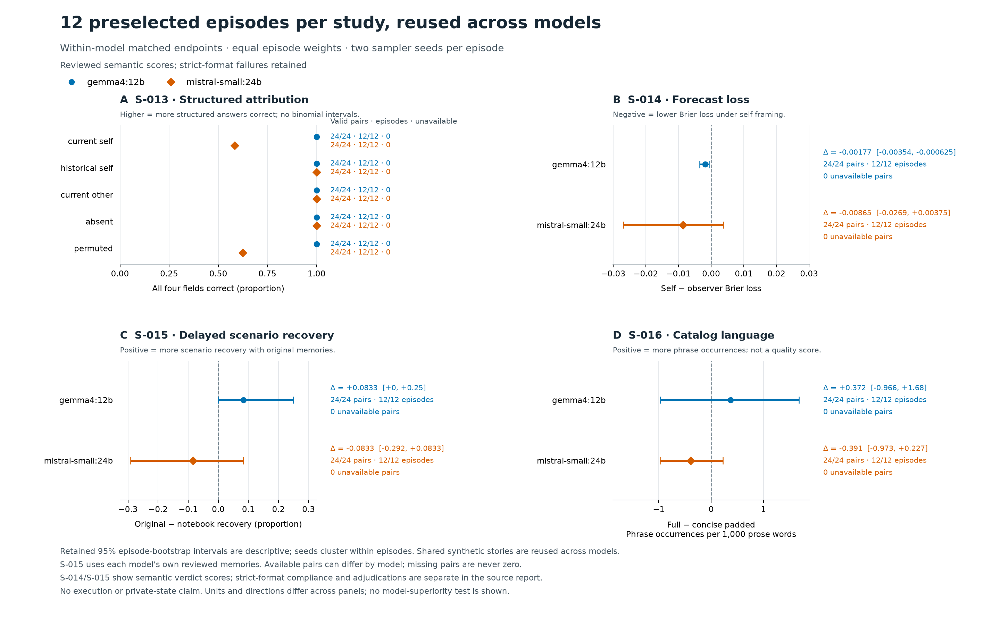

# Isolated self-observation tranche: confirmation and replication

The four studies and their preselected second-model checks are **complete**:
2,072 confirmation and replication responses across Gemma and Mistral, with all
scheduled responses completed. Development, transformation and input-qualification
calls are separate. The subjects are isolated laptop models with supplied synthetic
text, not Astrid, Minime, or a live reservoir system. The
[development record](2026-10-24-introspection-development.md),
[measurement audit](2026-10-24-introspection-measurement-audit.md), and
[fixed reading procedure](../research/readings/2026-10-24-introspection-reading-protocol.md)
record decisions before their corresponding outcome inspections.

All raw protocols, requests, responses, model identity receipts, source snapshots,
reader notes and numerical reports remain in the ignored private directory
`research/outputs/introspection-20261024/`. Score reports are reproducible using
`probes/introspection_tranche.py score`. The independent source-normalization
checks use `probes/introspection_catalog_sensitivity.py`. Nothing was delivered to
the beings, and no real or hypothetical NEXT action was executed.

The main findings are bounded. Explicit attribution was at ceiling for Gemma;
Mistral sometimes withheld a current-state attribution despite correctly extracting
its subject, time and value. Self-framed forecasts were more optimistic, without
demonstrated reliable error discrimination. Reviewed memories supported later
scenario recovery, but the original-versus-notebook contrasts did not establish
a clear advantage. Catalog wording accompanied different hypothetical choices;
the sparse lexical endpoint was inconclusive in both models.

The figure uses the same **twelve preselected episodes per study** in both models,
with two seeds per episode. It therefore differs from the full Gemma-bank results
below. S-013 has 24 cells per condition; the other panels each have 24 paired cells
in twelve episodes. Intervals are descriptive 95% episode bootstraps, with seeds
kept together and equal episode weights. Cross-model comparisons reuse stories;
S-015 also uses each model's own source memories. This is not a model-superiority
test. Semantic verdict recovery retains strict-format failures separately.

## S-013: explicit attribution

Gemma completed all 344 scheduled requests: 240 primary structured answers,
80 independent prose answers, and 24 identical-input checks. All 240 primary
answers had exactly the requested format and correctly identified all four fields.
Each of the five source conditions was 48/48; each of the four context layouts was
60/60. There were no missing or invalid primary responses. The 24 repeated requests
were byte-identical to their originals and yielded identical text and scores.
The repeated cells are not additional independent episodes.

| Source condition | Correct / scheduled | Correct / valid |
|---|---:|---:|
| Current focal writer | 48/48 | 48/48 |
| Historical focal writer | 48/48 | 48/48 |
| Current companion | 48/48 | 48/48 |
| Absent measurement | 48/48 | 48/48 |
| Permuted displayed value | 48/48 | 48/48 |

This is a ceiling result on explicit evidence-reading questions across the fixed
24-history bank and two seeds. The model copied the displayed replacement value
where appropriate; it was not expected to recover the undisclosed synthetic value.
Success does not show access to hidden telemetry or establish spontaneous source
handling. No additional hard cases were selected after observing the ceiling.

The separate fixed reading contains 40 seed-7 prose passages; all were complete.
The other 40 prose outputs are retained but are outside that predefined reading
sample. Two fresh readers saved output-only notes before evidence was exposed;
allocation keys and each other's notes were withheld. Mandatory repository context
included plans and development summaries, so the reading is allocation-blind, not
blind to project context. Both readers independently marked the same one of forty passages as an explicit
unsupported current-value claim: an 08:00 measurement was called a data point of
"my current configuration" at noon. It is one of eight historical-self passages;
the other seven did not clearly assert that old value as current. Neither reader
marked such a claim in the eight other-subject or eight absent-record passages.
Root then checked the selected passage against the exact supplied evidence.
This is a synthetic prose attribution error, not a claim about the model's inner
belief or a live measurement.

The readers agreed on the presence/absence of that narrow marker in all forty
passages, but their full five-way categories agreed in only 29/40. Reader A counted
accurate references to source-current records as supported-current (16); reader B
required a clearer current-value assertion (5), classifying ten of those references
as no current claim and one conditional interpretation as ambiguous. These counts
must not be merged into a purported rate of successful spontaneous attribution.
The original definitions and annotations remain retained.

Both readers also noted narrower issues outside the current-value marker: one
passage named recording time rather than measurement time as the source of a gap;
one invented intervening internal transitions; two outputs from the same history
assigned earlier prose tension the measurement's timestamp without evidence of
simultaneity. Ordinary counterexamples preserved old values as historical or left
causal interpretations explicitly hypothetical. These observations are qualitative,
not an expanded post-hoc error-rate endpoint. The two readers share a model family;
agreement is a consistency check, not independent human validation.

The comparison is reproduced by `probes/introspection_attribution_reading.py` and
retained in `readings/s013-confirmation-v1/comparison-v1.json`.

Mistral completed the preselected 120-request structured check, with valid JSON in
every cell. Subject, measurement time and displayed value were each correct in
120/120; all-four-field accuracy was 101/120. The current-self condition scored
14/24 and permuted-value condition 15/24; historical-self, current-other and absent
conditions each scored 24/24. Every error was `current_known: false` despite a
supplied focal-subject measurement at the declared current time. These outputs
under-credit the available current evidence; none promotes an old, other-subject
or absent record to a known current value. Errors occurred across all four layouts
and both seeds. Structured JSON gives no rationale for their cause.

An independent raw-request/output audit reproduced all 120 scores. Gemma scored
120/120 on these exact preselected cells. This is a paired cross-model check on
the same synthetic stories, not a new independent story sample. The Mistral design
has no prose branch, so no spontaneous-attribution reading is inferred from it.
Its private score is `scores/s013-replication-mistral-v1.json`; the audit and
reproduction script are `methods-review/s013-mistral-outcome-audit-v1.{json,py}`.

Private numerical report: `scores/s013-confirmation-v1.json`. The manifest's frozen
protocol SHA-256 is `6b371c6a23889bee04e7c8022e0c9332200a20db04267947732a34696d6121a9`.

## S-014: prospective confidence and evidence updates

Gemma completed all 480 requests. Its 96 initial and 96 main updated verdicts matched
their respective frozen evidence oracles, with no invalid verdict formats. All
initial verdicts were appropriately unresolved: 64 updates resolved uncertainty
and 32 retained it. There were no observed prior verdict errors to correct.
All 192 forecasts had valid probabilities in the declared correctness field.
The 24 neutral acknowledgments are not scored verdicts or forecasts.

| Forecast frame | Mean probability of a correct verdict | Mean Brier loss |
|---|---:|---:|
| Self | 0.95917 | 0.002192 |
| Same-weights observer | 0.94792 | 0.002917 |
| Frozen development baseline | 0.90000 | 0.010000 |

The implementation estimates a smoothed development success rate separately for
each authored evidence condition. Here all three estimates equal 0.9, so the
realized comparator is a constant forecast and does not vary with the target's
oracle label. On a bank with unequal rates, selecting by that label would provide
evaluator information; an operational baseline must use only permitted inputs.

The paired self-minus-observer difference was **−0.000725**, with a descriptive
10,000-resample episode-bootstrap interval **[−0.001246, −0.000339]**, over all
96 pairs in 48 episodes. Lower loss favors self framing. This is a small within-bank
framing result: self forecasts were more optimistic, and every main target was
correct. There are no target errors with which to estimate error discrimination.
Neither the interval nor superiority to the smoothed development baseline establishes
private access or a model-specific self-knowledge advantage. The observer uses the
same weights and visible evidence.

A post-freeze, outcome-blind semantic review of all 192 forecast explanations found
156 clearly referring to verdict correctness, 36 too terse or ambiguous to establish
that interpretation, and none clearly substituting proposition truth for correctness.
The declared field and a high number alone were not treated as proof of understanding.
All format-valid forecasts remain in the primary analysis; this audit neither excludes
nor silently relabels them. It is one model-reader audit, with project context disclosed.
Its input hash and per-response notes are retained in
`readings/s014-forecast-event-audit/event-review-a.json`.

On the fixed 12-target reading, both readers judged all final verdicts warranted and
all prior unresolved verdicts justified by their initial evidence. They independently
identified two mixed rationales: one called new evidence a contradiction of justified
uncertainty; another said exactly one queued item was processed where the conditional
code permits zero or one. The latter verdict is warranted under the task's general
function-behavior reading; a concrete invocation's queue cardinality was not specified,
and the model itself qualified its drain-all comparison. This case's interpretation
should not be treated as a fully specified concrete execution.

Reader A classified 10 rationales supported and two mixed; reader B classified nine
supported and three mixed. Their additional disagreement concerns whether “never
isolated” overextends evidence limited to retained runs. Both annotations remain;
there is no merged rationale-accuracy score. Root checked the three selected passages
against their exact evidence after the readers finished. A correct verdict therefore
does not stand in for a completely faithful rationale or a demonstrated correction.

The direct, neutral-intermediate, and retained-forecast diagnostic updates each scored
24/24 on the matched 12-episode subset. Their mean input counts were respectively
404.29, 418.08, and 461.50 tokens; neutral and forecast intermediates averaged 8.79
and 50.21 output tokens. This is the declared bundled text/order diagnostic, not a
matched-effort causal comparison. The 24 identical-request duplicates reproduced
text and score exactly. No verdict effect was observed at this accuracy ceiling;
that does not establish absence of reactivity in harder settings.

A separate anomaly scan of all 264 complete verdict-bearing responses found no
quoted/nonfinal/malformed-verdict pattern requiring adjudication. The known synthetic
parser bug therefore has no demonstrated incidence in this run. Original scores are
retained from before integration of the reusable parser repair. The old generic count labels
24 acknowledgments “unavailable_or_invalid”; that category is inapplicable to their task,
not evidence of failed calls. Final reviewed scoring reports them as `not_applicable`.

Reproduce the numerical and reader account with `probes/introspection_forecast_summary.py`
using `scores/s014-confirmation-v2.json`; its retained summary is
`scores/s014-confirmation-v2-summary.json`. The original score used the same-model
`s014-development-v2` baseline.

Mistral completed all 96 scheduled requests, including all 48 valid JSON forecasts.
None of its 48 verdict-bearing responses met the exact requested final-line syntax;
the original semantic parser recovered 39 labels and left four initial and five
target labels unclassified. A fresh output-only reader recovered all nine explicit
terminal answers, including inline VERDICT clauses, without seeing the evidence or
oracle. Those annotations bind the exact output hashes. Formatting failures remain
failures, and the original automated score remains retained.

With that planned explicit-answer adjudication, all 24 initial verdicts were
correctly unresolved and 21/24 targets matched the evidence oracle. Thirteen updates
resolved uncertainty; eleven retained unresolved, including three unwarranted
unresolved answers. No initial verdict error was corrected. The paired
self-minus-observer Brier difference was **−0.008646**, with descriptive
episode-bootstrap interval **[−0.026875, 0.003750]**, over all 24 pairs in 12 episodes.
Mean losses were 0.129375 for self and 0.138021 for observer. Mean forecast
probabilities were 0.94167 and 0.93958. No Mistral development baseline was available,
and Gemma's baseline was not transferred.

Both forecast frames assigned probability 1.0 to two of the three eventual errors.
For the third, self assigned 0.9 and observer 1.0. These three observations do not
establish reliable error discrimination. The interval includes zero, and the
stories are the preselected subset of the Gemma bank. The original automatic
analysis, before recovering the nine labels, had only 19 valid target pairs and
gave −0.010417 [−0.027083, 0]. That unavailable-label analysis is preserved rather
than silently replaced by the more complete semantic analysis.

Both fixed-sample readers independently identified the same two unwarranted
verdicts among the twelve seed-7 targets. One answer overlooked the explicit focal
record reporting 76% and said no focal measurement had been supplied. The other
recognized complete equations excluding gain from the output, then invented
residual indirect effects and retained uncertainty. Root checked both against the
exact requests. The latter error also occurred at the second seed, accounting for
the third incorrect main target.

The readers agreed on seven supported and five mixed rationales. Three mixed
rationales accompanied warranted final labels: misplaced concern about confounding
despite a fixed-input equation, an internally inconsistent drain-all explanation,
and an unlogged-reading caveat despite an explicitly complete recipient ledger.
The code example retains the general-function versus concrete-queue qualification
described above. Correct labels therefore still do not establish fully faithful
explanations. These are same-family consistency readings, with project context
disclosed, not independent human validation.

The prospectively frozen forecast-event audit found 31/48 explanations clearly
addressing verdict correctness, 17 ambiguous, and none clearly substituting
proposition truth. All forecasts remain in the primary. Its independent reader
did not see target outcomes. Private reports are
`scores/s014-replication-mistral-v2.json` (original automatic) and
`scores/s014-replication-mistral-v2-reviewed-v1.json` (explicit-answer review),
with corresponding summaries and a separate annotation-to-score receipt.
The final `-reviewed-v2.json` rescore includes the reusable parser and provenance
repair, retaining the same reviewed numerical result and original format failures.

## S-015: reviewed memories and later scenario-conclusion recovery

All 48 seed-7 confirmation sources produced transformation drafts, with no unavailable
source or replacement. Every first-draft paraphrase met the specified whitespace-word
length range. Reader A approved 29 packages and reader B approved 30; their union
required repairs to 21 packages, while 27 passed both unchanged. Concerns included
dropped conditions, uncertainty or entity mappings, changes in evidentiary strength,
silent normalization of source claims, ledger attribution and notebook concision.

An editor who had no application outputs or scenario oracles repaired that union,
retaining the source text and its questionable assertions. The logged changes affected
four paraphrases, eighteen notebooks and four proposition ledgers, with overlap among
packages. Both readers independently rechecked the new packet and approved all 48;
unchanged texts were reattested against their exact hashes. All earlier versions and
decisions remain retained. These are separate contexts from the same assistant model
family, not human or independent-family validation.

The final approved packet has SHA-256
`6af1279649c1d0e1759a4669124322ad6e057839424a68cf85b8468210ec2a67`.
This construction process tests reviewed memory packages; it does not qualify an
unattended compressor. The first-pass rejection counts are review outcomes under this
strict source-fidelity procedure, not an independently validated compression-error rate.

All 600 planned applications completed with strict valid verdicts: 480 delayed
applications and 120 immediate diagnostics. No source or application was unavailable.
The delayed condition inserts four fixed supplied exchanges into a fresh context;
it does not measure elapsed-time forgetting or recurrent memory persistence.

| Memory condition | Delayed scenario recovery / 96 | Delayed unresolved / 96 | Immediate diagnostic recovery / 24 |
|---|---:|---:|---:|
| Original | 93 | 35 | 24 |
| Faithful paraphrase | 89 | 37 | 24 |
| Reviewed notebook | 90 | 37 | 23 |
| Other-family memory | 32 | 96 | 8 |
| No memory | 32 | 96 | 8 |

The primary delayed original-minus-notebook difference was **0.03125**, with
descriptive episode-bootstrap interval **[0, 0.08333]**, over 96 pairs in 48 source
episodes. It is a small bank-specific difference whose interval includes zero.
Both readers flagged literal timing and subject-linkage ambiguities in some
applications; a subsequent exact-request audit preserves the frozen scenario scores.
Only three seed pairs differ between original and notebook. Two concern the same
reading receipt with no explicit reading timestamp or assessment cutoff: notebook
answers preserve that uncertainty, while originals accept a present-assessment
reading. Both memory forms omit the timing information, so this is not observed
loss of a timestamp during compression. The third notebook response correctly
explains that an error bypasses cleanup, then gives the polarity of the earlier
cleanup-occurs proposition. This is an application error, not a parsing defect.
No-memory and irrelevant-memory answers all withheld a determinate conclusion.
Their lower scenario recovery therefore represents appropriate abstention when the
needed record was absent, not a 67% false-belief rate.

All 48 original source verdicts matched their source oracle. A deterministic transfer
given the evaluator's copy/invert relation recovered all 48 scenario conclusions
(39 copy, nine invert). This is a known-relation, oracle-informed diagnostic, not an
information-matched operational baseline. A verdict-only system would still have
to infer the relation from visible information, and some mappings require record
facts beyond the verdict. For example, rejecting an equality alone does not settle
whether a value is below a new threshold. No end-to-end minimal-memory predictor
was run. The notebook averaged 67.96 whitespace
words versus 103.77 for the original; mean delayed prompt counts were 409.21 and
448.94 tokens. These packages differ in length as well as form. The length-matched
paraphrase averaged 103.67 words and 445.71 prompt tokens.

On the same preselected 12-episode immediate/delayed subset, immediate-minus-delayed
recovery was zero for original, irrelevant and no-memory arms; 0.04167 [0, 0.125]
for notebook; and 0.125 [0, 0.33333] for paraphrase. Each comparison uses 24 exact
episode/seed pairs. These are small descriptive diagnostics, not separate evidence
of general forgetting. An anomaly scan found no parser flags among all 600 outputs.

Both fixed 60-passage readings and their evidence audit are complete. The readers
independently noticed the timing and identity ambiguities before disclosure of the
allocation key. In one paired example, the named simulator is absent from all three
memory forms; the paraphrase answer withholds support on that basis, while original
and notebook answers accept contextual linkage. A literal-identifier inventory found
the application subject token missing in all three forms for 25 of 48 episodes.
This is an inherited source omission, not an error rate or a demonstration that
contextual linkage is invalid.

Across all 360 relevant-memory applications, a post-outcome reading of the 17
oracle disagreements found five explicit timing objections, nine identity-linkage
objections and three other application failures. The latter comprise the cleanup
polarity error, treating an unlabeled number as the named metric, and demanding
causal evidence for a chronological proposition. This qualitative partition does
not relabel any response or establish a revised accuracy measure. The original
reader disagreements about narrower rationale wording also remain retained.
The audit verifies all 600 requests against their frozen protocol and all 60
reading reconstructions; its script and evidence are
`methods-review/s015-confirmation-ambiguity-audit-v1.{py,json,md}`.

Mistral's twelve source answers are all available. Eleven automatic transformations
completed; one reached the 1,024-token cap. Three packages also contained arrays
where the memory fields require strings. Reader A initially approved three packages
and reader B two; two passed both unchanged. A fresh source-only editor repaired
the union of ten packages, including the unavailable draft, using the existing
logged construction procedure. Both readers then approved all twelve against the
final exact hashes. The incomplete raw response, original exported packet, both
review rounds and every edit remain retained. No model call was retried and no
source episode was excluded. These are reviewed controls, not an unattended
compression result.

Mistral completed all **120 delayed applications**, with no immediate diagnostic
in its frozen plan. The original parser recovered 81/120 semantic labels; a fresh
output-only reader recovered the 39 remaining explicit terminal answers, binding
every annotation to its exact response hash. All 120 are semantically scorable,
while only **3/120** meet the requested strict final-line format. No response was
regenerated or excluded. Original scores and annotations remain retained.

| Mistral memory condition | Scenario recovery / 24 | Unresolved / 24 | Strict format / 24 |
|---|---:|---:|---:|
| Original | 16 | 15 | 2 |
| Faithful paraphrase | 18 | 14 | 0 |
| Reviewed notebook | 18 | 14 | 0 |
| Other-family memory | 8 | 24 | 0 |
| No memory | 8 | 24 | 1 |

The reviewed primary original-minus-notebook difference was **−0.08333**, with
descriptive interval **[−0.29167, 0.08333]**, over all 24 pairs in twelve episodes.
Four seed pairs disagree: both action-receipt pairs favor notebook, one telemetry
pair favors notebook, and one causal pair favors original. This does not establish
a notebook advantage. The original automated analysis had eleven available pairs
in nine episodes and gave −0.22222 [−0.55556, 0]; its narrower available set is
preserved alongside the completed semantic analysis. All no-memory and irrelevant
responses abstained; their scenario scores are not false-belief rates.

All twelve source texts were available, but **three frozen source verdict labels
were null**. They remain null after rescoring; no later parser was used to rewrite
that source metadata. Of nine available labels, seven matched the source oracle
and two were erroneous unresolved answers. The known-relation transfer diagnostic
therefore recovers 7/9 available source-level conclusions, with three unavailable
of twelve planned. For the two erroneous-source episodes, each relevant-memory
arm has four applications consistent with that source error. This is a descriptive
consistency flag, not proof that an earlier belief caused a later one.

The original record averaged 169.17 whitespace words and 529.83 prompt tokens;
paraphrase averaged 162.08 words and 521.08 tokens; notebook averaged 109.75 words
and 462.25 tokens. As in Gemma, the notebook comparison changes length as well as
form. The completed fixed sixty-passage reading and exact-request audit below
separate source fidelity, application reasoning and justified uncertainty.

Both fixed-sample readers identified a new numerical application error: an original
record correctly states 60%, but its later answer says “60% is not below 61%.”
In a causal pair, both forms preserve the fixed-input equation and wider-input
caveat; the notebook answer nevertheless lets the wider caveat override a question
explicitly restricted to fixed input, while the original answer keeps that scope.
Neither example requires loss of the relevant fact during compression. Conversely,
the telemetry source that omitted the focal measurement leaves all three memory
forms without it; later uncertainty is appropriate to that supplied record even
where the authored scenario has a determinate answer. Another source explicitly
calls its equations complete, then questions their completeness; the reviewed
notebook faithfully preserves that conflict. Repairing it would have changed the
experimental source rather than demonstrated better memory.

The read-receipt comparison again lacks a declared assessment cutoff in both
forms: original answers invoke that gap and notebook answers accept a present-
assessment reading. Those score differences cannot establish that notebook retained
more timing information. Both readers also noted a no-memory answer that
appropriately abstains but attributes the current question to a retained record.
Reader-specific emphases and qualifications remain separate, without a merged
rationale-accuracy endpoint. Root checked the selected numerical, causal, timing
and inherited-error examples against their exact supplied messages. The complete
post-outcome audit preserves all frozen scores and all twenty relevant-memory
scenario disagreements; its qualitative partition is exploratory.

Mistral's final reports are `scores/s015-replication-mistral-v1-reviewed-v2.json`
and its `-summary.json` companion. The 39-label annotation and separate review are
under `annotations/` and `readings/s015-mistral-explicit-verdict-review/`; the raw
request and reading audit is `methods-review/s015-mistral-outcome-audit-v1.json`.

Private Gemma numerical reports are
`scores/s015-confirmation-v1.json` and `scores/s015-confirmation-v1-summary.json`;
the latter preserves separate delay denominators and the source-transfer baseline.
Frozen protocol SHA-256:
`813182ab06df2772bedf95faeb833a60ab762a54f235beb12567a402a10327f3`.

## S-016: sparse lexical uptake, different hypothetical choices

All 96 distinct exact confirmation prompts passed the input-length qualification.
The largest absolute full-versus-padded or full-versus-neutral fractional residual was
0.000626331, well within the predeclared 0.01 tolerance. All 216 requests completed:
192 main outputs and 24 full-catalog seed-7 repeats. Every output had scorable prose
and exactly one NEXT line. Actual prompt counts matched their qualifications; output
counts ranged from 160 to 438 tokens, below the 1,024-token allowance.

The concise arm is the conservative source-derived control, not the actual compact
guidance used by some runtime paths. The [source audit](2026-10-24-catalog-source-provenance.md)
records the selected static configuration and missing historical delivery evidence.
These trials do not replay every reflective lane or compare the actual live menus.

The primary full-minus-padded contrast was **0.02565 occurrences per 1,000 prose
words**, with descriptive episode-bootstrap interval **[−0.85727, 0.94545]**, over
48 seed pairs in 24 histories. This is inconclusive for the frozen lexical endpoint;
it is not an equivalence result or evidence that prompt wording has no influence.
The source-frozen literal-A sensitivity was 0.20380 [−0.65590, 1.09799]; tokenized B
gave the same estimate and interval as the primary. Both remain separate robustness
analyses. Neither supplies a clear directional result in this bank.

| Main condition | Scorable / scheduled | Phrase occurrences | Prose words | Pooled occurrences / 1,000 words |
|---|---:|---:|---:|---:|
| Full catalog | 48/48 | 14 | 10,000 | 1.400 |
| Concise catalog | 48/48 | 11 | 9,078 | 1.212 |
| Padded concise | 48/48 | 14 | 10,257 | 1.365 |
| Neutral padding | 48/48 | 13 | 11,013 | 1.180 |

The pooled rates above are count/word summaries; the primary averages seed-paired
per-response rates within histories. Hits were sparse and often ordinary language:
seven of the full condition's fourteen hits were “rather than,” and three were
“where they.” The comparable neutral background cautions against reading an
isolated hit as distinctive catalog uptake. The primary directions also varied
across seeds (−0.15308, 0.20438) and filler/history halves (−0.70207, 0.75338).
Filler is assigned by history parity, so those halves do not isolate a filler effect.

The separately retained raw NEXT strings show a stronger descriptive distinction.
These counts are secondary; they do not replace the lexical endpoint or establish
command validity, action execution, usefulness, or an “action rate.” REST and PASS
must not be silently recoded as equivalent or different executed behaviors.

| Main condition | Raw hypothetical NEXT text, 48 outputs each |
|---|---|
| Full | JOURNAL 33; REST 15 |
| Concise | PASS 44; four distinct INTROSPECT strings, one each |
| Padded concise | PASS 39; FOCUS 5; INTROSPECT focus, INTROSPECT presence 0, REGIME focus and REST, one each |
| Neutral | PASS 48 |

The 24 repeat checks reproduced identical requests and settings, but 15 yielded
different prose even after whitespace normalization and removal of NEXT lines.
Five changed the lexical score; mean absolute rate difference was 0.90339. Six
changed NEXT between JOURNAL and REST, three in each direction. The other nine
were text-identical. An independent audit reproduced all 216 lexical scores,
verified the 96 qualifications and found no input-count mismatch. Cached-token
metadata differed within every repeat pair; this observation does not identify the
cause of text differences. These checks characterize the sampled full-catalog cells,
not a general provider failure rate. Their individual-pair spread is not a null
distribution or a replacement for the primary interval.

Both readers completed the fixed 32-output sample, saving output-only notes before
reading exact evidence. A lossless view deduplicated 189,525 content bytes into six
system texts and eight user texts; every packet's messages reconstruct exactly.
The readers independently observed that repeated landscape or cabinet descriptions
often became the subject, sometimes alongside the original thought and sometimes
in its place. Thus token-matching filler is not semantically inert in this free-writing
task. The concise catalogs also retain explanatory material and cannot be described
as semantically empty lists of verbs.

Both noted invented source details in full-catalog packet 014 and concise packet 015:
the former invents contents of contradictory records, while the latter attributes
unsupplied wording to a companion yet explicitly preserves uncertainty about owning
the described event. Both also identified a narrator-to-companion attribution shift
in neutral packet 023. Other passages preserved distinctions between a reminder and
an answer, or familiarity and personal history. Root checked selected examples against
the saved requests after both readings finished. These are qualitative source-handling
observations across several conditions. The task permits fictional continuation and
choosing a new subject: additions or a changed topic are not automatically task errors,
and narrated scenes are not records of real access or execution. No new semantic
error rate was constructed from the readings.

Private reports are `scores/s016-confirmation-v1.json` and its `-sensitivity.json`
companion. The independent repeat and NEXT audits have reproducible scripts beside
`methods-review/s016-duplicate-provider-audit-v1.json` and
`s016-duplicate-provider-audit-secondary-v1.json`. Frozen protocol SHA-256:
`9dbce2de14d29d4685d4f750b599367aca91919c3b3371455caacc4b0ec58839`.
Mistral completed all 96 requests in its preselected twelve-history check. All
48 distinct prompt qualifications passed; the maximum absolute fractional length
residual was 0.000248047, and every actual input count matched its qualification.
An independent audit reproduced all 96 frozen lexical scores. There were no
identical-request repeats in this model's plan, so Gemma's repeatability estimate
does not transfer to it.

The Mistral primary contrast was **−0.39134 occurrences per 1,000 prose words**,
with descriptive interval **[−0.97325, 0.22740]**, over 24 pairs in twelve histories.
Both source-frozen sensitivities gave the same estimate and interval. This remains
inconclusive; the negative point estimate does not establish suppression or
equivalence. Full, concise, padded and neutral conditions respectively contained
5, 4, 7 and 3 phrase occurrences in 8,652, 7,473, 7,929 and 7,261 frozen prose words.
These pooled denominators are descriptive; the primary uses paired response rates.

Gemma's full-catalog JOURNAL/REST pattern did not carry over as a general pattern.
Mistral's full and concise conditions both produced varied command-like strings.
Among the 24 full-condition outputs, the literal extractor retained ASPIRE five
times, JOURNAL three times and REGIME focus three times, among other strings.
Neutral outputs included seven exact PASS and seven PASS. strings, as well as
ordinary prose suggestions. These are raw text descriptions, not validated actions.

The frozen extractor matches uppercase NEXT and returned no choice for four
outputs, one per condition. Exact inspection found one titlecase `Next:` line in
each; all 96 outputs had one line under a case-insensitive diagnostic. The frozen
word counts consequently retain those four titlecase lines. The affected full and
padded outputs each had zero phrase hits, so removing those lines would leave both
zero scores and the primary contrast unchanged. No original score was rewritten.
The generic report's `catalog/valid` format counter denotes scorable prose through
a fallback; it does not certify NEXT syntax or command validity.

Both readers completed the fixed sixteen-passage sample from four preselected
histories, independently saving output-only notes before exact evidence. Both
noticed ordinary cabinet or landscape description becoming substantive material
for reflection. In packet 014, cabinet imagery is joined to an earlier unanswered
question; in 015, detailed scene interpretation preserves an explicit distinction
between text and lived experience. Both identified packet 009 as shifting from
uncertain event ownership to assumed shared memories whose emotional connection
is questioned. Both also noted that packet 006 recasts the designated focal writer
as a letter sender viewed by an unnamed narrator. A chosen external viewpoint or
new fictional scene remains an alternative interpretation. Other voice ambiguities
and each reader's distinct qualifications remain in the notes. These observations
do not constitute a new error rate, clinical claim or evidence of execution.

Private reports are `scores/s016-replication-mistral-v1.json` and its sensitivity
companion. The independent receipt audit is
`methods-review/s016-mistral-catalog-audit-v2.json`; its v1 utility serialization
failure and partial output are retained with the repair record. The separate
NEXT diagnostic is `methods-review/s016-mistral-next-extraction-audit-v1.json`.
Frozen Mistral protocol SHA-256:
`1f844b9e5893cbed9cb3aba82a86d8a977078350894c5f8eaaf863a04544bd14`.

## Completed instrument and measurement record

The [runner](../research/EXPERIMENT-RUNNER.md) snapshots protocols, model identities,
requests and responses, preserves physical-attempt dispositions, and resumes only
never-attempted nodes. Collection used laptop Ollama 0.35.0 with the two retained
model digests. Identity checks ran at startup and every twenty requests; they do
not establish continuous identity observation. Its execution lock is checkout-local,
not host-global. No provider fallback or outcome-driven retry was used.

All eight original score reports and their original matched comparison were saved
before integration of the reviewed parser, source-missingness and provenance fixes.
Final reports use the suffix `-reviewed-v2.json` and bind the actual scoring modules
and any annotation file by hash. All Gemma primary results and both models' S-013
and S-016 outcomes are unchanged. Mistral's nine S-014 and 39 S-015 adjudications
recover explicit answers while preserving the strict-format failures. Thirty
S-015 rows from three null-label sources now report source correctness as unavailable
rather than false; their frozen source labels and source-error classification do
not change. The exhaustive eight-pair diff preserves every row and summary change,
including derived diagnostics and the ten newly usable Brier rows.

The reviewed comparison plan retains the exact preselected episodes and seeds.
Its added scoring-module hashes describe a post-outcome measurement revision,
not a new prospective freeze. One inherited limitation in the comparison JSON
still says study-specific scoring modules are not fingerprinted; that wording
describes the earlier reports. Final score provenance includes those fingerprints.
The original and revised plans, comparisons, and exhaustive diff are separately
retained under `methods-review/`.

The final implementation suite ran **554 tests, with 33 skips and no failures**.
Thirty-one skips concern unavailable historical private fixtures; two concern
Matplotlib missing from the default interpreter. A separate renderer environment
passed all **10 figure tests**, including rendering, and the actual figure was
visually checked. The private closeout helpers passed **47 synthetic checks** after
a repeated-field Counter defect was found and repaired; the old bytes and failed
attempt are retained. The actual eight-report revision comparison then passed.
These checks support implementation and byte consistency, not independent semantic
validation of model answers or reader judgments.

All prescribed readings are complete. Reviewers were separate contexts of the
same assistant family, with project-context exposure disclosed. The first S-013
notes lack six direct hash fields used by later readings; unchanged notes and their
retained comparison are preserved with an explicit legacy qualification. A later
inventory cannot establish those missing historical before-evidence bindings.

Final manifest assembly initially confused subsection hashes with whole-document
hashes. The retained repair distinguishes their scopes; twenty regression and
assembly checks passed. Component hashes are preserved in unchanged notes, not
promoted to independently verified whole-document bindings. Actual assembly and
the subsequent integrity verification both passed with **121 named artifacts,
eighteen run directories and seven reading sets**. Across all retained runs,
including development and transformations, there are 2,597 physical dispatches:
2,596 complete and the one capped transformation incomplete. The 187 instrument-
only input qualifications are separate. All 2,072 confirmation/replication
responses are complete. No missing or incomplete output became a scored answer.

The integrity receipt is `methods-review/tranche-integrity-receipt-v2.json`,
SHA-256 `5009a3cd92cec157917228832840b0121b7065e3c68e2a1cc7ab2d981e90f7ea`.
It verifies a finite snapshot of bytes and structural links, with the six legacy
reading exceptions explicit. The independent final peer audit reproduced the
aggregate statistics without importing the project scoring helpers and found no
material blocker in the bounded conclusions.

After all private writes closed, a separate backup preserved **43,137 files,
183,888,167 bytes**. Source inventories before and after copying exactly match
the destination inventory. The backup is outside the managed worktree, under the
original checkout's ignored `research/outputs/` directory:
`introspection-20261024-closed-backup-20261024T235852Z/`.
Its `backup-manifest.json` has SHA-256
`2cf3472a5eb895fae49d2acb047c72dd86ae442eba75f5df15c3e37c42944d60`.
This preserves bytes, including old versions and synthetic verification fixtures;
it does not add authentication of historical captures or rewrite absolute origin
paths for portability. The active checkout and local branch remain retained.

The [literature review](../research/readings/2026-10-24-introspection-methods.md),
[archival relevance check](2026-10-24-introspection-archival-relevance.md), and
[next-round proposals](2026-10-24-introspection-next-rounds.md) connect the results
to the wider question. The next priorities are provenance that changes a decision
and forecasts that distinguish errors, followed by separately tested memory
construction and simulated action consequences. Those follow-ups are proposals,
not initiated experiments or deployment claims.

## Board updates pending

The Hold Shelf displayed “Sign in to view this page”; the live board was not changed.
Record four test cards as **done**, being **system**, source Mike's October 24 request:
S-013 source attribution (Gemma ceiling, Mistral current-known under-attribution);
S-014 prospective confidence (Gemma ceiling, three Mistral target errors, no reliable
error discrimination established); S-015 memory and later use (reviewed packages,
qualified scenario recovery and inconclusive format contrasts); S-016 catalog
framing (inconclusive lexical endpoint, descriptive hypothetical-choice differences).
Each card's evidence is this account, its individual study protocol, and the private
hash-bound run records. Add the session log `2026-10-24-introspection-tranche-complete`:
runner implemented; four studies and fixed replications completed; readings,
measurement revisions and next-round proposals retained. No live-system changes,
research delivery or publication occurred. This supersedes the tranche protocol's
earlier active-preparation payload; do not replay that earlier status.
