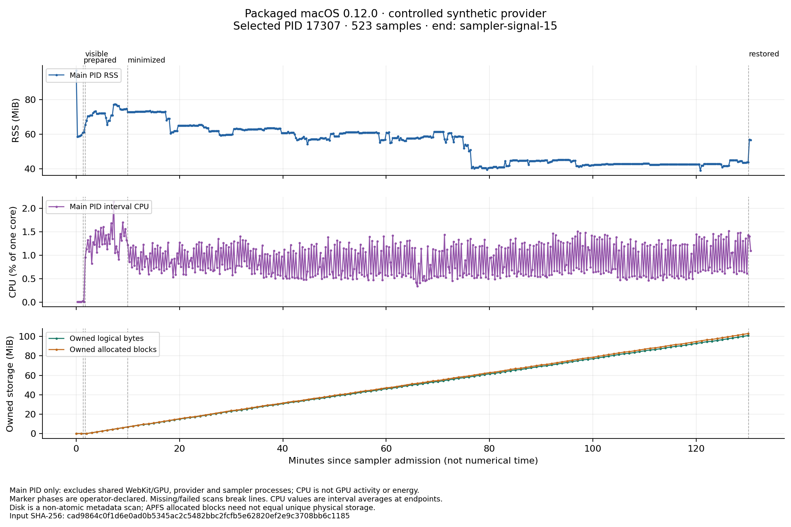

# Resource results: one actual packaged macOS run

The frozen 0.12.0 app continued an owned synthetic session for **at least 2 hours 11.206 seconds in the operator-declared minimized interval**. The closed capture contains 523 valid samples with no recorded sampling gaps, process/manifest read errors, identity discontinuities, wall-clock jumps or incomplete disk scans. Durable progress advanced from step 481 to 7081 and 16 to 236 saved journals during that interval. Explicit Pause subsequently retained step 7100.

The predeclared early/late main-process RSS investigation trigger was **not reached**: median RSS changed from 65.148 to 42.594 MiB. Thread and descriptor medians were unchanged in those windows. This is a bounded observation of one process in one synthetic session; it establishes neither total application memory nor absence of memory leaks, GPU activity, energy use, real-model throughput or performance on another platform.

## Identity, timing and coverage

| Item | Retained result |
| --- | --- |
| Candidate | macOS arm64 shipping 0.12.0; PID 17307, process start seconds `1791908342`, microseconds `773376` |
| Executable SHA-256 before/after capture | `f68a3752a628edf11ac6161a26e6979bb22dcf4c3ee1c63f10add2cea86ab40d` |
| Closed capture SHA-256 | `cad9864c0f1d6e0ad0b5345ac2c5482bbc2fcfb5e62820ef2e9c3708bb6c1185` |
| Capture admission / footer UTC | 2026-10-13 16:29:21.121003 / 18:39:57.312655 |
| Actual sampler duration | 7,836.242204 monotonic seconds; intentional `sampler-signal-15`, not completion of the 9,000-second ceiling |
| Observed Start → observed Pause | 16:31:05.920848 → 18:39:57.222628 UTC; 7,731.351178 monotonic seconds |
| Conservative minimized markers | 16:39:18.845510 → 18:39:30.005769 UTC; **7,211.206384 monotonic seconds** |
| Sampled minimized progress endpoints | 16:39:21.337886 → 18:39:24.571027 UTC; 7,203.279207 monotonic seconds |
| Samples / process reads / manifest reads | 523 / 523 / 523; sample sequences exactly 0–522 |
| CPU intervals / complete disk scans | 522 / 131; disk scans scheduled every fourth sample |
| Largest adjacent sample spacing | 15.056362 seconds, against nominal 15 seconds |
| Largest measured sampling operation | 0.036039 seconds; not a measure of total sampler overhead |
| Reported gaps / row errors / clock jumps / incomplete scans | 0 / 0 / 0 / 0 |

The visible prelude lasted 492.927729 seconds (about 8 minutes 13 seconds), rather than the planned five minutes. The later standalone minimize acknowledgment is used conservatively; earlier timed-out UI interactions are not counted as minimized time. Window state is operator-declared, not continuously instrumented. The primary marker snapshot ends at Pause and is separate from later recovery actions: [primary markers](primary-markers-final-01.jsonl).

The selected configuration used seed `20261013`, one backend step per requested 1,000 ms when free, a writing opportunity every 30 steps, regulated sensory retention, 10,000 maximum steps, 400 maximum attempts, a 7,800-second duration limit and 256 MiB logical storage budget. The local endpoint served a controlled synthetic response fixture with a nominal 200 ms hold; it was not a language model. Writing and persistence hold numerical stepping. Capture duration, wall/monotonic elapsed duration, backend running time and simulated numerical time are distinct clocks.

## Functional criteria and remaining gates

These outcomes apply to the original frozen binary. The subsequently tested publisher, snapshot-ordering, quota and reading-source repairs were **not present** in it.

| Frozen criterion | Outcome and evidence boundary |
| --- | --- |
| Exact candidate | **Observed pass.** Header/footer executable digests match; the selected PID/start identity remained attributable with no recorded identity error. [Raw analysis](final-raw-analysis-01.json), [stop receipt](sampler-stop-01.json). |
| Actual duration | **Observed pass within operator-declared visibility.** More than 7,200 seconds of minimized progress is supported independently by the conservative markers and by sampled durable-progress endpoints. The sampler uptime alone is not the basis. |
| Continuing work | **Observed pass at retained sampling resolution.** No manifest identity/count regression. The largest interval between newly observed higher durable steps was 45.076041 seconds; conservatively bracketing every constant-step sample run by its previous lower/next higher observation gives a maximum 60.110728 seconds, below the 120-second unexplained-stall trigger. Minimized samples report 475 running and 6 awaiting-language publications. Sub-sample scheduling is not continuously observed. [Derived gates and method](final-resource-gates-01.json). |
| Journal continuity | **Observed pass in separate offline verification.** The exact shipping CLI replayed the explicit export through 7,100 steps, 1,180 segments and 236 journals. Owned fixture evidence matches 236 requests; 13 changed copies were rejected, and original export bytes were preserved. This does not authenticate real-model execution or power-loss durability. [Frozen CLI receipt](export-frozen-cli-01-receipt.json), [request evidence and controls](export-evidence-and-negatives-01.json). |
| Stable reading | **Observed older-entry stability.** The operator Pause marker records step-30 writing still selected with Follow latest off while newer entries accumulated. Its exported entry identity, object bytes and text hash match the pre-minimize receipt. The explicit Follow latest transition is not established by this resource capture. [Byte comparison](selected-journal-export-continuity-01.json). |
| UI return | **Observed return, limited to operator evidence.** The Pause marker records usable return, live=durable 7,100, matching exact coordinates/fill and renderer counters advancing 98→99. There is no calibrated UI latency or independent GPU measurement. |
| Storage bounds | **Observed below quota.** Every complete selected-directory scan stayed below the 256 MiB logical budget; the largest was 101.003 MiB (39.454%). No pruning or quota hold was needed in this workload. The separate natural-quota failure/repair findings remain distinct; this run does not qualify the original binary's quota-exhaustion behavior. |
| Recovery | **Separate clean-quit recovery observed; full continuation verification remains a separate gate.** Actual Cmd-Q ended the original process from the settled paused boundary. Identical-package idle relaunch left 236 requests unchanged; explicit Restore retained step 7,100 and elapsed 7,721.255 seconds in generation 2, still paused. Explicit Resume/Pause later reached step 7,127 with one new journal/request. This is clean quit/relaunch, not forced interruption or power loss. [Quit](normal-quit-01.json), [idle relaunch](idle-relaunch-01.json), [held Restore](restored-paused-01.json), [explicit continuation](resumed-paused-01.json). |
| Terminal behavior | **Observed explicit Pause; exhausted-bound branch unexecuted here.** Final retained manifest and exact exported manifest match paused step 7,100/revision 8,283. The subsequent owned log still had 236 requests. This session was paused before its duration/step/attempt/storage cap; it does not exercise a hard-cap terminal transition. [Post-Pause request count](post-pause-requests.json). |
| Sampling coverage | **Observed pass for the actual closed interval.** All 523 scheduled rows are valid; intentional early sampler termination is retained. There are no samples after the observed Pause marker, so a final settled resource window is unavailable. |

The conservative no-progress bracket includes sampling uncertainty rather than treating each repeated manifest as an exact stall duration. Resource-load exclusions never remove progress rows, unexpected phases or failures from these functional checks.

## Main-process measurements

All CPU percentages below use **100% = one occupied logical CPU**. RSS is sampled resident memory for the selected main PID. It excludes separate WebKit/GPU processes, the fixture, sampler, editor and other host processes.

| Window | RSS n; median / p95 / max MiB | CPU intervals; weighted mean / p95 / max % | Threads median / p95 / max | FDs median / p95 / max |
| --- | --- | --- | --- | --- |
| Visible prelude, all observed | 33; 72.141 / 77.281 / 77.313 | 32; 1.3337 / 1.7054 / 2.1413 | 23 / 26 / 26 | 13 / 13 / 14 |
| Entire minimized interval, all observed | 481; 56.875 / 72.969 / 73.531 | 480; 0.8886 / 1.3921 / 1.5223 | 23 / 24 / 26 | 13 / 13 / 17 |
| Minimized, documented load excluded | 406; 53.891 / 73.000 / 73.531 | 389; 0.8982 / 1.3970 / 1.5223 | 23 / 24 / 26 | 13 / 13 / 17 |
| Restored before Pause marker | 2; 56.797 / 56.953 / 56.953 | 1; 1.0939 / 1.0939 / 1.0939 | 24 / 26 / 26 | 13 / 13 / 13 |

The two restored samples are too few for a settled-window conclusion. There is no post-Pause resource sample. The full-capture RSS maximum was 97.094 MiB at the first pre-Start sample; it is distinct from the 73.531 MiB minimized maximum.

Minimized RSS first/last observations were 72.922/43.688 MiB, with a descriptive least-squares slope of −15.970 MiB/hour (load-excluded −16.078). These are observations of retained resident pages, not allocation/leak measurements; the decrease is not attributed to minimization or any repair. The CPU mean covers 7,203.279 seconds of whole intervals inside the minimized window; after exclusions it covers 5,837.517 seconds.

## Frozen early/late comparison and investigation triggers

The original windows were not moved after inspection: **10–25 minutes after observed Start** (16:41:05.920848–16:56:05.920848 UTC) and **110–125 minutes** (18:21:05.920848–18:36:05.920848 UTC). Both lie wholly inside the declared minimized interval and each contains 60 raw sample points. They are dependent windows from one session, not replicated trials.

| Measurement | Early, all | Late, all | Early, load excluded | Late, load excluded |
| --- | --- | --- | --- | --- |
| RSS sample count | 60 | 60 | 46 | 59 |
| RSS median MiB | 65.148 | 42.594 | 65.484 | 42.594 |
| RSS p95 MiB | 73.469 | 42.875 | 73.469 | 42.891 |
| RSS maximum MiB | 73.531 | 44.922 | 73.531 | 44.922 |
| RSS slope MiB/hour | −52.654 | −0.782 | −52.784 | −0.840 |
| CPU intervals | 59 | 59 | 42 | 57 |
| CPU duration-weighted mean % | 0.9031 | 0.9234 | 0.9080 | 0.9248 |
| CPU p95 % | 1.2734 | 1.4528 | 1.2611 | 1.4528 |
| Whole-interval CPU coverage, seconds of 900 | 885.247 | 885.341 | 630.160 | 855.318 |
| Thread / FD median | 23 / 13 | 23 / 13 | 23 / 13 | 23 / 13 |

- **RSS growth trigger not reached.** Raw late-minus-early median is −22.555 MiB (−34.620%); load-excluded it is −22.891 MiB (−34.956%). The predeclared greater-of-64-MiB-or-25% positive-growth threshold is 64 MiB here. Neither window shows a positive fitted RSS slope. This is not a claim of “no memory leak.”
- **Five-minute high-RSS/high-CPU trigger not observed.** No RSS point exceeded 512 MiB and no measured CPU interval exceeded 100%. Brief peaks between RSS observations remain unmeasured.
- **Final settled thread/FD trigger incomplete.** Comparable early/late running medians are unchanged, but the prospective post-run settled comparison lacks samples. It must not be silently replaced with the two restored samples.
- **90% logical-storage trigger not reached.** The largest complete scan was 39.454% of the selected budget; no quota change was made.

The early excluded CPU subset covers 70.018% of its requested 900 seconds versus 95.035% late. That uneven coverage limits the sensitivity comparison; it does not justify shifting either window. Neither the visible/minimized contrast nor the source-test-excluded comparison identifies a causal effect of window visibility, resource repairs or host load.

## Retained storage and host-load sensitivity

The 121 complete scans within the minimized interval run from 16:39:21.337886 to 18:39:24.571027 UTC. Selected-directory logical bytes rose from 7,119,620 to 105,908,862 (6.790→101.003 MiB), a net 98,789,242 bytes, or 47.085 MiB/hour over those endpoints. Allocated blocks rose from 7,294,976 to 108,072,960 (6.957→103.066 MiB), a net 100,777,984 bytes, or 48.033 MiB/hour. File count rose from 98 to 1,418. The descriptive fitted logical slope is 46.749 MiB/hour; it differs from the endpoint rate. These measurements are non-atomic scans of the selected owned directory, not APFS unique physical storage or an estimate of total host writes.

The exact later paused export is separately 106,035,294 bytes (101.123 MiB), after its final numerical tail was committed. It must not replace the earlier sampled endpoint. Volume-wide available space varied with unrelated host work and is retained in the JSON; it is not attributed to this app.

The final sensitivity analysis includes **18 closed load intervals**, including the tiny 18:37:45.205727–18:37:45.345315 helper test, the reading preview and all retained closed source-test receipts. [Load provenance](final-load-intervals-02.json) binds their source bytes. The separately timed natural-quota Clippy interval was found in its retained log/note after the first final analysis, so [phase analysis 02](final-phase-analysis-02.json) adds that interval; the earlier output remains preserved. Original observations and the [raw analysis](final-raw-analysis-01.json) are unchanged.

These intervals do not account for every edit, compiler invocation, Codex/browser operation, thermal/cache effect or unknown workload. Earlier full-frontend work lacks a completely timestamped command envelope and remains an explicit uncertainty. Exclusion is a sensitivity analysis, not reconstruction of an idle host. No functional stall or failure was removed.

## Plots and reproduction

The [PNG](final-resources-01.png) and [SVG](final-resources-01.svg) retain the unfiltered series, operator phase markers, units, gaps policy and full input hash. The PNG was visually inspected and the SVG parsed successfully. Both use the existing Matplotlib recipe; the retained SVG copy changes only the export format. Neither plot contains synthetic replacement values or smoothed/interpolated measurements.

Commands, exact input/tool/output hashes and closed execution times are in [analysis qualification 01](final-resource-analysis-01-qualification.json) and [supplemental analysis qualification 02](final-resource-analysis-02-qualification.json). The four main commands ran 18:42:04.441524–18:42:05.630447 UTC; the supplemental phase command ran 18:43:58.074907–18:43:58.159237 UTC. Both occurred **after** the primary capture ended. Derived criteria are reproducible with [summarize_resource_gates_01.py](summarize_resource_gates_01.py), whose exact source and result are bound in [its receipt](final-resource-gates-01-qualification.json). Output creation is exclusive; use new output names for any rerun.

No app, provider, UI, sampler, model or live Being system was changed by this analysis. The separately operated clean-quit recovery above lies outside the resource window and is not folded into its timings or statistics. Forced interruption, actual sleep/wake, sudden power loss, other hosts, real-model pressure and a longer-duration run need their own bounded evidence.
