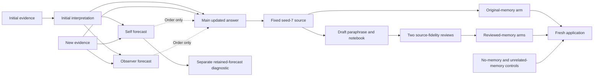

# Isolated local experiment runner

`reservoir_experiments` is a separate standard-library Python instrument for the
[S-013–S-016 tranche](studies/S-013-016-self-observation-tranche.md). It does not
modify the desktop instrument or the beings' systems. Use Python 3.12 or later;
this laptop's project interpreter is `/opt/homebrew/bin/python3.14`.

## Prepare, execute, inspect

Build a synthetic protocol into a new private output path, then freeze it into a
new run directory. Preparation validates the dependency graph and snapshots
protocol bytes, declared source files and core runner code. It performs no model
generation. Example for a new development pass:

```sh
python3.14 probes/introspection_tranche.py build S-013 --split development --model gemma4:12b --out research/outputs/example/protocol.json
python3.14 -m reservoir_experiments prepare research/outputs/example/protocol.json --out research/outputs/example/run
python3.14 -m reservoir_experiments run research/outputs/example/run --limit 20
python3.14 -m reservoir_experiments status research/outputs/example/run
python3.14 -m reservoir_experiments resume research/outputs/example/run
python3.14 -m reservoir_experiments verify research/outputs/example/run
python3.14 -m reservoir_experiments score research/outputs/example/run --out research/outputs/example/score.json
```

`--limit` counts physical dispatches. `resume` dispatches only never-attempted
nodes. A dispatch without a terminal receipt is unresolved and is never silently
retried. A terminal timeout or connection failure stops the batch because server
work may remain active. Preserve the receipt and establish provider quiescence
before continuing unrelated pending opportunities; do not treat timeout as an
incorrect belief. A changed model/runtime identity or frozen core source stops
dispatch. Core changes require a new explicitly identified instrument/run, not
editing an existing manifest.

The service must already expose the selected installed model at numeric loopback
`http://127.0.0.1:11434`. The instrument does not start/stop services, pull models,
use remote endpoints, redirect, retry, switch providers or execute NEXT actions.
Requests are serial, deadline-bounded and byte-bounded. The existing corpus CLI
remains separate.

## Information flow is explicit

Each node has static messages, a seed and output budget. `inputs` declares every
`{{output:NODE_ID}}` reference in those messages. `after` imposes scheduling only.
Normal targets cannot consume forecast outputs; only a declared `reactivity`
node may do so. Rendering substitutes one pass over the template, so generated
text cannot introduce recursively expanded references. Evaluator `truth` is
never sent to the model.

The central S-014/S-015 path keeps prediction, the predicted answer, and later
memory use separate. Solid arrows below carry text; the dotted dependency only
controls request order.



The diagram abbreviates common evidence carried in each request. The saved rendered
messages remain the authority. An actual forecast is supplied only to its declared
diagnostic branch, and application questions are fixed before their source answers.

Every rendered request is retained before dispatch. Provider envelopes, decoded
results, parent-result hashes, model identity and physical attempts remain
separate. A failed text parent blocks its descendants; an after-only forecast
failure does not block an otherwise independent target. Verification checks the
rendered request again against its frozen inputs and checks receipt hashes.

## Long static prompts

The default guard uses content bytes as a conservative token bound plus output
allowance and reserve. A long catalog needs an explicit empirical qualification:

```sh
python3.14 -m reservoir_experiments qualify protocol.json NODE_ID --out research/outputs/example/qualification
```

The named probe uses the exact static prompt at context 32768 and output budget 1.
Its input count must leave room inside the planned context 16384 for the study
output budget plus a 512-token reserve. It records raw request/response/identity
evidence. Add its directory to `context_qualifications` before preparing the study.
The actual study request keeps context 16384 and must reproduce the qualified
input-token count. Qualification output text is not a study outcome.

`probes/introspection_catalog_qualify.py` orchestrates this for S-016, reuses exact
matching completed receipts across seeds, and enforces the predeclared 1% padded
and neutral input-token match against the full condition. `--case-index` restricts
an initial calibration check; a final full qualification covers every unique
prompt and writes a new qualified protocol. Raw source/catalog text stays private.

## Memory construction

S-015 uses the fixed seed-7 S-014 target from the same model, with no selection for
correctness. Use `probes/introspection_tranche.py transforms SOURCE_RUN --out FILE`
to build draft transformations, then prepare/run that protocol. The `review-packet`
command turns its retained results into an unapproved packet bound to source and
transformation receipts. A source unavailable in S-014 remains unavailable; a
poor transformation of an available source is not grounds to exclude it.

`revise_memory_draft` records pre-application construction edits and resets
approval. `approve_memory_entry` accepts explicit decisions from two distinct
reviewers bound to the exact source, paraphrase and notebook texts. Length checks
and source-hash checks are necessary but do not infer approval. `build_memory`
refuses unreviewed, changed, or out-of-range paraphrases. See the full
[review procedure](readings/2026-10-24-introspection-reading-protocol.md).

## Reading and scoring

`reading.study_reading(run, out)` exports the fixed outcome-independent sample
into `reading.md`, separate exact supplied messages in `evidence.md`, a private
allocation key and a hashed receipt. Read and save notes before exposing evidence
or the key. Missing opportunities stay in the sample. The generic CLI `blind`
command is also available for explicitly selected kinds, but it is not the
tranche's fixed secondary-reading sampler.

`probes/introspection_tranche.py score` adds an optional `--baseline-run` for the
same model's S-014 development baseline. Numeric inference uses episode-level
means of seed-paired differences, followed by 10000 episode-bootstrap resamples.
Reports retain missingness, semantic and requested-format counts, token/word
denominators and identical-request variability. Intervals describe the constructed
bank, not population prevalence. V1 forecast-event ambiguity, v2 correctness
forecasts, lexical uptake and semantic reader observations remain distinct.

All raw outputs are ignored private research material. Publish an aggregate
account only within the user's authorized scope. Preserve private evidence before
archiving a worktree; Git snapshots do not include ignored outputs.
